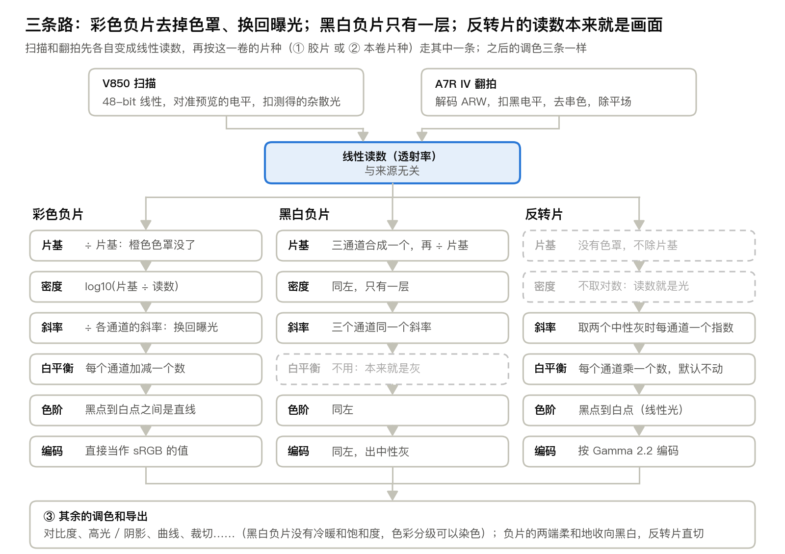
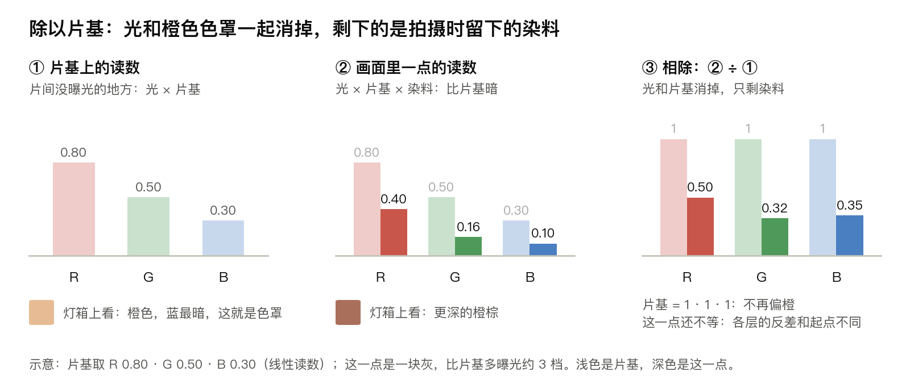
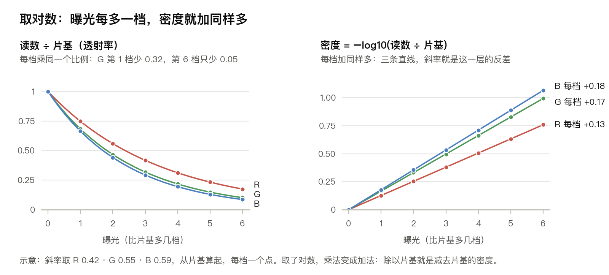
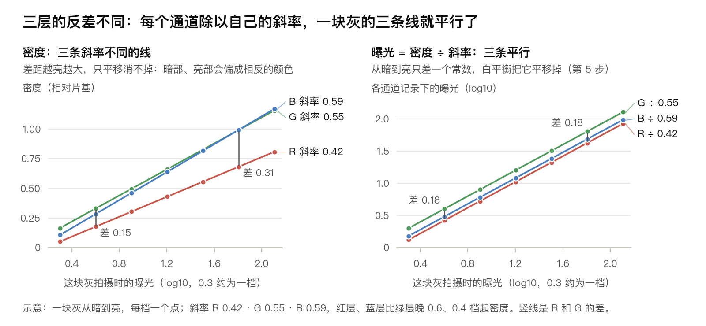
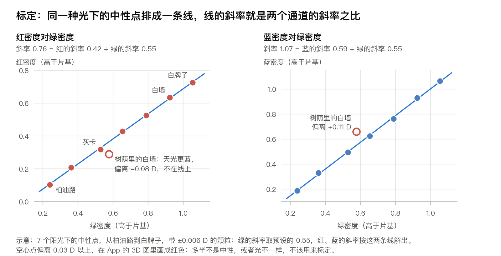
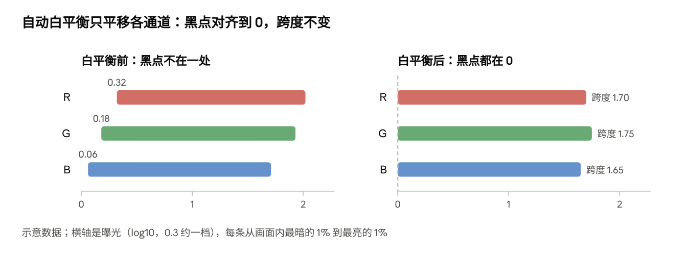
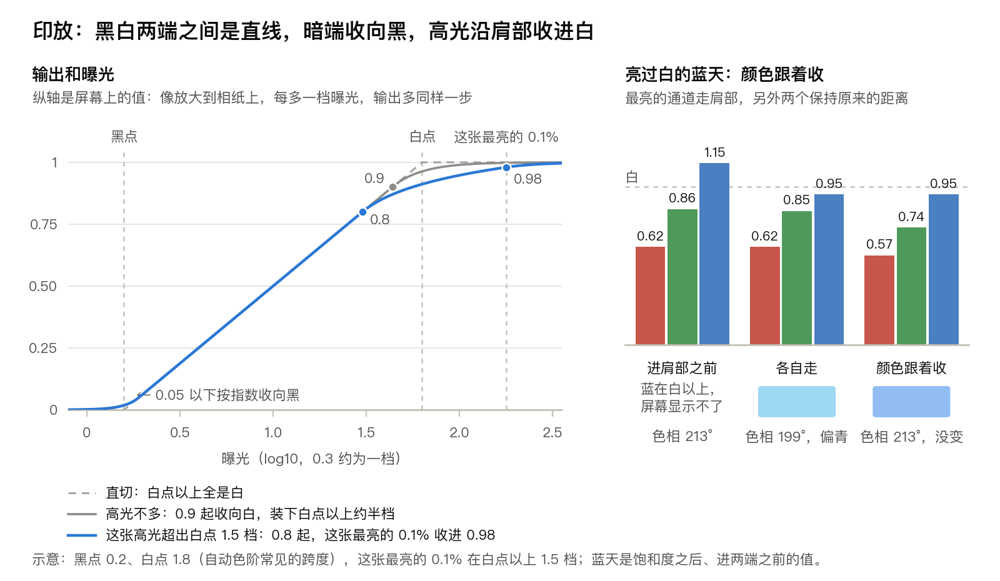
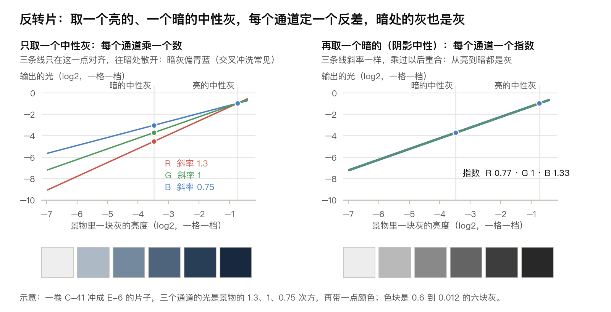
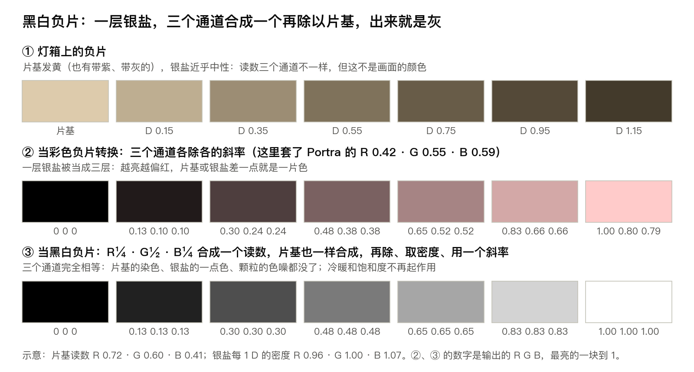

<p align="center">
  
</p>

<h1 align="center">Epson Scan plus</h1>

<p align="center">
  在 macOS 上扫描、翻拍和转换彩色负片与反转片<br>
  为 Epson Perfection V800 / V850 设计，也能用 Sony A7R IV 联机翻拍
</p>

<p align="center">
  <b>0.23.2</b> · macOS 26 · Apple 芯片 · 全部在本机处理
</p>

<p align="center">
  <a href="#一览">一览</a> ·
  <a href="#操作演示">操作演示</a> ·
  <a href="#原理">原理</a> ·
  <a href="#安装">安装</a> ·
  <a href="#快速开始">快速开始</a> ·
  <a href="doc/interface.md">界面说明</a> ·
  <a href="doc/CHANGELOG.md">版本记录</a>
</p>


扫描或翻拍（①），去色罩（②，有漏光的照片在这里去漏光），调色和导出（③），全部在本机处理。只有去漏光生成参考图时，才会在你确认后上传一张缩图。

> [!NOTE]
> 个人开发的实验工具，不是 Epson 官方产品。各版本的改动见[版本记录](doc/CHANGELOG.md)。

## 一览

<table>
<tr>
<td width="50%" valign="top"><br><b>库</b>：每卷一页底片保存页，标签旁边放着这一卷的胶卷，打开过的卷显示正片。同一批底片叠成一摞，能按卷名、胶片、画幅和备注搜索。</td>
<td width="50%" valign="top"><br><b>新建工程 · 胶片架</b>：100 款常见胶片的暗盒和 120 卷，照实物印刷，附厂家数据表。先选胶片、画幅、片边和片种；选了胶片，下面列出它在这台 Mac 上已有的标定。</td>
</tr>
<tr>
<td colspan="2" valign="top"><br><b>照实物画的暗盒</b>：每一款的印刷都照着真暗盒的照片画，包括颜色、版式、字体和读的方向，暗盒顶盖和片口也照实物做。</td>
</tr>
<tr>
<td colspan="2" valign="top"><br><b>暗盒和 120 卷的细节</b>：120 卷也照实物画，包括各家的背纸和封条，片轴是薄薄的黑色轴挡，中间凹着卷片钮的键孔；暗盒的印刷、顶盖和片口都对照过实物照片。</td>
</tr>
<tr>
<td colspan="2" valign="top"><br><b>会转的胶片</b>：鼠标在胶片架、② 的胶片页或库的标签上停一下，暗盒就在原地转一圈，片头从旁边扫过去，影子跟着在地上转；从库里打开一卷时，它一直转到这卷打开。片头照原厂暗盒切：一出暗盒口，下边就顺着一道内凹的弧收成舌头。</td>
</tr>
<tr>
<td colspan="2" valign="top"><br><b>厂家资料、画幅和片边</b>：选中一款，下面是厂家怎么介绍它、数据表里的关键数据，以及数据表和厂家页面的链接。「片边」说照片里有没有拍进片边，尺寸按胶片的实际宽度算：135 为 35 mm，120 为 61.5 mm。</td>
</tr>
<tr>
<td valign="top"><br><b>① V850 扫描</b>：片夹放好后先扫一张 48-bit 线性整幅预览，自动识别 135 和 120 的画面，按行合并扫描，扫完自动导出正片。</td>
<td valign="top"><br><b>① A7R IV 翻拍</b>：直连相机的 PTP，支持 4 张或 16 张像素位移。翻拍的卷按画幅排在灯箱上，先去串色、再除以平场。</td>
</tr>
<tr>
<td valign="top"><br><b>① A7R IV 等着实时取景</b>：照着作者的翻拍架做的 3D：带刻度的立柱、三维调平云台上镜头朝下的相机；光从片夹底下透上来，只有片窗亮着。</td>
<td valign="top"><br><b>3D 看标定和平场</b>：标定的中性点放在红、绿、蓝密度组成的空间里，偏离中性轴 0.03 D 以上的点是红的；平场的三个通道各是一层曲面，三层分开的地方就是边上偏色。都能拖着转、用滚轮缩放。</td>
</tr>
<tr>
<td valign="top"><br><b>② 去色罩 → ③ 调色</b>：② 除以片基，按全卷斜率估计或本机标定的通道斜率拉齐三层反差，负片变成干净的正片；③ 在它上面调色，右栏按调色的顺序排：白平衡、影调、色阶、色彩，每一节都能单独复位。两步各管各的设置，重置、同步、粘贴互不串扰。</td>
<td valign="top"><br><b>两种裁切</b>：琥珀色是显示和导出的画面，可以按比例（1:1、2:3、4:5、6:7……）裁，裁切时画三分线；青色是算片基、白平衡和色阶的地方，自动避开片边、边字和齿孔。</td>
</tr>
<tr>
<td valign="top"><br><b>除尘</b>：在负片上找灰尘、毛发和纤维，用旁边的胶片补上，补的地方只会变亮。工具栏的「除尘标出」开关画出或隐藏这些圆圈。</td>
<td valign="top"><br><b>曲线</b>：和 Lightroom 一样的参数曲线和 RGB / 单通道点曲线，背后是正片的直方图；也能在照片上直接拖着调。</td>
</tr>
<tr>
<td valign="top"><br><b>看片镜</b>：Pentax、Mamiya、Peak、Rodenstock、Schneider 式的 3D 看片镜，放在灯箱或单张上，按画幅算视场和放大倍率。</td>
<td valign="top"><br><b>去漏光（② 的最后一步）</b>：用同一张照片的干净参考图，或手画的区域，修复红色 / 品红 / 黄色漏光；输出的像素都来自原片。修好以后「用到 ③ 调色」，在修好的照片上接着调色和导出。</td>
</tr>
<tr>
<td valign="top"><br><b>左栏</b>：① 扫描仪或相机的设置（相机的曝光读数是一块会亮的肩屏）；② 的胶片页（胶片、预设和它的标定、片基）；③ 的输出页（格式、尺寸、接触表）。</td>
<td valign="top"><br><b>键盘快捷键</b>：⌘/ 打开一览，包括画面上不在菜单里的单个字母键。</td>
</tr>
</table>

## 操作演示

<table>
<tr>
<td colspan="2" valign="top"><br><b>② 去色罩 → 去漏光 → ③ 调色</b>：在 ② 的画面工具栏点「去漏光」，顶栏写成「② 去色罩 › 去漏光」；画一个区域、点一处干净的天空修好，「用到 ③ 调色」以后就到 ③，在修好的照片上接着调色和导出（动画快放 2 倍）。</td>
</tr>
<tr>
<td width="50%" valign="top"><br><b>打开一张</b>：点灯箱上的一张，它从原位放大到单张视图；回灯箱时缩回它的格子里。</td>
<td width="50%" valign="top"><br><b>换张</b>：← → 或点胶片条，下一张从它所在的那一边滑进来。</td>
</tr>
<tr>
<td valign="top"><br><b>缩放</b>：双击照片放大到 3 倍，指着的地方不动；再双击或点「适合」，平滑缩回。</td>
<td valign="top"><br><b>取中性灰</b>：按 N，在应该是灰的地方点一下（这里是栈桥的白栏杆），照片淡到新的白平衡。</td>
</tr>
<tr>
<td valign="top"><br><b>多选</b>：⌘ / ⇧ 点选几张后，旋转、镜像、勾选、删除、重置和同步都对所选的每一张起作用；灯箱上每张在自己的格子里转过去。打开「自动同步」，调显示的这张，所选的几张一起变；「选择性粘贴」（⌥⇧⌘V）一项项勾选要粘贴的设置；调好的一张能存成调色预设，一键套用到别的画面；「快照」记下一张现在的调色，换个调法以后一键回来。</td>
<td valign="top"><br><b>胶片架</b>：新建工程时用 ↑ ↓ 挑胶片，下面跟着换成这一款的暗盒或 120 卷、厂家资料和数据表。</td>
</tr>
<tr>
<td valign="top"><br><b>导出</b>：在「输出」里选导出哪些、放到哪里，看好多大，一个键直接导出；等着的、正在写的、导出过的和导出后又改过的，胶片条和灯箱上都标着（动画快放 2.5 倍）。</td>
<td valign="top"><br><b>接触表</b>：改胶片条 / 网格、背景和每行几张时，「输出」里的小图先排给你看，各张滑到新的位置。</td>
</tr>
</table>

## 原理



扫描和翻拍先变成线性读数，也就是每个通道透过胶片的光有多少：V850 的 48-bit 扫描本来就是线性的，翻拍要扣黑电平、去串色、除以平场。从这里起两种来源完全一样，只按片种分成三条路：彩色负片、黑白负片、反转片（新建工程时选的胶片决定，也可以在 ① 的「胶片」或 ② 的「本卷片种」里换）。下面一步步讲彩色负片，最后是反转片和黑白负片。公式的完整推导见[去色罩原理](doc/negative-conversion.md)，具体的设置见[胶片配置、转换与颜色](doc/film-and-color.md)。

### 1. 色罩：除以片基

彩色负片的片基是橙色的。这层色罩是带颜色的成色剂，用来抵消品红、青染料多吸的蓝光和绿光，放大到相纸上颜色更干净；它均匀地铺满整卷，所以读数里蓝最暗。

光依次穿过片基和染料，透射率相乘：

```
读数         = 光源 × 片基 × 染料
片基上的读数 = 光源 × 片基          （片间、片边没曝光的地方）
读数 ÷ 片基  = 染料
```

每个通道除以片基的读数，光源和色罩一起消掉：片基自己成了 1 · 1 · 1，是中性的，剩下的只是拍摄时曝光留下的染料。



片基依次取：手动「取片基」，整卷共用的取样，V850 整版预览里画面之间的片间，翻拍或一张一个文件的照片四边的片边；都没有时按这一张最薄的地方估计，会偏密一点。某个通道的片基偏一点，这个通道整张都跟着平移，暗部最明显，所以能取就取。

### 2. 密度：为什么取对数

```
密度 D = −log10(读数 ÷ 片基)
```

密度 0 就是片基，越密的地方（正片里越亮）数值越大。导入的 Gamma 编码文件，结果再乘上它的输入 Gamma（默认 2.2）；本程序的扫描和翻拍是线性的，乘 1。

胶片对曝光的反应是按比例的：曝光每多一档，透射率乘同一个比例。所以在透射率上，越密的地方一档的差距越小；取了对数，每一档加同样多的密度，成了一条直线，就是胶片的特性曲线，直线的斜率就是这一层的反差。乘法也成了加法：除以片基，就是减去片基的密度。



### 3. 三层的反差：各除以自己的斜率

红、绿、蓝三层乳剂的反差不一样，Portra 这类胶片大约是 R 0.42 · G 0.55 · B 0.59。一块灰从暗到亮，三个通道的密度是三条斜率不同的直线，差距越亮越大。只把三个通道平移对齐消不掉它：暗部偏一种色，亮部偏它的补色。

所以每个通道的密度先除以自己的斜率 s，换回这一层记录下的曝光：

```
曝光 e = D ÷ s
```

除过以后，这块灰的三条线平行了，从暗到亮只差一个常数。这个常数来自各层起步的曝光不同，以及拍摄时光的颜色，第 5 步的白平衡把它平移掉。



片基附近，特性曲线会弯成趾部。片基是测得的、预设里又有标定时拟合的趾部，暗部就按弯曲换算；否则按直线。

**斜率从哪里来**，按顺序取第一个有的，检查器「胶片」一节写着这一张用的是哪一种：

1. **本机标定的预设**（扫描是「· V850」，翻拍是「· 翻拍 · 开拍时间」）：在这台扫描仪或这套翻拍灯上用中性点标出来，见下一节。斜率其实是「胶片 × 光源 × 传感器」的组合，换一台设备会差很多：参考卷 Portra 160 在 V850 上，红通道比数据表低约 20%。
2. **全卷斜率估计**（「胶片」一节的开关，扫描和翻拍的卷默认开）：纹理、褶皱、阴影过渡这些明暗变化让三个通道的曝光一起变，所以在这些边缘上，红、蓝密度的变化和绿的变化之比就是斜率之比；取整卷的中位数，带颜色的边缘拉不动它。绿沿用预设，至少要 2 张有细节的画面。
3. **厂家数据表**：内置胶片的 Status M 特性曲线中段的斜率。
4. 都没有（「通用」）时没有斜率，每张按自己的画面拉伸各通道。

### 4. 标定：中性点排成一条线

中性的东西（灰卡、白墙、水泥、柏油路）三个通道收到的光一样多。除掉片基以后，它每个通道的密度 = 这个通道的斜率 ×（同一个曝光量 + 这个通道的偏移），偏移里是各层起步的差别和光的颜色。所以同一种光下的中性点，从暗到亮落在一条直线上：红对绿一条，蓝对绿一条，直线的斜率就是两个通道的斜率之比。绿的斜率沿用预设，红、蓝的就解出来了；直线的位置记下这种光下中性落在哪里，用这个预设时白平衡按它配平。



所以点要在同一种光下：都在阳光下，或都在同一片阴影里。阴影里是天光，比阳光蓝，同一面白墙的阴影部分不在阳光那条线上。明暗要拉开，绿密度至少相差 0.3，最好 0.6 以上。标定只定三层怎么对上，不套色卡，胶片的风格留着。

### 5. 白平衡：每个通道平移

换算成曝光以后三个通道只差一个常数，白平衡就是给每个通道加一个偏移 b：

```
x = e + b
```

在对数里加一个数，等于在光里乘一个数，和放大时加滤色片一样。b 按顺序取：

- **取了中性灰**（N）：这一点三个通道拉到一样。
- **用着标定的预设**：按它记下的中性，开不开自动都一样；在别的光下拍的照片会带着那种光的颜色，像日光片按日光印放。
- **自动**：每个通道画面里最暗的 1% 对齐到 0，跨度不变（下图）。
- **原片**：不按画面配平。



没曝光的地方是中性的黑：按标定的中性或取的灰配平时，偏移从片基往上逐渐加进来，高出片基约 1.2 档时差不多加满，片基那样黑的地方不会配成紫黑（预设拟合了趾部时不用，趾部已经把三条线弯到片基上）。冷暖、绿 / 洋红不在这里算，而是在色阶之后对输出按通道加减；阴影冷暖、阴影色调只动暗部。

### 6. 色阶、印放和高光的肩部

像放大到相纸上：输出和曝光的对数成正比，曝光每多一档，输出多同样一步。黑点和白点把这把尺的一段放到 0 到 1：

```
输出 q = (x + 0.30103 × EV − 黑点) ÷ (白点 − 黑点)
```

- **自动色阶**：黑点取三个通道里最暗 0.5% 的最小值，白点取最亮 0.5% 的最大值。三个通道用同一对，颜色不变。两端相距不到 1.2（4 档）时，以中点为准撑开到 4 档，雾和平光的照片印出来还是灰的、柔的。
- **曝光（EV）** 是放大时的曝光：在两端之前把整把尺平移，0.30103 一档，所以负的 EV 能拉回高光。

「柔和的暗部和高光」（默认开）让两端像相纸那样收：

- **暗端**：0.05 以下按指数收向黑，不硬切成纯黑。
- **亮端**：从 0.9 起收向白，装得下白点以上约半档。高光超出更多（这张最亮的 0.1% 到了 1.1 以上）时，肩部从 0.8 起按这张最亮的 0.1% 伸长，把它收进 0.98，最多伸到白点以上两档。
- **颜色跟着收**：最亮的通道走肩部，另外两个保持原来在它下面的距离。q 和对数曝光成正比，距离不变就是曝光的比不变，所以亮过白的蓝天还是蓝的，不会三个通道各自挤向白、偏成青；再把亮度抬回一半，天不会太深。比这张最亮的 0.1% 还亮的地方（太阳、反光）照旧褪成白。
- **只收明暗，不收细节**：白墙、路牌里的细纹理按原来的反差加回去，亮处不发平。



冷暖、对比度、饱和度、高光 / 阴影 / 白色 / 黑色都在两端之前，曲线在最后。算出来的 q 直接当作 sRGB 的值，导出到 P3、Adobe RGB、ProPhoto 时交给 ColorSync。全程不用扫描仪或相机的色彩矩阵：负片上是三层染料的密度，不是景物的颜色。

### 7. 反转片

反转片没有色罩，读数本来就是画面，路短得多：不除片基、不取对数、不用斜率，在线性光里直接做：

- **白平衡**：每个通道乘一个数。默认「原片」不动，片子本来的颜色就是画面；取中性灰时这一点三个通道相等；「自动」把每个通道从它最暗的 0.5% 拉到最亮的 0.5%，适合褪了色的片子。
- **色阶**：最暗的 0.5% 到黑，最亮的 0.5% 到白，三个通道同一对；曝光（EV）在这里是乘上 2 的 EV 次方。
- **编码**：按 Gamma 2.2 编码到屏幕上。之后的调色和负片一样，只是没有柔和的两端，到黑白直接切。

**裸光不算**：齿孔里、片边外直接透过来的灯光比最透的片子还亮（片子最透的地方也挡掉五分之一以上的光）。三个通道一起堆在各自最亮处、又比画面里其余最亮的地方亮出一成以上的那片光，连同它周围三个像素，不进自动白平衡和色阶；裁切保持你定的样子，不用为了统计把齿孔裁掉。画面里本来就最亮的一片（过曝的天空），亮度一路连到画面的其他明暗，照旧算进去。

**两个中性灰定各通道的反差**：正常冲洗的反转片三个通道反差一样，乘一个数就够。交叉冲洗（C-41 冲成 E-6）或者老化的片子不是这样：每个通道的光是景物亮度的不同次方，乘一个数只能让一块灰变灰，暗处的灰照样偏色，而且越暗越偏。这时先用「中性灰」点一处亮的中性，再用「阴影中性」点一处暗的（亮暗至少差一档）。两点在对数里各连一条线，绿为 1，红、蓝的指数是

```
k = ln(绿亮 ÷ 绿暗) ÷ ln(这个通道亮 ÷ 这个通道暗)
```

每个通道先取 k 次方，再按亮的那个灰乘一个数，三条线就重合了，从亮到暗的灰都是灰。白平衡菜单显示「自定义」，选「原片」或「自动」就去掉。



### 8. 黑白负片

黑白负片只有一层银盐。银盐本身近乎中性，片基却常常发黄、带紫或带灰（片基染色、防光晕层没洗干净、定影液老了），扫出来三个通道并不一样。如果把它当彩色负片，三个通道各除各的斜率、各配各的白平衡，一层银盐就被当成了三层：片基或银盐差一点，就是一整张的偏色，越亮越明显；颗粒在三个通道里也各不相同，成了彩色的噪点。

所以黑白负片先把每个像素的三个通道合成一个读数，片基也同样合成：

```
读数 m = R^¼ × G^½ × B^¼          （几何平均，绿算两份）
密度 D = −log10(m ÷ 片基 m)
```

在对数里，这就是三个通道的密度按 1 : 2 : 1 平均：绿通道在扫描仪和相机里都最干净，所以多算一份；平均以后颗粒的噪点也小了。之后和彩色负片一样只走一层：一个斜率（预设里绿的那个），胶片预设里给彩色胶片标定的三通道反差和趾部都不用，黑白两端、肩部照旧。出来的三个通道完全相等，就是中性灰。



因为三个通道本来就一样，黑白负片没有白平衡：③ 里白平衡、冷暖、阴影冷暖、中性灰吸管、混色器、自然饱和度、饱和度和色噪都不显示；按彩色转换时取过、调过的不起作用，换回彩色时原样还在。想要相纸调色（棕调、硒调那种），用「色彩分级」的色轮给暗部、亮部染色。

画面识别也按黑白来：没有橙色色罩可找，片间的片基是灰的，按透光的片间和片框找画面。胶片架里选了黑白胶片，新建的工程就是黑白负片；已经按彩色转换过的卷，在 ① 的「胶片」或 ② 的「本卷片种」里换成「黑白」，整卷一步换过来，可以撤销。

**还能做的**
- 48-bit 线性采集：独立的 SANE 进程，绕过系统驱动的 24-bit 限制（[扫描仪接口](doc/scanner.md)）。
- 反转片：扫幻灯片和正片条，读数直接作画面；交叉冲洗的片子用两个中性灰定各通道的反差。
- 黑白负片：三个通道合成一层，片基的染色和彩色噪点一起去掉，出中性灰。
- 调色像 Lightroom：裁切与拉直（R 或画面上方的「裁切」键，框外拖动旋转，「自动」按地平线放平，颜色不变），白平衡原片 / 自动 / 自定义，纹理、清晰度、去朦胧、自然饱和度，混色器（HSL）和色彩分级色轮；参数曲线和点曲线（分通道、目标调整），曲线上取点和取中性点（像 Capture One）；直方图画屏幕上最终的样子，自动白色 / 黑色，J 显示溢出，\ 看调色前 / 后；裁切可以按比例（1:1、2:3、4:5、6:7……）并画三分线。
- 整理像 Lightroom：星级、留用 / 不要旗标和颜色标签（0–5、P、X、6–9），选择性粘贴和同步、调色预设、快照。
- 翻拍标定：在画面上点中性的东西，点够了就自动生成翻拍预设，点列成表、3D / 2D 图里看哪个点不在线上；胶片架上选了胶片就列出它的标定。
- 导出：TIFF 16 / 8-bit、PNG、JPEG，sRGB、P3、Adobe RGB、ProPhoto，嵌入 ICC 和胶片信息；可以按长边缩小（4000、3000、2048、1600、1080 像素）；接触表自动控制在 10 MB 以内，页头可以画上这卷胶片。
- AI 助手（MCP）：让 Claude 帮你看偏色、调整、做翻拍标定，每一步都能撤销（[AI 助手](doc/ai-assistant.md)）。

## 安装

- **要求**：Apple 芯片的 Mac，macOS 26 或更新；扫描用 Epson Perfection V800 / V850，翻拍用 Sony A7R IV（可选）。
- **安装**：打开 `Epson-Scan-plus-<版本>.dmg`，把 App 拖进「应用程序」。
- **更新**：App 自己检查更新，下载并核对签名，退出时换上；旧版本留在 `~/Library/Application Support/epscan/旧版/`。

## 快速开始

1. 在库里点「新建工程」，在胶片架上选胶片、画幅、片边和片种。
2. ① 采集：「预览」，画面自动框好。翻拍时直接拍。
3. ② 去色罩：看看片基和画面范围，左栏随时能换胶片；有漏光的照片点画面工具栏的「去漏光」。
4. ③ 调色（⌥⌘3）：调色，在左栏「③ 输出」里导出。
5. 扫描的卷回到 ①，「扫描勾选」：扫完的正片自动导出到这一卷的 `Exports`。

窗口各部分、每一节检查器和快捷键，见[界面说明](doc/interface.md)和[键盘快捷键](doc/shortcuts.md)。

## 构建

```sh
bash build.sh
"../Epson Scan plus.app/Contents/MacOS/EpsonScanPlus" --self-test --test-output /tmp/EpsonScanPlus-tests
```

只需要 Xcode Command Line Tools，不用第三方 Swift 包。Sony 的 SDK 是可选的，不在这个仓库里。自检、发布、图标和 SDK 的放法见[构建与测试](doc/building-and-testing.md)。

## 文档

- [界面说明](doc/interface.md)：窗口、库、工程文件、单张视图、看片镜、裁切和拉直
- [键盘快捷键](doc/shortcuts.md) · [AI 助手（MCP）](doc/ai-assistant.md) · [去漏光](doc/light-leak.md)
- [去色罩原理](doc/negative-conversion.md) · [胶片配置、转换与颜色](doc/film-and-color.md) · [扫描仪接口](doc/scanner.md)
- [构建与测试](doc/building-and-testing.md) · [版本记录](doc/CHANGELOG.md) · [第三方组件与许可证](ThirdParty/README.md)

## 许可证

采集进程 `ScannerHelper/SaneCapture.mm` 以 GPL-2.0-only 发布；内置的 SANE epson2 后端为 GPL-2.0，libusb 为 LGPL-2.1 或更新，源码包见 `ThirdParty/Sources`。本项目其余代码尚未选定许可证。
