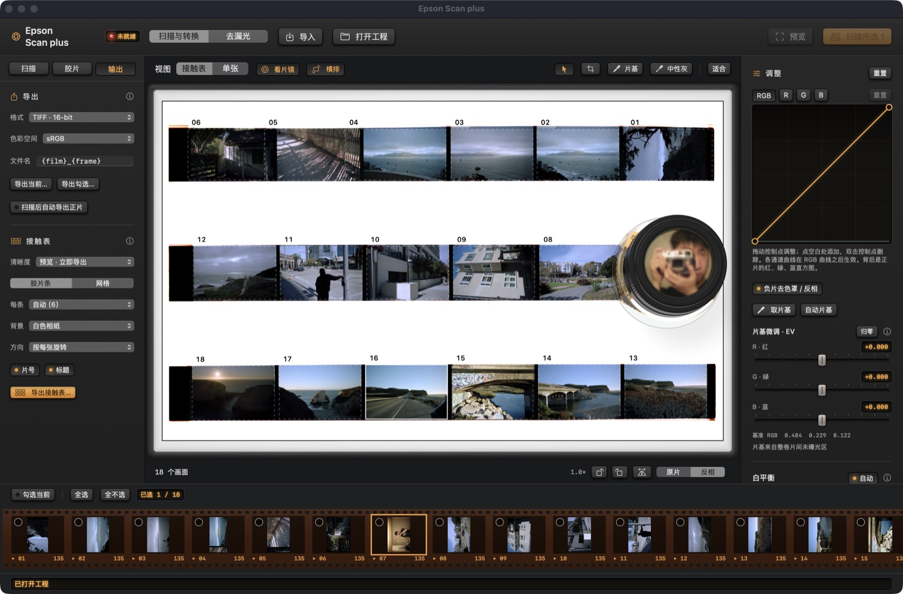
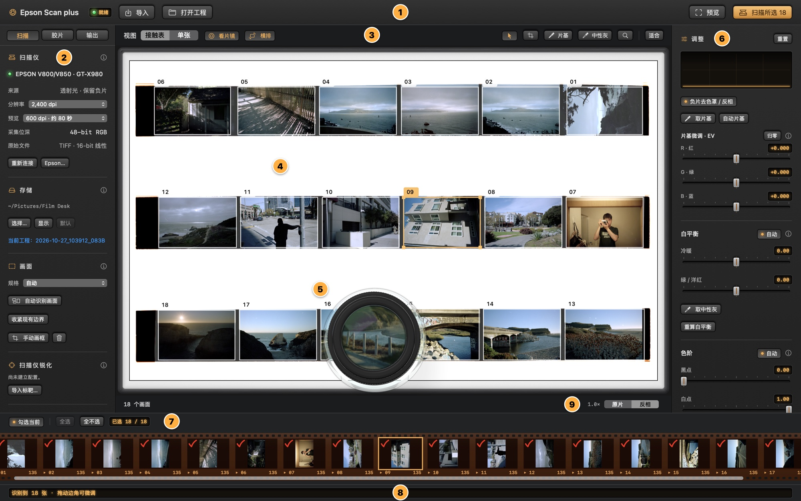
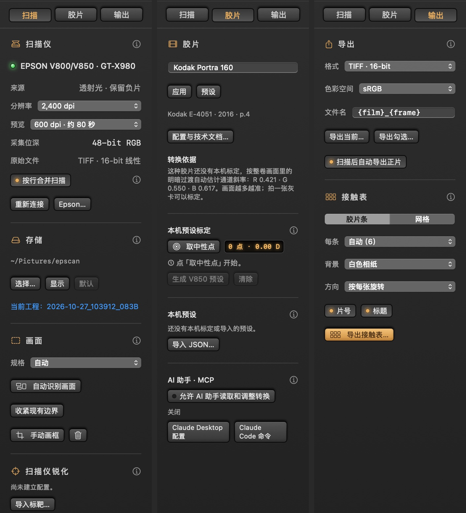
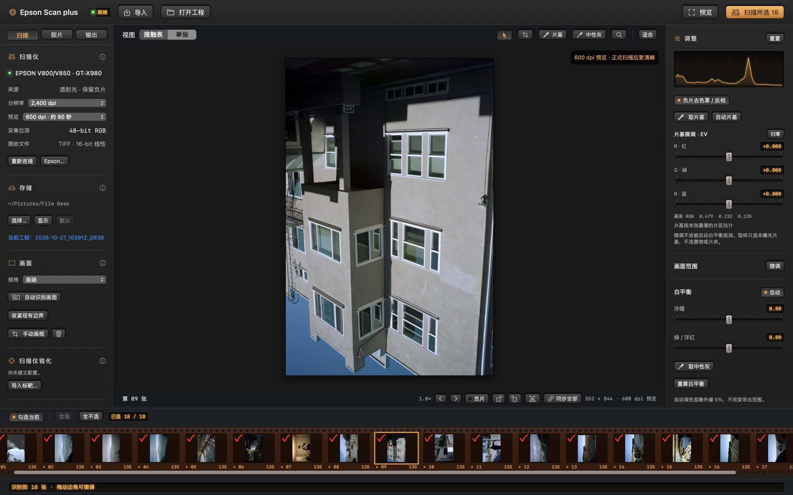
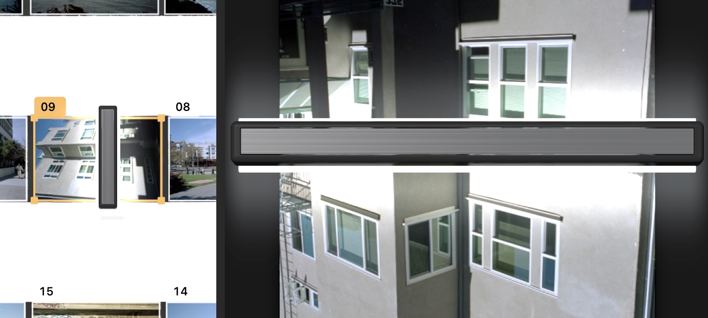
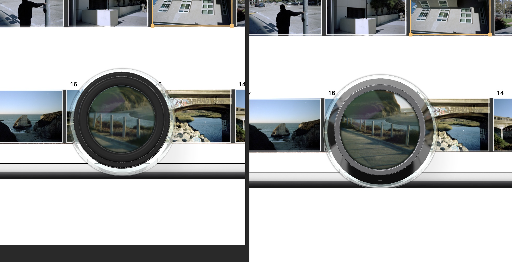
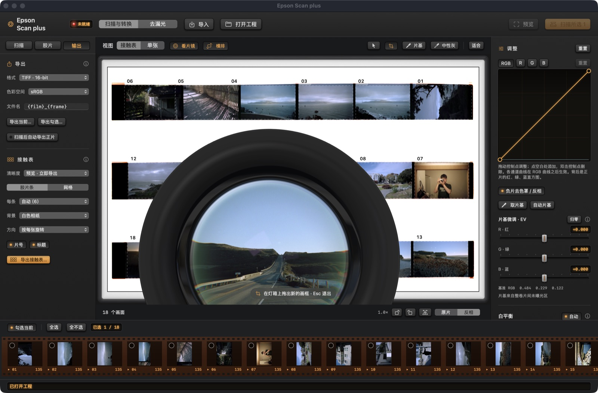
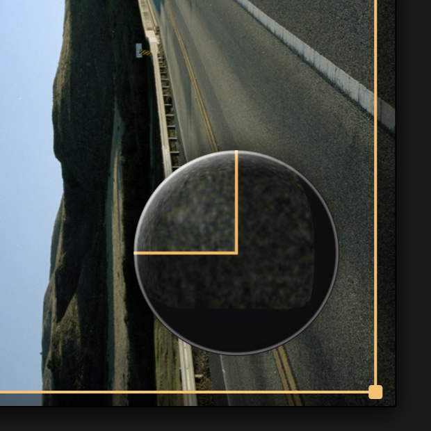
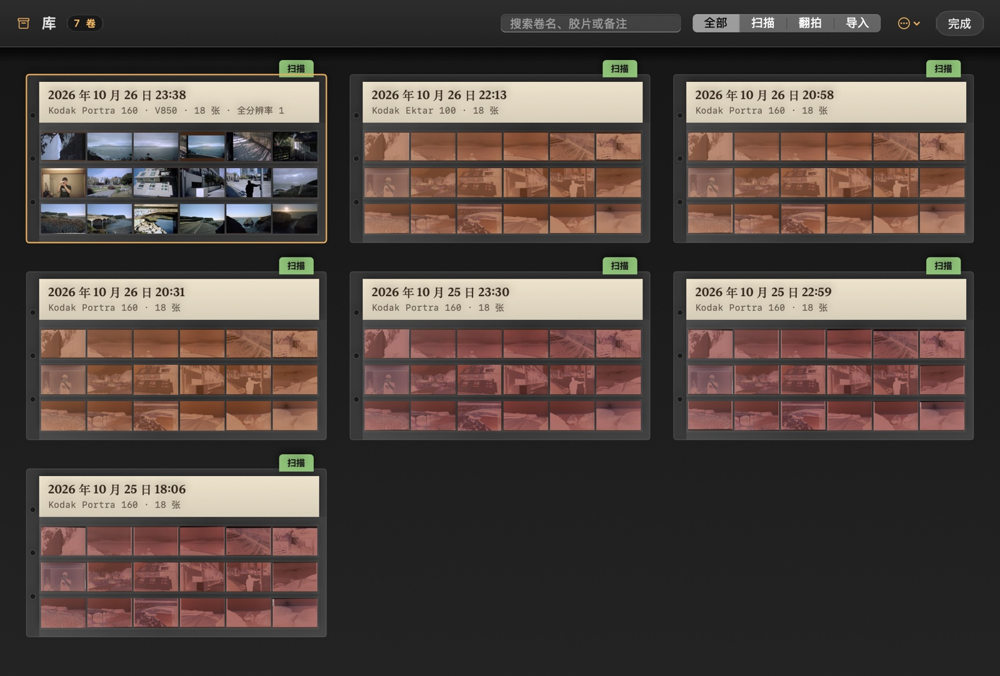
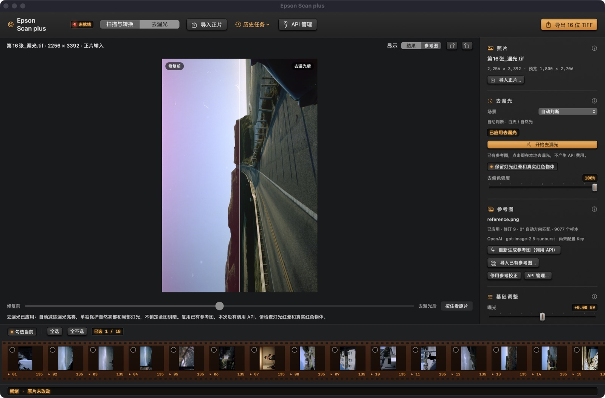

# Epson Scan plus

在 macOS 上扫描和转换彩色负片的工具，为 Epson Perfection V800 / V850 设计：48-bit 线性采集、去色罩、整卷自动估计通道反差、在这台扫描仪上标定的胶片预设、接触表、灯箱上的 3D 看片镜，以及用参考图修复漏光。全部在本机处理；只有去漏光生成参考图时，在你确认后上传一张缩图。

> 个人开发的实验工具，不是 Epson 官方产品。当前版本 0.6.6，各版本的改动见[版本记录](doc/CHANGELOG.md)。



## 功能

- **三个模块和本地库**：顶栏中间的分段按钮在 ① 采集（V850 扫描、A7R IV 翻拍、导入文件）、② 去色罩、③ 去漏光之间切换。扫描、导入（以及以后翻拍）的每一卷都自动放进库里；库是一个档案柜，每卷是一页底片保存页，打开过的卷显示正片，其余显示负片原样。见下文[库](#库)。
- **48-bit 采集**：内置独立的 SANE epson2 采集进程，绕过 ICA 驱动的 24-bit 限制；线性 RGB16，扫描仪不做除尘、锐化或自动调色。见[扫描仪接口](doc/scanner.md)。
- **整幅预览**：600 dpi（约 80 秒）或 150 dpi（约 50 秒），自动识别 135 和 120 画面，可手动调整或补画。
- **去色罩**：扫描值 → 片基相对密度 → 各通道斜率 → 白平衡与色阶 → 手动调整 → sRGB。斜率依次取本机标定预设、整卷自动估计、Kodak 数据表。见[胶片配置、转换与颜色](doc/film-and-color.md)。
- **调整**：片基微调、白平衡、色阶、曝光、对比度、饱和度、色彩降噪、柔和的暗部和高光、RGB 与单通道曲线，以及按实测 MTF 的锐化。每张单独保存，可同步旋转和镜像到整卷；所有编辑都能撤销和重做。
- **接触表与看片镜**：接触表放在 Metal 渲染的铝框灯箱上；Pentax 式 5.5×、Mamiya 式 4×（135），或 Rodenstock 式 3×（6×6）、Schneider-Kreuznach 式 3×（6×7）看片镜放在画面上放大细看，接触表和单张视图都能用。接触表图片可按预览直接导出，或先以 1200 dpi 扫描再导出。
- **去漏光**：第三个模块，移植自 FilmLightLab 1.5.0 的修订 9 匹配算法。用同一张照片的干净参考图（图像模型生成或自己导入）在本机修复红色 / 品红漏光，参考图只指导平滑的色彩校正，输出像素都来自原片；本卷的照片按当前调色直接处理，不用先导出。见下文[去漏光](#去漏光)。
- **导出**：TIFF 16 / 8-bit、PNG 16-bit、JPEG；sRGB、Display P3、Adobe RGB 或 ProPhoto RGB，嵌入 ICC 配置文件；写入胶片、片号、扫描仪和扫描日期等元数据，文件名可按模板生成。扫完的正片自动导出到工程的 `Exports`，未反相的原始负片保留在 `Originals`。

## 界面介绍



1. **顶栏**：系统的窗口工具栏，在 macOS 26 上是液态玻璃；放不下时，多出来的收进右端的溢出菜单。
   - 左侧：侧栏开关；扫描仪指示灯（绿色就绪，琥珀色闪烁表示工作中，红色未就绪）。
   - 中间：模块分段按钮，① 采集、② 去色罩、③ 去漏光；也可以按 ⌥⌘1–3。
   - 中间模块旁边是 AI 助手：一盏灯（已连接绿、等待连接琥珀、关闭暗）和名字，状态写在提示里。
   - 右侧：本页的主要操作，最右是检查器（右栏）开关。
   - 「库」：打开档案柜（⇧⌘L）。
   - ① 采集里还有「导入」（TIFF / PNG / JPEG）。来源选 V850 时，右侧有「预览」和「扫描所选 N」：前者做整幅预览，后者依次扫描勾选的画面，两张以上时先确认张数、分辨率、预计用时和占用空间。预览和扫描时，画面列表下面的状态栏右端显示进度和「取消」。
2. **左侧面板**：系统侧栏，可以拖宽窄，也可以用顶栏的开关收起。① 采集里顶上是来源（V850 / A7R IV / 导入）；② 去色罩里是「胶片 / 输出」两页，见下文。各节的详细说明在标题右侧的「ⓘ」里。
3. **工作区工具栏**：
   - 「接触表 / 单张」切换视图；「看片镜」（Z）点一下把看片镜放到画面上，再点一下收起；「横排」把竖放的片夹横过来摆在灯箱上（默认打开）。
   - 工具依次为选择（V）、画框（C，手动添加画面）、片基（B，实心吸管，取未曝光的片基）、中性灰（N，空心吸管，取画面中的灰色，按它自动白平衡；取样时鼠标变成滴管，尖端就是取样点）、高光（W，半满吸管，Dmax：点负片上最密、正片里应为纯白的地方，各通道以它为白点对齐，开着自动色阶时它就是白色，更亮处剪成白）；看片镜开着时，取样工具点在镜片上就按镜片里放大的那一点取样；「适合」复位缩放。
   - 选中工具后，画面底部有一行操作说明；按 Esc 退出工具。取 IT8 色卡或标定用的中性点时，⌫ 撤回上一个点，不会删掉画面。
   - 单张视图另有上一张 / 下一张、「负片」对照、左右旋转、水平镜像和「同步全部」。
4. **灯箱上的接触表**：整幅预览放在乳白灯箱上，每张标出画框和编号。竖放的片夹默认横过来显示，胶片条横向排开：方向跟随多数画面的旋转，都没有旋转时顺时针转，横拍的画面正立，每条从右往左读（01 在第一条右端）。点一下画面，或在下方胶片条点一下，视角就推近到这张：整张灯箱跟着放大，这张移到画面中央，周围的画面移出画面，灯箱淡去后就是单张（系统式的弹簧动画，约半秒；打开「减弱动态效果」时改为淡入）。点「单张」或按 ⌘1 时也一样。预览边扫边显示时不能切到单张，扫完后照常。
   - **其他动画**：都用系统式的弹簧或渐变；打开「减弱动态效果」时都改为短暂的淡入淡出。
     - 回接触表时视角拉远：画面缩回它在灯箱上的位置，整卷回到眼前。
     - 单张里换下一张，画面从它所在的那一侧滑进来；胶片条跟着滚到所选的一张，让它在中间。
     - 「负片」「原片 / 反相」切换时交叉淡化；正式扫描完成，预览换成全分辨率时也淡入。
     - 旋转时画面转过 90°，镜像时画面侧过来再翻成镜像。不用等新画面算好，点下去马上开始转。
     - 进入裁切时画面缩进它的周边，裁切框落在原来的位置；确定裁切后，裁切范围放大填满画面。
     - 预览识别出画面或打开一卷时，画框一个接一个落到各自的画面上。接触表上不能拖动或缩放画框，画面范围在单张里用裁切工具调；漏识别的画面可用画框工具在接触表上补画。接触表不缩放，始终显示整卷；细看用看片镜，或进入单张后按住 ⌘ 滚动、双指捏合缩放。
   - **接触表页**：一张一个文件的画面（翻拍、导入）像冲印的接触表一样排在灯箱上，每条 6 张、每页 6 条，片边印着编号。排满 36 张后下一页在右边：在灯箱上左右滑动，或用下方的「‹ 第 N / M 页 ›」翻页，整页推过去。选中别页的画面会翻到那一页；按 ← → 换到上一张 / 下一张，到了下一页的第一张就翻过去。扫描的卷是片夹的整幅预览，另外导入的单张排在后面几页。看片镜在接触表页上按 135 画面的大小放大，视场装下一整格。
5. **看片镜**：点「看片镜」或按 Z，它出现在所选画面上（单张视图中在画面中央），再点一下收起；灯箱不为它留空位，胶片占满玻璃。默认像眼睛贴在目镜上看：镜片放大成一个大圆（单张视图中大视场刚好和照片一样宽），外面一圈细细的黑色目镜边框，再往外仍是灯箱；拖动细看，拖动途中一直保持对焦和放大。灯箱上镜片和真的看片镜一样装下整格：5.5× 和 4× 装下 24 × 36 mm 的 135 画面，Rodenstock 3× 装下 6 × 6，Schneider 3× 装下 6 × 7；换大、中、小视场只改变镜片的大小和看到的范围，放大倍数不变（按大视场装下整格时的倍数，不会比灯箱上更小）。镜片边缘有轻微的枕形畸变（按真实看片镜估计：Pentax 边缘约 3%，4× 约 2%，Rodenstock 3× 约 1.5%，Schneider 3× 约 1%）和轻微色散（红蓝在边缘差约 1%），最外一圈玻璃边在朝向光源的一侧反光。右键可换「大 / 中 / 小视场」或「实物大小」（按胶片比例放在灯箱上，从远处看）。镜片里是这张画面自己的像素：灯箱上是正式扫描或预览的全分辨率，单张视图中是全分辨率的这一张，倍率不超过像素能撑起的程度（至少 2×）。右键还可选择型号、移到所选画面中央或收起。
   - **外观**：整个界面用系统的控件和材质。按钮、开关（系统开关）、滑块（系统滑块，双击回到默认值）、分段按钮都是系统的，读数是等宽数字。在 macOS 26 上，工具栏、侧栏和检查器是系统的液态玻璃，灯箱和取景画面上浮着的工具条也是液态玻璃。工作区、画面列表和状态栏是同一个底面，中间不再有分隔线和色带。
6. **右侧面板**：系统检查器，可以拖宽窄，也可以用顶栏右端的开关收起。① 采集里是「本卷」（翻拍时上面是对焦检查），可以填卷名和备注（相机、镜头、冲洗等），会存进工程，库里也会显示；还有画面数、文件夹和「下一步：② 去色罩」。② 去色罩里是调整面板（各节的说明在「ⓘ」里）：
   - 最上面是曲线：RGB 与红、绿、蓝各自的曲线都画出来，正在编辑的在最上层；背后是正片的红、绿、蓝直方图。下面是「负片去色罩 / 反相」开关。
   - 片基：取片基、自动片基、片基微调（EV）；「整卷共用这个片基」把这一张取的片基用于整卷（片间测不到片基的翻拍或单张导入的卷）；画面范围微调与还原。
     - **翻拍和单张照片自动从片边取片基**：在画框外面的未曝光片边和片间取，不取画面里的暗部（先找画框的边，只取线外面）。每张用自己片边的；看不到片边的用最近一张看得到的。调整面板里写明片基来自哪里，打开「标出」在单张上看取的是哪里。取片基时，自动找到的片基也会标出来。
     - **自己取片基**：点「取片基」再点片边或片间。手动取的优先，取的位置在「标出」里画成一个圈；点「自动片基」回到片边测量。
   - 白平衡（自动、冷暖、绿 / 洋红、选取中性灰）与色阶（自动、黑点、白点、中间调）。
   - 影调（曝光、对比度）、色彩（饱和度）、锐化、输入设置（输入 Gamma）。
   - **色彩降噪**：只平滑颜色、不动明度，传感器和去串色带来的彩色噪点（尤其蓝黄）去掉，胶片颗粒的明暗保留。翻拍的照片默认 1，扫描默认关。缩小看的预览按比例减弱，因为噪点已经被平均掉了。
   - **柔和的暗部和高光**（默认开）：
     - **暗部**：最暗的地方不硬切成纯黑，而是平滑地压下去，暗部各通道的差别和颜色因此留着，并略补暗部的饱和度。
     - **高光**：最亮的地方用柔和的肩部收向白，近白处干净。中间段不变。
     - 关掉就是原来的直切。
   - 「重置」把这张的调整恢复默认，输入 Gamma、方向和整卷估计保留。
7. **勾选与胶片条**：「勾选当前 / 全选 / 全不选」决定批量扫描和导出哪些画面。胶片条带齿孔和片边编号，红勾表示已勾选。在接触表上点胶片条里的一张，视角推近到它、进入单张；在单张里点则换成那一张。右键某一张可以删除它（⌘Z 撤销）。
8. **状态栏**：当前操作和结果。
9. **接触表显示**：全卷逆时针 / 顺时针旋转、全卷水平镜像（不管「同步全部」是否打开，都作用于整卷）；「原片 / 反相」切换显示未反相的负片，或按各张调整得到的正片。多数画面镜像时，灯箱上的胶片也镜像显示。

### 左侧面板



（截图还是改成三个模块之前的样子：现在「扫描」在 ① 采集里，「胶片」和「输出」在 ② 去色罩里。）

- **① 采集 · V850 扫描**：
  - 扫描仪状态与采集位深、正式扫描分辨率、预览分辨率、原始文件格式；「按行合并扫描」把片夹里并排的几张一次扫完（更快时才合并），再分成每张的原始文件。
  - 每张正式扫描都和预览配准，换算到预览的标尺，整卷颜色一致（原理见[扫描仪接口](doc/scanner.md)）。
  - 存储位置与当前工程。
  - 画面识别：规格、重新识别、收紧现有边界、手动画框。
  - 扫描仪锐化：导入分辨率标靶扫描，测量 MTF 生成锐化配置。
  - 扫描仪标定：用 IT8.7/1 透射色卡测量杂散光，转换前扣除。
- **① 采集 · A7R IV 翻拍**（还没在真机上测过）：通过 Sony Camera Remote SDK 联机，A7R IV 只能用 USB，相机的 USB 连接方式要选「PC 遥控」。
  - **左栏**：连接、电量、快门 / 光圈 / ISO / 曝光补偿（列出相机给的可选值）、白平衡和色温（100K 一档；RAW 不受它影响，只改取景和 JPEG 的颜色）、AF-S / MF、对焦区域、文件格式、保存位置（只存电脑，或电脑和存储卡），以及能复制的诊断日志。
  - **深色和浅色**：整个 App 跟随系统的外观设置，每一页都可以是深色或浅色，切换页面不会变色。翻拍页窗口底下垫着模糊的实时取景，深色时压成深灰，浅色时提成浅灰。
  - **中间是实时取景**：点画面移动对焦点（对焦区域要是「自由点」）。取景画面上不放看片镜。用相机自己的对焦放大（A7R IV 是 5.9× 和 11.9×）在对焦点看传感器的真实像素，放大跟着对焦点走，切换对焦模式后会自动恢复。上方显示对焦框里三个通道的清晰度。在 macOS 26 上，上下的控制条浮在取景画面上，是液态玻璃。
  - **下方是对焦和拍摄**：
    - 「AF」在对焦框处自动对焦一次并锁住焦点。相机提供 MF 时，对完切到 MF。不提供时（A7R IV 配 Sigma 70mm 微距，镜头开关在 AF），在 DMF 里半按按住，按钮显示「已锁焦」。锁住时可以步进微调，快门不会再对焦。拍完一张相机会松开，下一张前再按 AF。整卷不想每张都对焦，就在锁焦后把镜头开关拨到 MF：焦点停在原处，快门不对焦，但步进也用不了。
    - « ‹‹ ‹ › ›› » 按 Near/Far 的 7、3、1 档步进，也可以拖对焦环。
    - 「拍摄」（空格）只按快门，不对焦：焦点锁住时直接全按；相机提供 MF 时先切到 MF 再按。两者都不行时，这一张会先对焦，App 会提示先按 AF。
    - 对焦步进（« ‹‹ ‹ › ›› »，6 / 3 / 1 档）和拖对焦环：相机在它能驱动的 MF 里，或焦点锁住时才走。镜头开关在 MF 时相机驱动不了镜头，App 会说明。步进前都先要回「电脑优先」。
    - **快门键**：在控制条右边，跨两行，是一颗圆形的红色磨砂玻璃键，整颗一种颜色。按下时下沉、更亮，快门动作时亮起一圈光。在 macOS 26 上整个键放在一滴液态玻璃里，按下时玻璃跟着形变。就绪时四周有柔和的红光；照片写入和传输时整颗一明一暗，这时不接受按键；没连相机时是灰色。照片入库后，取景画面上浮出一条提示，几秒后消失。
  - **直方图**：
    - **取景上方的工具条**：实时取景的直方图做成一条，通道有像素到顶时对应字母加粗变亮并提示过曝，旁边的按钮可以收起；窗口很窄放不下时这一条先不显示。取景画面放在上下两排工具条之间，不被按钮和直方图挡住，胶片边缘能看全。
    - **右栏**：上一张照片的直方图。无压缩 ARW 按传感器原始读数统计（扣黑电平、按满量程归一，横轴与光量成正比），并给出每个通道亮端（最亮 0.5% 的起点）占满量程的百分比、离满量程差几档，以及到顶的感光点比例。调翻拍曝光以这里为准。
  - **右栏是对焦检查**：上一张照片在对焦点附近的原始像素，按 100%、200%、400% 显示，不做平滑，并分通道显示清晰度。
  - **删除照片**：在下方胶片条点「删除」删掉当前这张，或右键某一张选「删除这张」。删除后选中它后面的一张，最后一张则选前一张。⌘Z 可以撤销；原文件留在这一卷的文件夹里。
  - **入库**：拍好的照片自动进库里一卷「翻拍」的卷，解成线性 16 位 TIFF。无压缩 ARW 直接从传感器读出，每个通道是它那种颜色的光，不套色彩矩阵；其他 RAW 用系统的 RAW 引擎解，不加色调曲线、锐化、降噪和镜头校正，白平衡整卷固定。这卷默认一起做整卷估计。
  - **去串色**：从传感器读出的照片默认去掉翻拍光源的串色，见下面「② 去色罩 · 胶片」。
  - **光源标定**（翻拍页左栏）：
    - **怎么拍**：拿走底片，灯箱上什么都不放，只开红灯、只开绿灯、只开蓝灯各拍一张，每张曝光到最亮处约 70%，然后点「用最近三张标定光源」。三张的顺序不限，App 按最亮的通道认出是哪种灯。
    - **得到什么**：
      - 这组灯的串色矩阵：每种灯在相机三个通道里的比例，取画面上曝光合适处的中位数；
      - 每种灯的平场：去串色后它自己的通道，按 24 × 16 格取中位数，除以最亮的一格；灯几乎照不到的格子（片夹遮住的地方）不动。
    - **之后**：翻拍读出 RAW，先去串色，再除以平场，把四周偏暗的地方补平；然后才测片基、密度和白平衡。新拍的照片跟着这次标定，当前这一卷也换成它。
    - **什么时候重标**：换了灯的位置或灯箱就要重标；灯的亮度配比怎么调都不用。曝光不够时会提示重拍。没标定过时，用 2026-10-29 用 IT8 测的矩阵，没有平场。
    - 标定用的三张空白帧，之后可以在胶片条上删掉。
  - **像素位移**：SDK 没有这一项，只能在相机菜单里打开。App 按设定的张数（4 或 16）把一组文件放进同一个文件夹，合成还没做，先用每组的第一张。
  - **在相机上设好**：RAW 选「无压缩」，快门类型也在相机上设。
- **① 采集 · 导入文件**：TIFF、PNG 或 JPEG，复制到库里新的一卷。
- **② 去色罩 · 胶片**：
  - 胶片名称与预设；「转换依据」说明当前斜率来自本机预设、整卷估计还是数据表。一张一个文件的画面多于一张时，有「导入的单张一起做整卷估计」开关。
  - 「去串色 · RGB 光源」（卷里有从传感器读出的翻拍时出现）：
    - **为什么**：相机的红、绿、蓝滤色片和翻拍灯的光谱有重叠，蓝灯有 34% 读进绿通道，绿灯约 12%、11% 读进红和蓝。每个通道掺了别的灯的光，转出来颜色发灰，原来要把饱和度拉到 1.8 左右才像 Capture One。
    - **做法**：在线性读数上、除片基之前，乘串色矩阵的逆，把串色去掉。之后的片基、整卷斜率、白平衡、取样和导出都按去掉后的读数算。
    - **矩阵**：2026-10-29 用 IT8 透射色卡、每次只开一种灯翻拍测得，属于这台 A7R IV 和这组 RGB 灯。换了相机或灯就不准；白光翻拍时关掉。
    - **开关**：整卷一起开关，⌘Z 可以撤销。取过的片基、中性灰、高光按同样的矩阵换算。新拍的照片跟着这一卷；新的一卷沿用上次的选择，默认打开。
    - **效果**：在 Capture One 导出过的 RGB 光源画面上，饱和度 1.0 时彩度就接近 C1。但整卷斜率估计带来的中间调偏蓝也会更明显：整卷估计的蓝斜率还要再查。
  - 本机预设标定：取中性点，生成 V850 预设，带步骤提示；中性点深入暗部时同时标定暗部趾部。
  - **翻拍预设标定**（翻拍的卷上，同一个面板）：
    - **怎么用**：在本来是中性的东西上取点，比如白牌子、白墙、灰水泥、阴影里的灰，明暗不同的至少 2 个、跨度 0.3 D 以上，再点「生成翻拍预设」。预设叫「胶片名 · 翻拍」，以后同一种胶片的翻拍卷自动用它。
    - **标定什么**：每个通道的反差（斜率），修好「越亮越偏蓝」这类随亮度变的偏色。整体冷暖照旧由自动白平衡或你自己定，胶片的色彩风格保留：不套相机色彩矩阵，不用色卡。
    - **为什么要标**：整卷估计按画面里明暗过渡的比值估斜率，蓝层的反差随密度一直在变，估计会随画面内容偏。比如 R22 树叶多，蓝偏低约 18%，灰越亮越蓝（b* 到 −15）。在 R22-7478 上取 3 个中性点标定后，那里回到 0 附近，和 C1 的色差从 8.1 降到 4.6；同一组灯下拍的 7493 从 8.1 降到 3.7。
    - **适用范围**：属于这台相机、这组翻拍灯和这种胶片。灯的亮度配比怎么调都不影响，因为片基会除掉、去串色以后配比也不起作用。
    - **和去串色的关系**：去串色在读图时先做，标定叠在它后面，只改斜率，不会替换串色矩阵。标定和使用时去串色要保持同一个状态（默认打开）；预设说明里如实记着标定时是开还是关。
  - 本机预设的使用、导出、删除和导入。
  - AI 助手（MCP）：允许助手读取和调整转换，并复制连接配置（见下文）。
- **② 去色罩 · 输出**：
  - 导出格式与 JPEG 质量、色彩空间、文件名模板，导出当前 / 勾选，扫描后自动导出正片。
  - 接触表清晰度（「预览 · 立即导出」按预览的分辨率直接生成，不扫描；「1200 dpi · 先扫描」先补扫低于 1200 dpi 的画面）、排列（胶片条或网格、每条张数、背景、方向、片号、标题）与导出。

### 单张视图



用 ← / → 浏览。右上角提示这张是预览还是正式扫描；底部显示像素尺寸、来源和方向工具。

### 扫描头



正式扫描时，正在扫描的那张上会出现一个 3D 渲染的扫描头：黑色机身、拉丝铝顶板，灯管从两侧透出，照亮下方的一条胶片。它按扫描进度从画面的一端走到另一端（V850 从片床顶端往下读），在接触表和单张视图中都会显示。

### 看片镜





四种型号都按胶片的实际比例绘制（底座直径 48 / 56 / 90 / 100 mm）；单张视图中画面比实物大得多，看片镜按窗口大小画。贴近目镜看时，视点在镜片轴上、目镜正上方，镜片占满所选视场。灯箱上镜片显示这款看片镜的整个视场（5.5× 约 46 mm、4× 约 52 mm、Rodenstock 3× 约 84 mm、Schneider 3× 约 92 mm），放大倍率由镜片在屏幕上的大小决定；大视场至少放大 1.5×，放不下时在画布内尽量放大（3× 的镜片可以占到画布短边的九成多）。单张视图中倍率相对画面，不超过型号本身的倍率和像素能撑起的程度。由 Metal 逐像素光线步进渲染：透明底座透出并折射下面的胶片，黑色机身映出上方的柔光箱和下面发亮的灯箱，镜片带镀膜反光。视点在灯箱前方，看片镜离画面中心越远，越能看到它的侧面。

### 裁切时的玻璃泡



单张视图里拖裁切框的角，或在接触表上画新的画框时，光标左上方会出现一个玻璃泡。

- **内容**：泡里是角落附近的画面，放大到屏幕上的 4 倍，拖动的那个角正好在泡的中心；裁切线画在里面，框外和画布上一样压暗。
- **玻璃外观**：边缘把画面向外折，有约 1% 的轻微色散，朝光源的一侧有高光，泡下有投影。出现时稍微弹一下，松手后淡出。
- **位置**：靠近窗口边缘时，泡换到另一侧，不会挡住光标。
- **不出现的时候**：只拖动整个框时不出现。
- **取样**：泡取的是屏幕上的这张图（编辑裁切时最长约 3000 像素），不是原始扫描的全分辨率。

### 拉直

「画面范围」里的「拉直」让画面绕中心转动（±15°，正数顺时针），裁去转出的空角，保留同样比例的最大矩形。

- **网格线**：拖动时画面上显示三分线和细网格，对着地平线或建筑边缘调；停下约一秒后收起。
- **微调裁切时**：画面按胶片原样显示，转动后保留的部分用琥珀色斜框标出；`[` `]` 每次 0.1°，加 ⇧ 每次 1°。
- **画线拉直**：点「画线」（或裁切时按住 ⌥），沿地平线或建筑竖线拖一条线，松手就按它拉成水平或竖直。
- **一致**：导出、缩略图、放大到像素、看片镜和各种取点都按拉直后的画面。接触表上的画框仍按胶片原样显示，保留的部分用虚线框标出。
- **去漏光页**的「裁切原片」也能拉直。

## 库



点顶栏的「库」或按 ⇧⌘L 打开。库是一个档案柜，每卷是一页底片保存页：

- **标签**：顶上的纸标签写卷名（没起名时写开始的时间）、胶片、张数、全分辨率的张数和已导出的张数。
- **索引签**：右上角的索引签表示来源：扫描、翻拍或导入。旧版图库里的卷注明「旧版」。
- **画面**：透明袋里每条六格。打开过的卷显示 App 渲染的正片；其余的显示负片原样，带橙色色罩。竖放的画面横过来放，和灯箱上一样。
- **操作**：双击一页打开这一卷，进入 ② 去色罩。可以按卷名、胶片、备注搜索，按来源筛选。右键可以在 Finder 中显示；「…」菜单里能从文件打开工程，或更改新卷的存放位置。

库直接读图库文件夹里的各卷，不在里面另写索引或别的文件。用默认图库时，0.4.8 及以前的 `~/Pictures/Film Desk/` 里的卷也会列出来。正片缩略图存在 `~/Library/Caches/local.epscan.mac/Rolls/`，删了不影响工程，下次打开那一卷时会重新生成。

## 去漏光



顶栏切到「去漏光」。这一页移植自 FilmLightLab 1.5.0（修订 9），算法逐项改写为 Swift：同样的输入下，场景判断、自动保护、对齐、拟合出的模型和输出像素与原版一致，见[去漏光](doc/light-leak.md)。

1. **选照片**：在下方胶片条点一张本卷的照片，按它当前的调色在本机转换为 Adobe RGB 16 位正片处理，不用先导出再导入；也可以「导入正片」其他软件已去色罩、反相的 TIFF / PNG / JPEG（推荐带 ICC 的 16 位 TIFF，原文件不改动）。左右旋转在画面右上角。
2. **开始去漏光**：已有参考图时在本地免费修复；没有时先生成参考图。也可以在「参考图」里导入在别处得到的同一张照片的干净版本。
3. **检查**：拖动画面下方的对比滑杆看修复前后，按住「按住看原片」临时看原片，「结果 / 参考图」切换看参考图。场景（自动 / 白天 / 夜晚）、「保留灯光红晕和真实红色物体」、去偏色强度和基础调整（曝光、冷暖、绿 / 品红、对比度）随时可改，换场景或旋转后用已有参考图在本地重新拟合。所有改动都能 ⌘Z 撤销。
4. **局部处理**（可选）：「局部区域与保护」里可以画椭圆框住漏光并点干净参考点、用画笔保护真实的红色物体和灯光、自动检测候选区域（勾选才生效）、在自动对齐不确定时手动标对应点、裁切，以及保存 / 载入预设（与 FilmLightLab 的预设文件通用）。
5. **导出 16 位 TIFF**：原图裁切尺寸的 RGB 16 位 Adobe RGB TIFF，旁边附同一像素的 sRGB JPEG 和参数记录（`.tif.json`）；只写你选的文件，同名的 JPEG 已存在时加编号，不覆盖。本卷照片导出时按建立任务时的调色重新转换全分辨率；调色改过后，「照片」一节会提示并可「按当前调色重新载入」。

**参考图与费用**：生成参考图调用 OpenAI 图像接口（`https://api.openai.com/v1/images/edits`，模型 gpt-image-2.5-sunburst / flare 或 gpt-image-2，提示词与 FilmLightLab 相同）。只在你在确认窗口点「生成并去漏光（调用 API）」后，上传最长边 1536 px、无 EXIF 的 JPEG 缩图及附加要求；原尺寸照片留在本机。每次 1 张，不自动重试，失败或超时仍可能已计费。生成的参考图先保存再拟合，拟合失败也不会再次收费。

**API Key**：在「API 管理」里填写，可选存入 macOS 钥匙串（本 App 自己的一项，下次自动读取），否则只在本次内存中；不写入文件、任务、日志，也不会回显。不要把 Key 发到聊天中。首次或 App 更新后 macOS 可能请求钥匙串授权。

**任务**保存在 `~/Library/Application Support/epscan/LightLeak/`（每张一个文件夹：正片预览、参考图、参数），不写入照片库；本卷照片只有在开始去漏光或导入参考图后才保存任务。顶栏「历史任务」列出以前的任务，也可在 Finder 中打开这个文件夹。

## AI 助手（MCP）

Epson Scan plus 可以作为 [MCP](https://modelcontextprotocol.io) 服务器，让 Claude 等 AI 助手帮你看转换：读取选中画面的片基与来源、胶片的通道斜率、整卷估计、白平衡、色阶、负片密度和正片的直方图，看预览、在画面上取点，并调整片基、中性灰、冷暖、曝光、色阶等。每次调整都是 App 里的一步编辑，可以用 ⌘Z 撤销；助手不能扫描、删除或导出文件。

1. 在「胶片」页的「AI 助手 · MCP」打开「允许 AI 助手读取和调整转换」（默认关闭）。
2. 连接助手：
   - **Claude Desktop**：点「Claude Desktop 配置」复制，在 Claude Desktop 的设置 → 开发者 → 编辑配置里加入 `mcpServers`，重启 Claude Desktop。
   - **Claude Code**：点「Claude Code 命令」复制，在终端运行。
3. 在对话里让助手「看看这张为什么偏色」之类即可。App 没开或没开启 MCP 时，助手会收到提示。

**让助手做翻拍标定**：说「帮这卷做翻拍标定」。
- **它怎么做**：先看几张预览，按物体挑出本来就中性的东西，比如拍在胶片上的色卡灰块、白牌子、白墙、灰水泥、云。从亮到暗挑 3–6 个，用 `calibration_add_points` 交给 App。
- **它怎么查**：看每个点偏离拟合多少，把不中性的点去掉。
- **最后**：生成「胶片 · 翻拍」预设，并告诉你选了哪些地方。
- **注意**：
  - 判断靠认出是什么东西，不靠颜色，所以预览整体偏色也不影响。
  - 取点用浮点读数，密的地方也不会因为 8 位量化而不准。
  - 看预览时，画面会发给助手所在的 AI 服务处理。

助手启动的是 App 自己（`EpsonScanPlus --mcp`），它通过只有你的账户能访问的本机连接与正在运行的 App 通信，不经过网络。工具列表：`get_state`、`list_frames`、`list_presets`、`select_frame`、`preview`、`sample`、`adjust`、`pick_film_base`、`auto_film_base`、`pick_neutral`、`choose_preset`、`apply_to_roll`、`reset_adjustments`、`undo`。

去漏光页也在同一个 MCP 服务器里。FilmLightLab 原来本机 HTTP 接口能做的，这里都能做，对照表见 [去漏光](doc/light-leak.md#通过-mcp)：

- **打开和导入**：`leak_open`（本卷某张或某个任务）、`leak_import`（给出路径导入正片，原文件不改）、`leak_import_reference`（导入别处做好的干净参考图，免费）。
- **查看**：`leak_get_state`、`leak_list_jobs`、`leak_list_regions`、`leak_preview`、`leak_sample`。
- **修复**：`leak_start`、`leak_set`、`leak_clear_correction`。
- **局部**：`leak_detect`、`leak_add_region`、`leak_update_region`、`leak_delete_region`、`leak_add_protection`。
- **对齐、方向和预设**：`leak_set_landmarks`、`leak_rotate`、`leak_crop`、`leak_load_preset`。

有几件事留给你在 App 里确认：

- **生成参考图**：要上传缩图并计费，`leak_request_reference` 只打开确认窗口，可以预填质量和附加要求。
- **写文件**：`leak_export`、`leak_save_preset` 只打开保存窗口，由你选位置。
- **API Key**：助手读不到，也改不了。

## 快速开始

1. 退出 Epson Scan 2、图像捕捉等占用扫描仪的程序，打开 Epson Scan plus。左上角指示灯变绿、「扫描」页显示「48-bit RGB」即为就绪。
2. 在「扫描」页选择正式扫描分辨率（默认 2400 dpi）和预览分辨率，点「预览」。
3. 预览完成后程序自动识别画面，画框依次落到接触表上，第一张选中；点一下画面进入单张。检查画框，必要时用裁切工具调整，或回到接触表用画框工具补画。
4. 在「胶片」页输入胶片名称（如 Portra 160）。已有本机标定的「· V850」预设时自动选用，没有时按整卷自动估计。
5. 调整画面后，用「扫描所选」扫描勾选的画面；扫完的正片自动导出到工程的 `Exports`。
6. 需要时在「输出」页导出接触表。

## 快捷键

| 按键 | 作用 |
|---|---|
| ⇧⌘P | 预览 |
| ⇧⌘S | 扫描当前画面 |
| ⌘. | 取消扫描 |
| ⌥⌘1 / ⌥⌘2 / ⌥⌘3 | ① 采集 / ② 去色罩 / ③ 去漏光 |
| ⇧⌘L | 库 |
| ⌘1 | 接触表 / 单张 |
| ← / → | 上一张 / 下一张（单张视图和接触表上都可以，接触表跟着翻页） |
| V / C / B / N / W | 选择、画框、片基、中性灰、高光（画面有焦点时） |
| Z | 放上 / 收起看片镜（画面有焦点时） |
| ⌫ | 删除所选画面；取 IT8 或中性点时撤回上一个点 |
| ⌘L | 看片镜 |
| ⌘R / ⇧⌘R | 顺时针 / 逆时针旋转 |
| ⌘E / ⇧⌘E | 导出当前 / 导出勾选 |
| ⌥⌘E | 导出接触表 |
| ⌘Z / ⇧⌘Z | 撤销 / 重做 |
| ⌘, | 打开 ① 采集里的扫描仪设置 |
| ⌘ + 滚动，或捏合 | 缩放（单张视图） |
| Esc | 退出当前工具并复位缩放 |

## 工程文件

每次预览或导入都会在存储位置（默认 `~/Pictures/epscan/`；0.4.8 及以前默认 `~/Pictures/Film Desk/`，那里的旧工程原样保留，可用「打开工程」打开）新建一个「日期_编号」文件夹：

- `overview.tif`：整幅预览，不压缩（0.4.6 及以前为 `overview.png`）。
- `Originals/`：未反相、保留橙色色罩的原始负片，TIFF 16-bit 线性，用于存档和重新转换。
- `Exports/`：自动导出的正片，每张附带转换参数 JSON。
- `Session.epscan`：自动保存的工程，也记着卷名和备注（没填时不写）。0.4.8 及以前的工程叫 `Session.filmdesk`，照样能打开，并存回原文件。

整个文件夹可以搬移或改名：工程同时按相对路径记录文件，打开时按文件夹的新位置读取（0.4.8 起；更早的工程搬移后也会按文件名找回）。

## 系统要求

- Apple Silicon Mac，macOS 14 或更新。
- Epson Perfection V800 / V850（USB `04b8:0151`，实测设备名 GT-X980）。
- App 为本地临时签名，未经 Apple 公证。

## 构建

```sh
bash build.sh
"../Epson Scan plus.app/Contents/MacOS/EpsonScanPlus" --self-test --test-output /tmp/EpsonScanPlus-tests
```

只需 Xcode Command Line Tools，不依赖第三方 Swift 包。用 Xcode（macOS 26 SDK）构建时，在 macOS 26 上还会用到 SwiftUI 的液态玻璃：会流动、会融合、按下会回弹；用 Command Line Tools 构建的是运行时取用的静态玻璃。翻拍要用 Sony Camera Remote SDK：它不在这个仓库里，受 Sony 的许可约束。把它的头文件放在 `../Sony-CrSDK/include`，`libCr_Core.dylib` 和 `CrAdapter/` 放在 `../Sony-CrSDK/lib`（或者用 `EPSON_SCAN_PLUS_CRSDK` 指定位置），构建时就会编进相机进程，并把 SDK 的库放进 App 的 `Contents/Frameworks`。没有 SDK 时照常构建，只是翻拍面板会提示缺少 SDK。自检、扫描仪实测和命令行导出见[构建与测试](doc/building-and-testing.md)。

## 文档

- [版本记录](doc/CHANGELOG.md)
- [胶片配置、转换与颜色](doc/film-and-color.md)
- [去色罩原理：从片基、密度、通道斜率到输出](doc/negative-conversion.md)
- [扫描仪接口](doc/scanner.md)
- [去漏光：算法与和 FilmLightLab 的对照](doc/light-leak.md)
- [构建与测试](doc/building-and-testing.md)
- [第三方组件与许可证](ThirdParty/README.md)

## 许可证

采集进程 `ScannerHelper/SaneCapture.mm` 以 GPL-2.0-only 发布；内置的 SANE epson2 后端为 GPL-2.0，libusb 为 LGPL-2.1 或更新，源码包见 `ThirdParty/Sources`。本项目其余代码尚未选定许可证。
