<p align="center">
  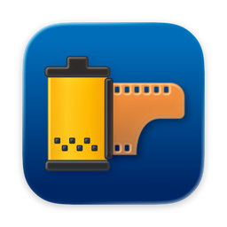
</p>

<h1 align="center">Epson Scan plus</h1>

<p align="center">
  在 macOS 上扫描、翻拍和转换彩色负片与反转片<br>
  为 Epson Perfection V800 / V850 设计，也能用 Sony A7R IV 联机翻拍
</p>

<p align="center">
  <b>0.21.2</b> · macOS 26 · Apple 芯片 · 全部在本机处理
</p>

<p align="center">
  <a href="#一览">一览</a> ·
  <a href="#操作演示">操作演示</a> ·
  <a href="#原理">原理</a> ·
  <a href="#安装">安装</a> ·
  <a href="#快速开始">快速开始</a> ·
  <a href="doc/interface.md">界面说明</a> ·
  <a href="doc/CHANGELOG.md">版本记录</a>
</p>

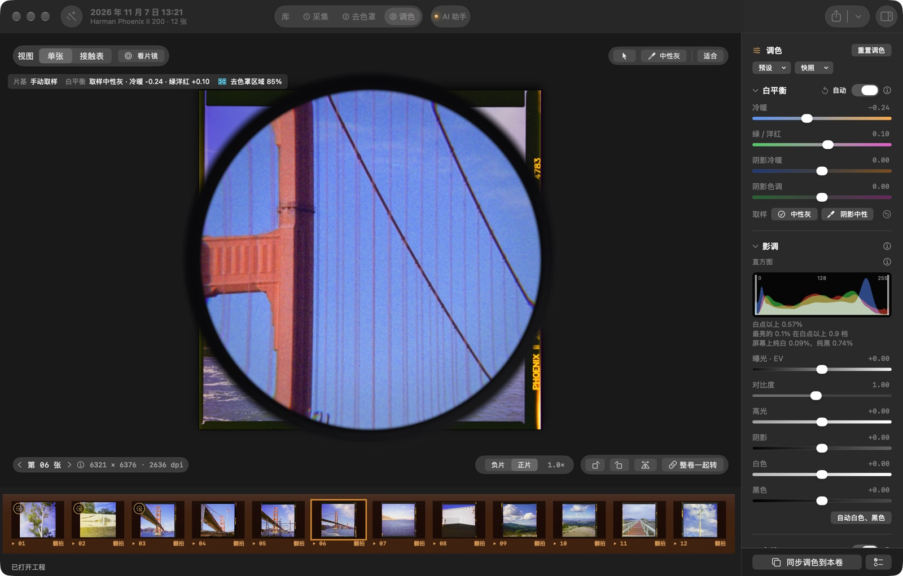

扫描或翻拍（①），去色罩（②，有漏光的照片在这里去漏光），调色和导出（③），全部在本机处理。只有去漏光生成参考图时，才会在你确认后上传一张缩图。

> [!NOTE]
> 个人开发的实验工具，不是 Epson 官方产品。各版本的改动见[版本记录](doc/CHANGELOG.md)。

## 一览

<table>
<tr>
<td width="50%" valign="top">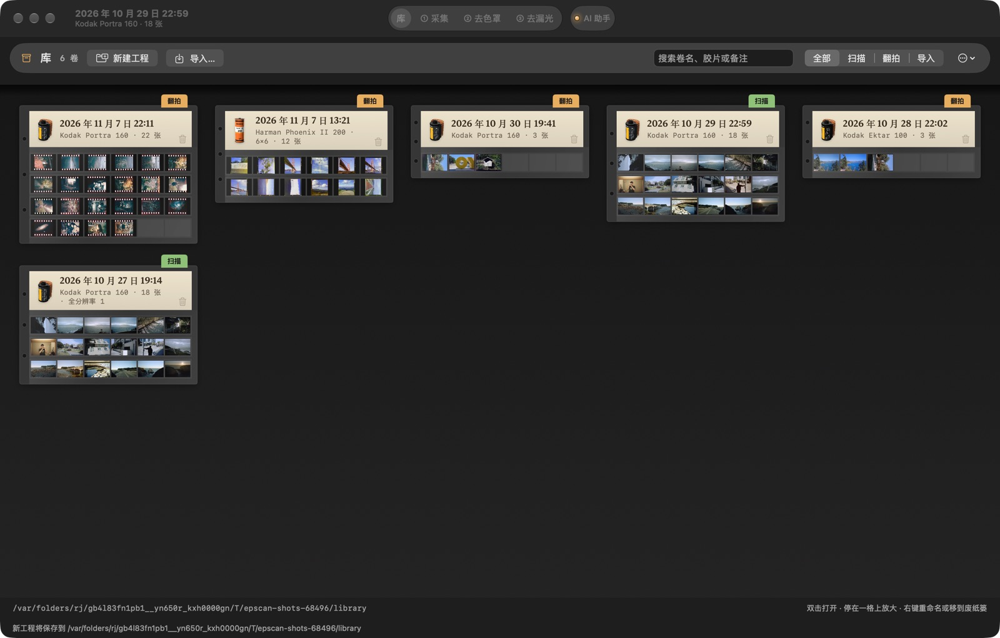<br><b>库</b>：每卷一页底片保存页，标签旁边放着这一卷的胶卷，打开过的卷显示正片。同一批底片叠成一摞，能按卷名、胶片、画幅和备注搜索。</td>
<td width="50%" valign="top">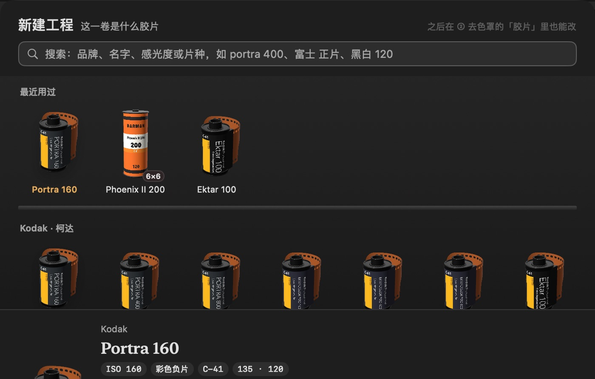<br><b>新建工程 · 胶片架</b>：100 款常见胶片的暗盒和 120 卷，照实物印刷，附厂家数据表。先选胶片、画幅、片边和片种；选了胶片，下面列出它在这台 Mac 上已有的标定。</td>
</tr>
<tr>
<td colspan="2" valign="top">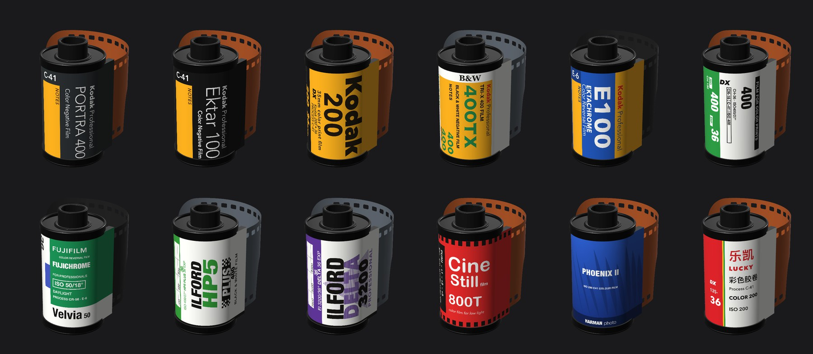<br><b>照实物画的暗盒</b>：每一款的印刷都照着真暗盒的照片画，包括颜色、版式、字体和读的方向，暗盒顶盖和片口也照实物做。</td>
</tr>
<tr>
<td colspan="2" valign="top">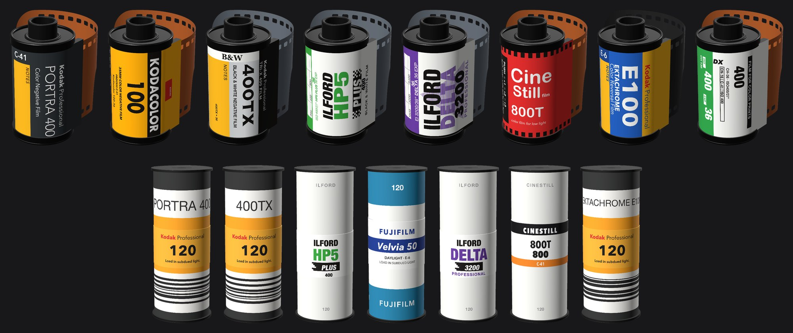<br><b>暗盒和 120 卷的细节</b>：120 卷也照实物画，包括各家的背纸和封条，片轴是薄薄的黑色轴挡，中间凹着卷片钮的键孔；暗盒的印刷、顶盖和片口都对照过实物照片。</td>
</tr>
<tr>
<td colspan="2" valign="top">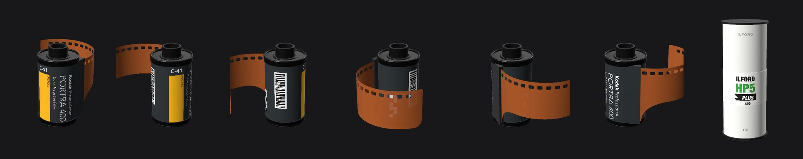<br><b>会转的胶片</b>：鼠标在胶片架、② 的胶片页或库的标签上停一下，暗盒就在原地转一圈，片头从旁边扫过去，影子跟着在地上转；从库里打开一卷时，它一直转到这卷打开。片头照原厂暗盒切：一出暗盒口，下边就顺着一道内凹的弧收成舌头。</td>
</tr>
<tr>
<td colspan="2" valign="top">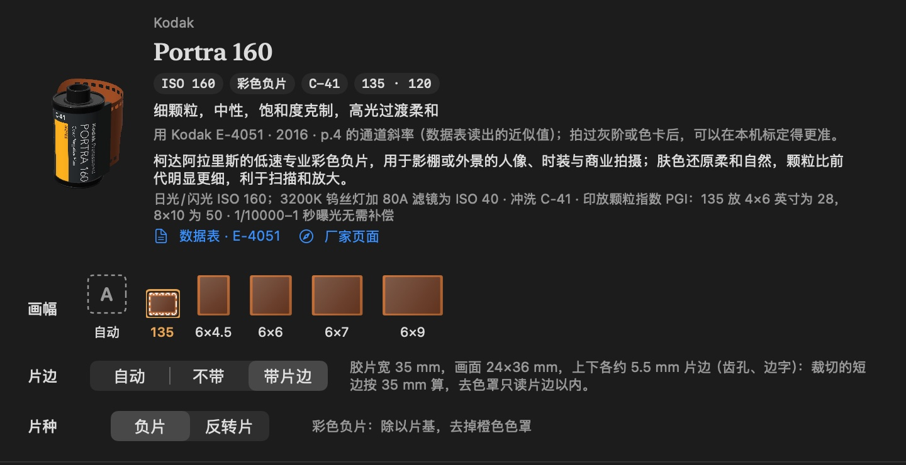<br><b>厂家资料、画幅和片边</b>：选中一款，下面是厂家怎么介绍它、数据表里的关键数据，以及数据表和厂家页面的链接。「片边」说照片里有没有拍进片边，尺寸按胶片的实际宽度算：135 为 35 mm，120 为 61.5 mm。</td>
</tr>
<tr>
<td valign="top">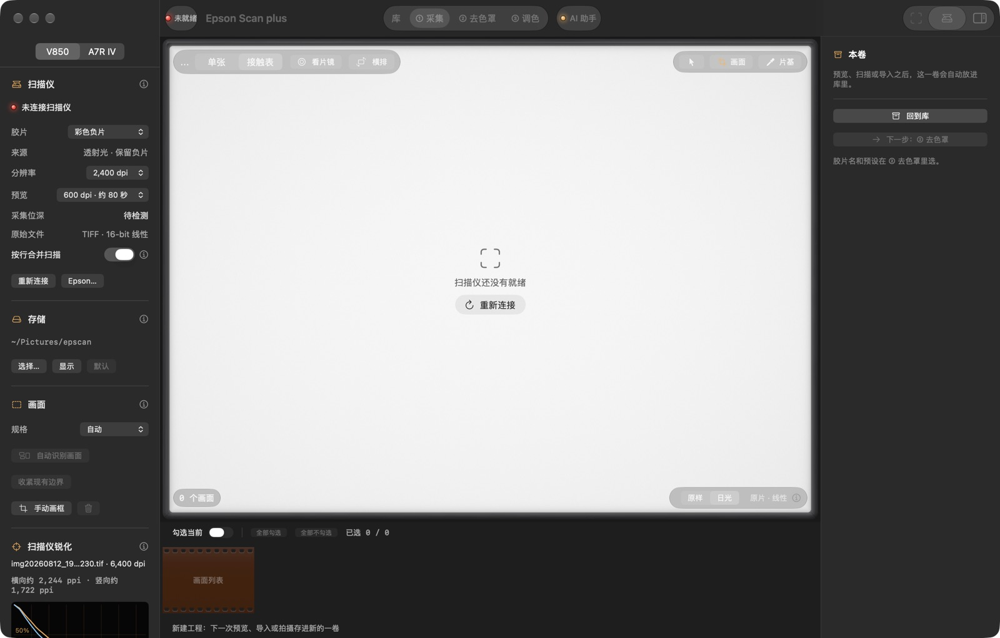<br><b>① V850 扫描</b>：片夹放好后先扫一张 48-bit 线性整幅预览，自动识别 135 和 120 的画面，按行合并扫描，扫完自动导出正片。</td>
<td valign="top">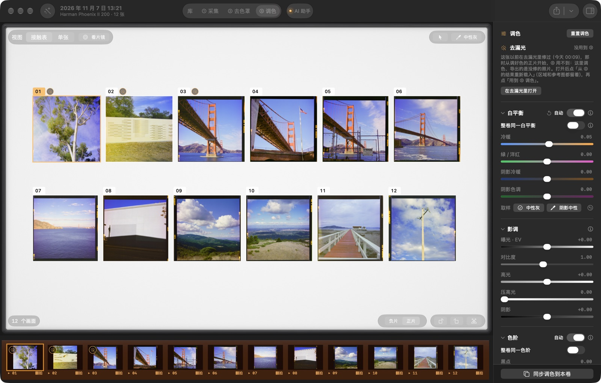<br><b>① A7R IV 翻拍</b>：直连相机的 PTP，支持 4 张或 16 张像素位移。翻拍的卷按画幅排在灯箱上，先去串色、再除以平场。</td>
</tr>
<tr>
<td valign="top">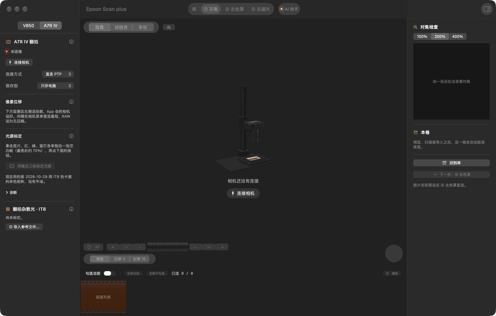<br><b>① A7R IV 等着实时取景</b>：照着作者的翻拍架做的 3D：带刻度的立柱、三维调平云台上镜头朝下的相机；光从片夹底下透上来，只有片窗亮着。</td>
<td valign="top">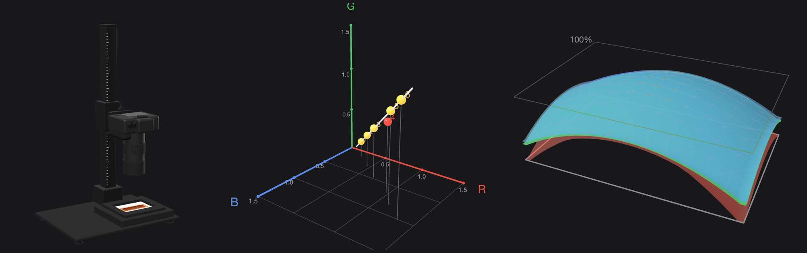<br><b>3D 看标定和平场</b>：标定的中性点放在红、绿、蓝密度组成的空间里，偏离中性轴 0.03 D 以上的点是红的；平场的三个通道各是一层曲面，三层分开的地方就是边上偏色。都能拖着转、用滚轮缩放。</td>
</tr>
<tr>
<td valign="top">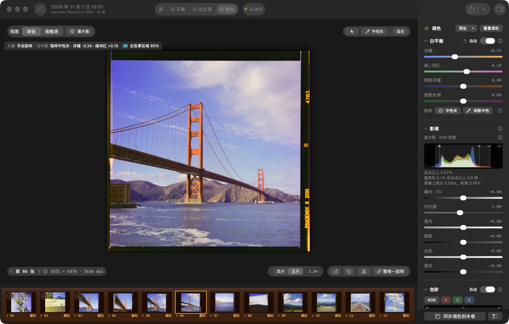<br><b>② 去色罩 → ③ 调色</b>：② 除以片基，按全卷斜率估计或本机标定的通道斜率拉齐三层反差，负片变成干净的正片；③ 在它上面调色，右栏按调色的顺序排：白平衡、影调、色阶、色彩，每一节都能单独复位。两步各管各的设置，重置、同步、粘贴互不串扰。</td>
<td valign="top">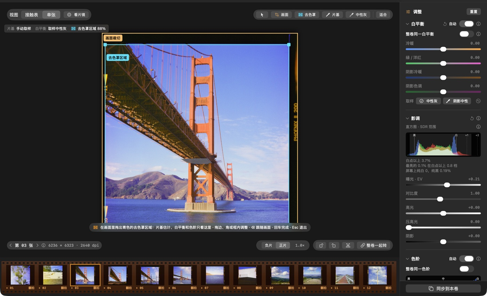<br><b>两种裁切</b>：琥珀色是显示和导出的画面，可以按比例（1:1、2:3、4:5、6:7……）裁，裁切时画三分线；青色是算片基、白平衡和色阶的地方，自动避开片边、边字和齿孔。</td>
</tr>
<tr>
<td valign="top">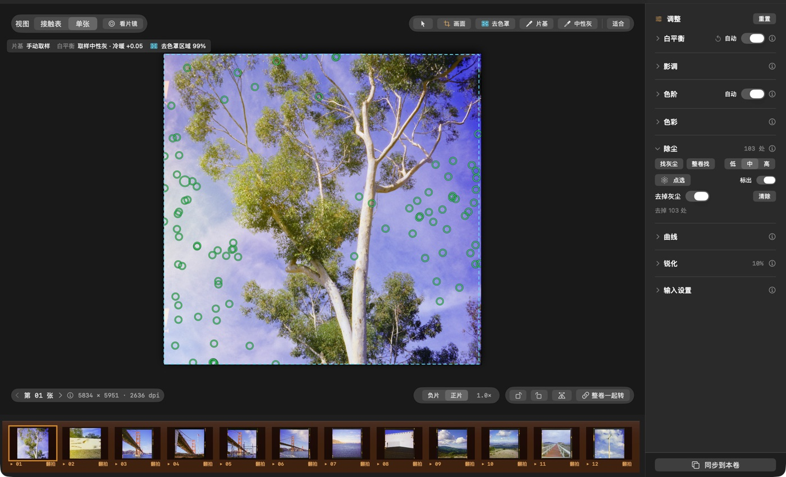<br><b>除尘</b>：在负片上找灰尘、毛发和纤维，用旁边的胶片补上，补的地方只会变亮。工具栏的「除尘标出」开关画出或隐藏这些圆圈。</td>
<td valign="top">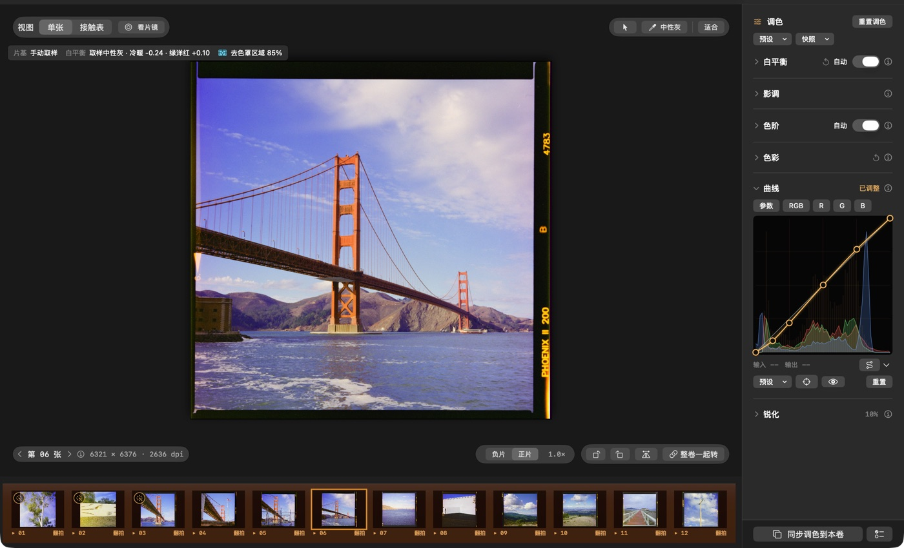<br><b>曲线</b>：和 Lightroom 一样的参数曲线和 RGB / 单通道点曲线，背后是正片的直方图；也能在照片上直接拖着调。</td>
</tr>
<tr>
<td valign="top">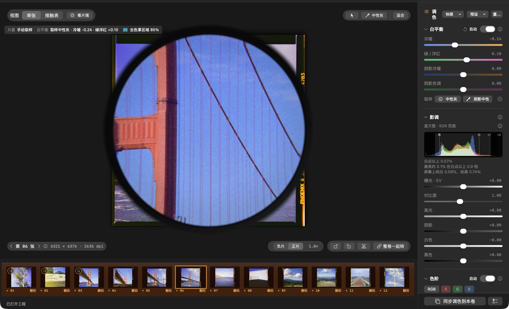<br><b>看片镜</b>：Pentax、Mamiya、Peak、Rodenstock、Schneider 式的 3D 看片镜，放在灯箱或单张上，按画幅算视场和放大倍率。</td>
<td valign="top">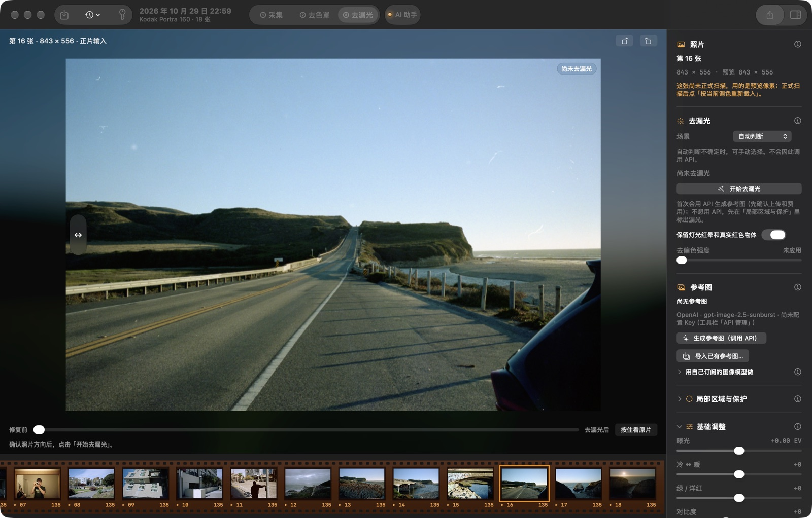<br><b>去漏光（② 的最后一步）</b>：用同一张照片的干净参考图，或手画的区域，修复红色 / 品红 / 黄色漏光；输出的像素都来自原片。修好以后「用到 ③ 调色」，在修好的照片上接着调色和导出。</td>
</tr>
<tr>
<td valign="top">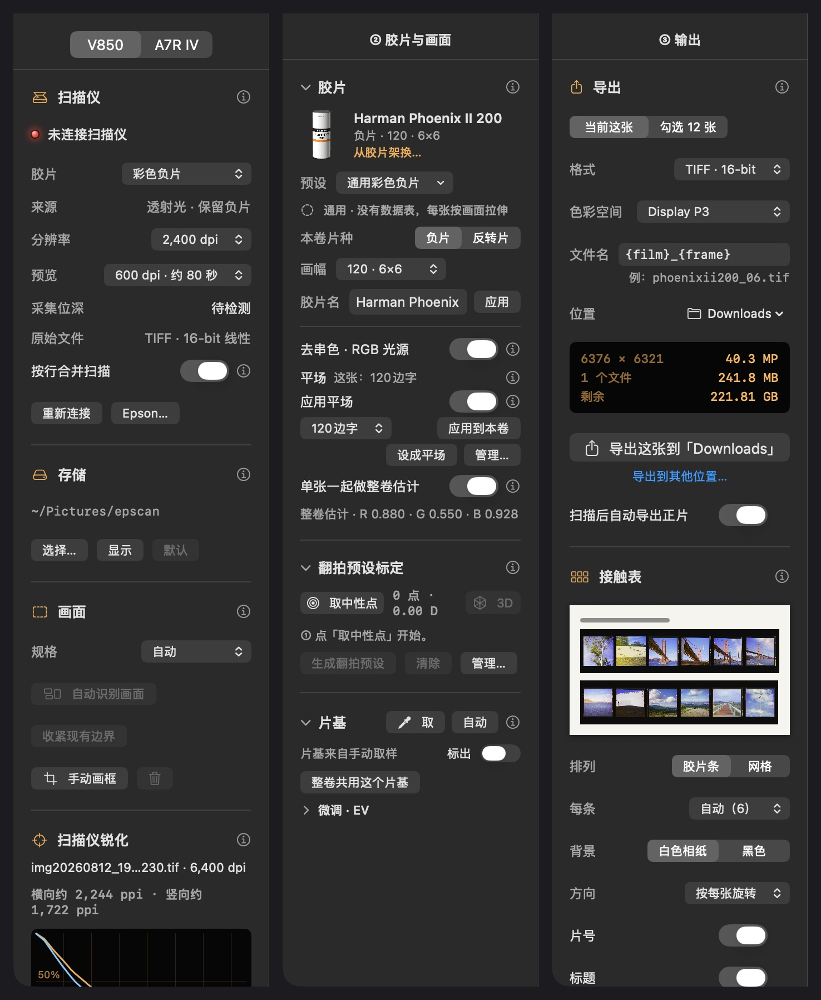<br><b>左栏</b>：① 扫描仪或相机的设置（相机的曝光读数是一块会亮的肩屏）；② 的胶片页（胶片、预设和它的标定、片基）；③ 的输出页（格式、尺寸、接触表）。</td>
<td valign="top">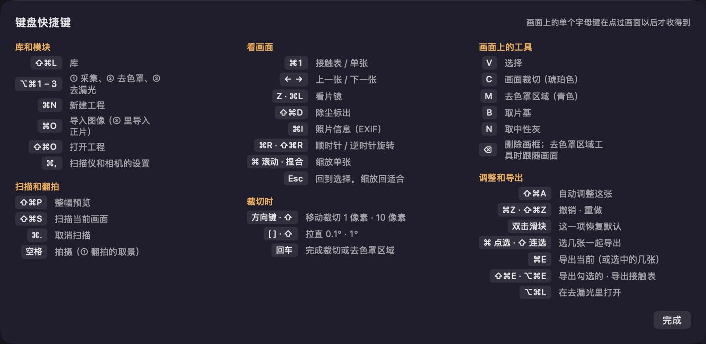<br><b>键盘快捷键</b>：⌘/ 打开一览，包括画面上不在菜单里的单个字母键。</td>
</tr>
</table>

## 操作演示

<table>
<tr>
<td colspan="2" valign="top">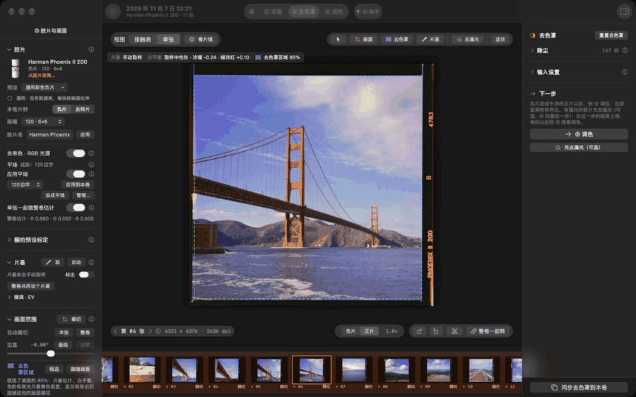<br><b>② 去色罩 → 去漏光 → ③ 调色</b>：在 ② 的画面工具栏点「去漏光」，顶栏写成「② 去色罩 › 去漏光」；画一个区域、点一处干净的天空修好，「用到 ③ 调色」以后就到 ③，在修好的照片上接着调色和导出（动画快放 2 倍）。</td>
</tr>
<tr>
<td width="50%" valign="top">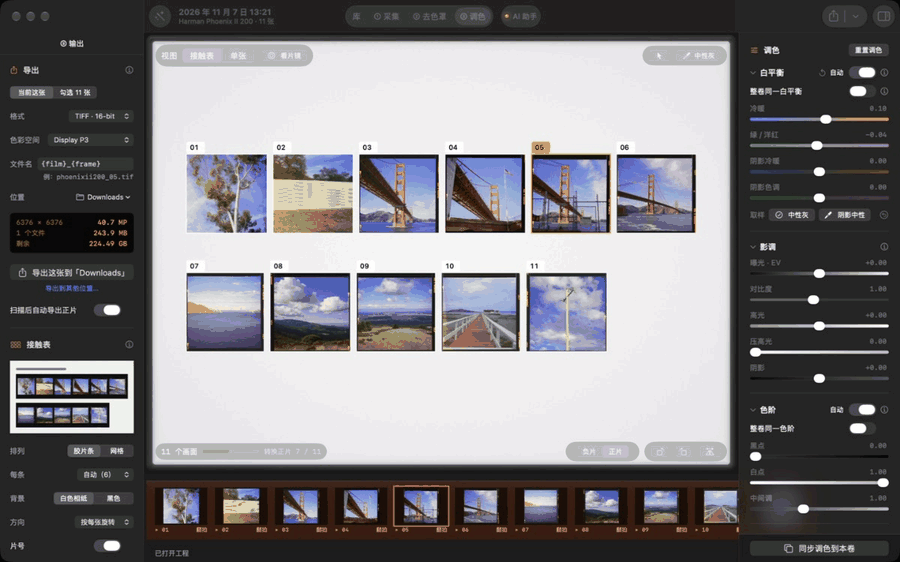<br><b>打开一张</b>：点灯箱上的一张，它从原位放大到单张视图；回灯箱时缩回它的格子里。</td>
<td width="50%" valign="top">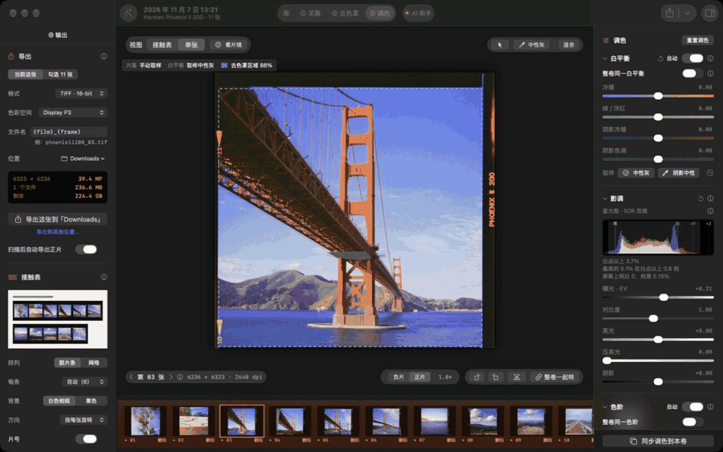<br><b>换张</b>：← → 或点胶片条，下一张从它所在的那一边滑进来。</td>
</tr>
<tr>
<td valign="top">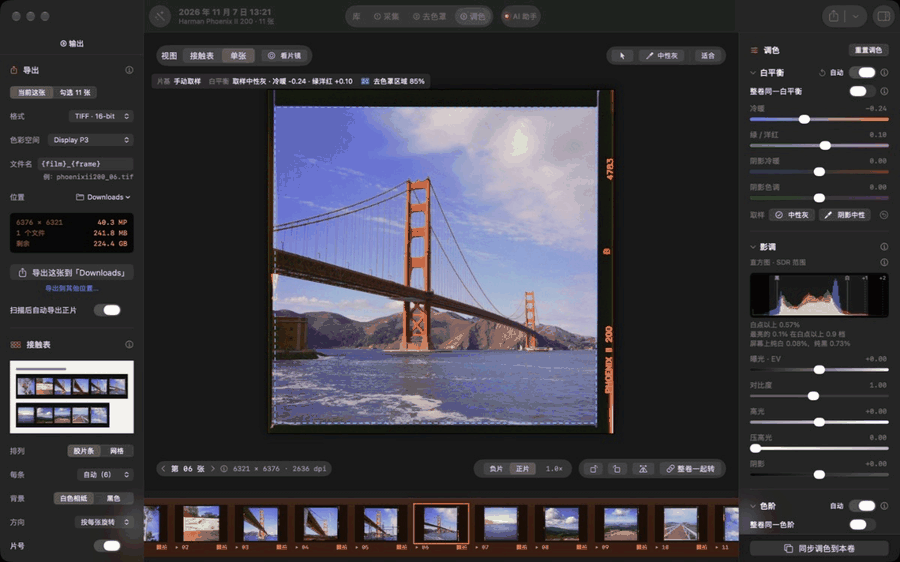<br><b>缩放</b>：双击照片放大到 3 倍，指着的地方不动；再双击或点「适合」，平滑缩回。</td>
<td valign="top">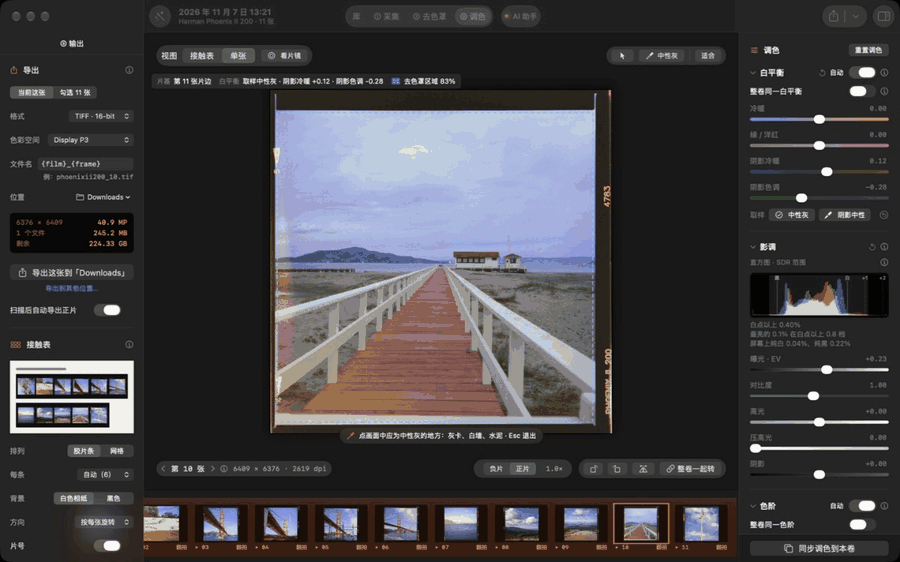<br><b>取中性灰</b>：按 N，在应该是灰的地方点一下（这里是栈桥的白栏杆），照片淡到新的白平衡。</td>
</tr>
<tr>
<td valign="top">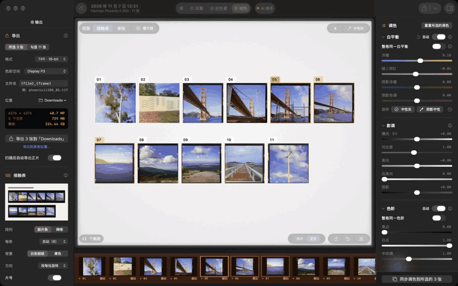<br><b>多选</b>：⌘ / ⇧ 点选几张后，旋转、镜像、勾选、删除、重置和同步都对所选的每一张起作用；灯箱上每张在自己的格子里转过去。打开「自动同步」，调显示的这张，所选的几张一起变；「选择性粘贴」（⌥⇧⌘V）一项项勾选要粘贴的设置；调好的一张能存成调色预设，一键套用到别的画面；「快照」记下一张现在的调色，换个调法以后一键回来。</td>
<td valign="top">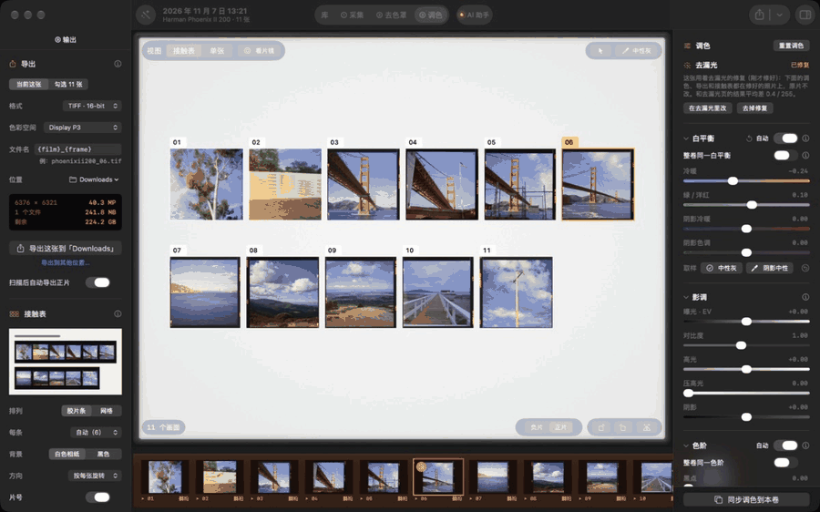<br><b>胶片架</b>：新建工程时用 ↑ ↓ 挑胶片，下面跟着换成这一款的暗盒或 120 卷、厂家资料和数据表。</td>
</tr>
<tr>
<td valign="top">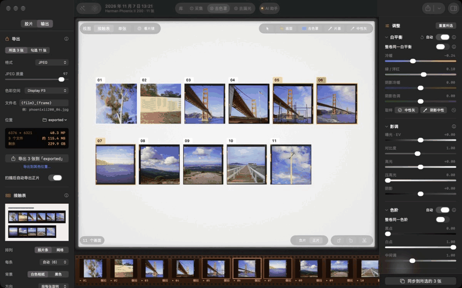<br><b>导出</b>：在「输出」里选导出哪些、放到哪里，看好多大，一个键直接导出；等着的、正在写的、导出过的和导出后又改过的，胶片条和灯箱上都标着（动画快放 2.5 倍）。</td>
<td valign="top">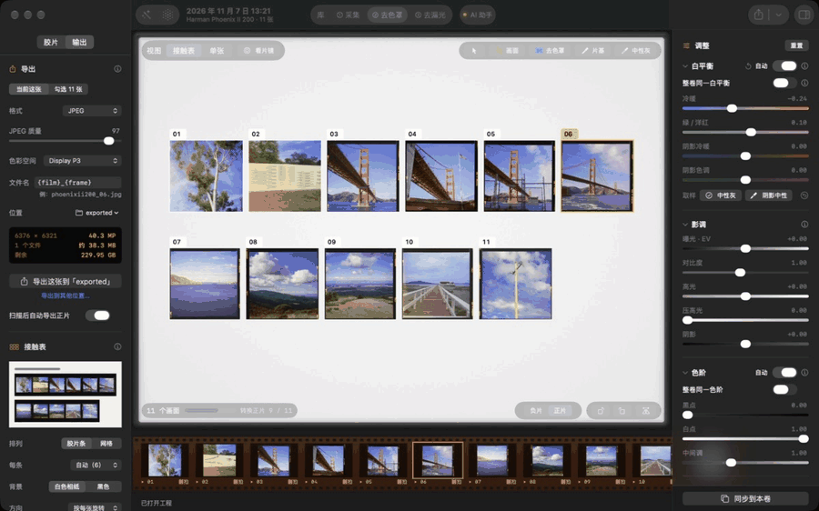<br><b>接触表</b>：改胶片条 / 网格、背景和每行几张时，「输出」里的小图先排给你看，各张滑到新的位置。</td>
</tr>
</table>

## 原理

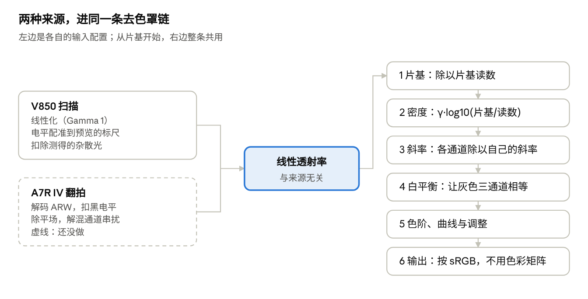

扫描和翻拍走同一条去色罩链。三个通道的斜率依次取本机标定的预设、全卷斜率估计和厂家数据表。详见[去色罩原理](doc/negative-conversion.md)，以及[胶片配置、转换与颜色](doc/film-and-color.md)。

**还能做的**
- 48-bit 线性采集：独立的 SANE 进程，绕过系统驱动的 24-bit 限制（[扫描仪接口](doc/scanner.md)）。
- 反转片：扫幻灯片和正片条，读数直接作画面。
- 调色像 Lightroom：参数曲线和点曲线（分通道、目标调整），曲线上取点和取中性点（像 Capture One），色阶直方图分通道看，裁切可以按比例（1:1、2:3、4:5、6:7……）并画三分线。
- 翻拍标定：在画面上点中性的东西，点够了就自动生成翻拍预设，点列成表、3D / 2D 图里看哪个点不在线上；胶片架上选了胶片就列出它的标定。
- 导出：TIFF 16 / 8-bit、PNG、JPEG，sRGB、P3、Adobe RGB、ProPhoto，嵌入 ICC 和胶片信息；可以按长边缩小（4000、3000、2048、1600、1080 像素）；接触表自动控制在 10 MB 以内，页头可以画上这卷胶片。
- AI 助手（MCP）：让 Claude 帮你看偏色、调整、做翻拍标定，每一步都能撤销（[AI 助手](doc/ai-assistant.md)）。

## 安装

- **要求**：Apple 芯片的 Mac，macOS 26 或更新；扫描用 Epson Perfection V800 / V850，翻拍用 Sony A7R IV（可选）。
- **安装**：打开 `Epson-Scan-plus-<版本>.dmg`，把 App 拖进「应用程序」。
- **更新**：App 自己检查更新，下载并核对签名，退出时换上；旧版本留在 `~/Library/Application Support/epscan/旧版/`。

## 快速开始

1. 在库里点「新建工程」，在胶片架上选胶片、画幅、片边和片种。
2. ① 采集：「预览」，画面自动框好。翻拍时直接拍。
3. ② 去色罩：看看片基和画面范围，左栏随时能换胶片；有漏光的照片点画面工具栏的「去漏光」。
4. ③ 调色（⌥⌘3）：调色，在左栏「③ 输出」里导出。
5. 扫描的卷回到 ①，「扫描所选」：扫完的正片自动导出到这一卷的 `Exports`。

窗口各部分、每一节检查器和快捷键，见[界面说明](doc/interface.md)和[键盘快捷键](doc/shortcuts.md)。

## 构建

```sh
bash build.sh
"../Epson Scan plus.app/Contents/MacOS/EpsonScanPlus" --self-test --test-output /tmp/EpsonScanPlus-tests
```

只需要 Xcode Command Line Tools，不用第三方 Swift 包。Sony 的 SDK 是可选的，不在这个仓库里。自检、发布、图标和 SDK 的放法见[构建与测试](doc/building-and-testing.md)。

## 文档

- [界面说明](doc/interface.md)：窗口、库、工程文件、单张视图、看片镜、裁切和拉直
- [键盘快捷键](doc/shortcuts.md) · [AI 助手（MCP）](doc/ai-assistant.md) · [去漏光](doc/light-leak.md)
- [去色罩原理](doc/negative-conversion.md) · [胶片配置、转换与颜色](doc/film-and-color.md) · [扫描仪接口](doc/scanner.md)
- [构建与测试](doc/building-and-testing.md) · [版本记录](doc/CHANGELOG.md) · [第三方组件与许可证](ThirdParty/README.md)

## 许可证

采集进程 `ScannerHelper/SaneCapture.mm` 以 GPL-2.0-only 发布；内置的 SANE epson2 后端为 GPL-2.0，libusb 为 LGPL-2.1 或更新，源码包见 `ThirdParty/Sources`。本项目其余代码尚未选定许可证。
