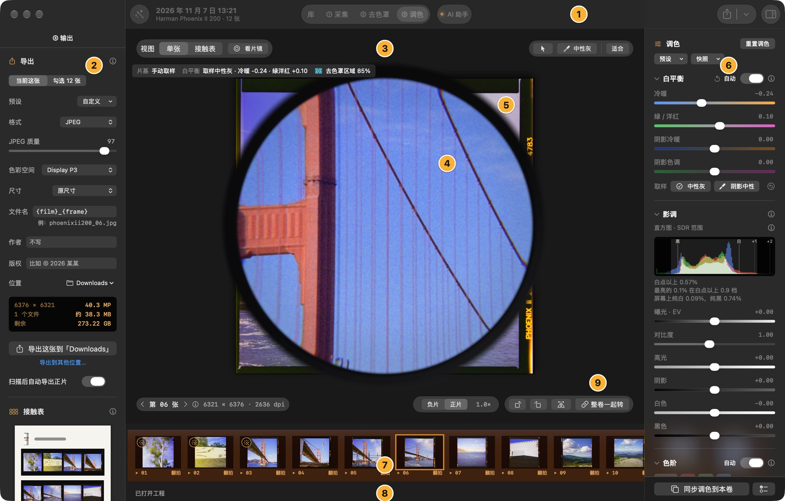
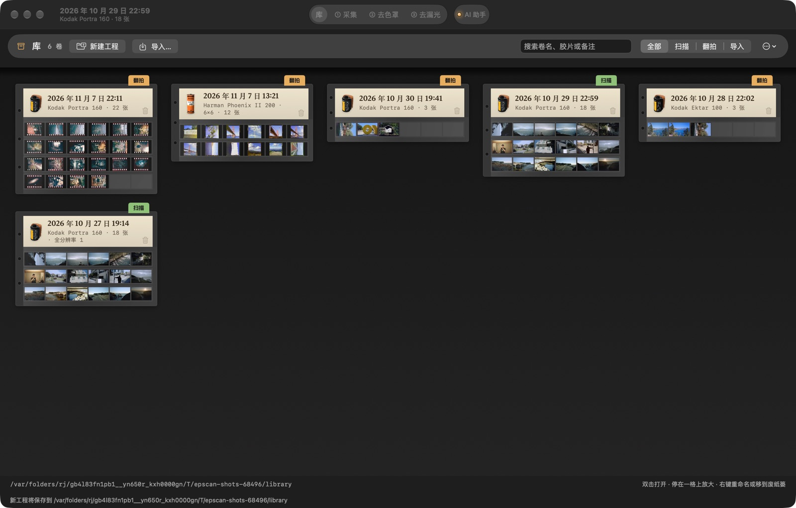
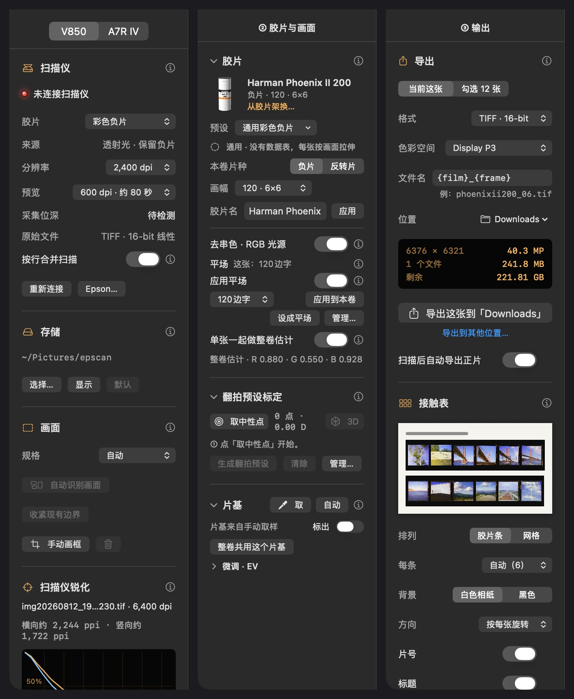
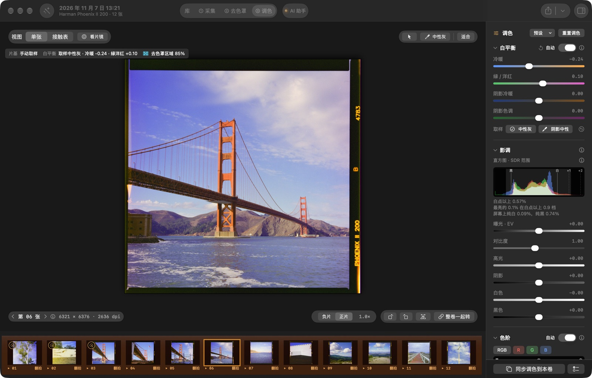
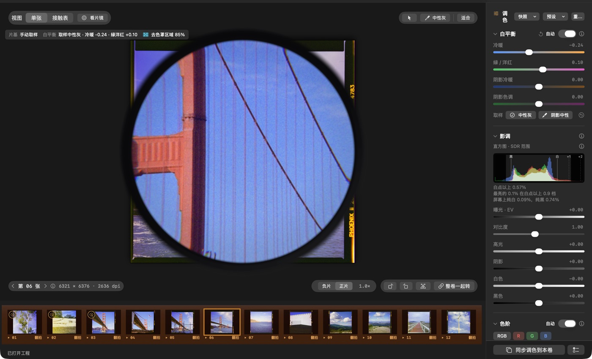

# 界面说明

[← 返回 README](../README.md)

窗口从上到下、从左到右的各个部分，以及单张视图、扫描头、看片镜、裁切和拉直的细节。快捷键见[键盘快捷键](shortcuts.md)。

## 一眼看全

| # | 区域 | 做什么 |
|---|---|---|
| 1 | 顶栏 | 库和模块切换（库 · ① 采集 · ② 去色罩 · ③ 去漏光）、本页的主要操作（预览、扫描、导出）、② 标题旁的「自动调整」「除尘标出」和 AI 助手 |
| 2 | 左侧面板 | ① 里是扫描仪或相机的设置；② 里是胶片和它的预设标定、片基和画面范围，以及导出设置，默认收起 |
| 3 | 工作区工具栏 | 接触表 / 单张、看片镜，以及选择、画面裁切、去色罩区域、取片基、中性灰几个工具 |
| 4 | 灯箱上的接触表 | 整幅预览或一页页的接触表，标出画框和编号 |
| 5 | 看片镜 | 放在画面上放大细看，接触表和单张都能用 |
| 6 | 右侧面板 | ① 里是这一卷的信息；② 里是检查器：白平衡、影调、色阶、色彩、除尘、曲线，底部是「同步到本卷」 |
| 7 | 勾选与胶片条 | 决定批量扫描和导出哪些画面 |
| 8 | 状态栏 | 当前操作和结果、扫描进度 |
| 9 | 接触表显示 | 全卷旋转、水平镜像，负片 / 正片 |

## 库

库是顶栏模块切换最左边的一页（⇧⌘L），App 打开时就在这里。一卷从这里开始：

- **新建工程**：先打开一个「胶片架」，问这一卷的胶片、片种（负片或反转片）和画幅（135、120 的 6×4.5 / 6×6 / 6×7 / 6×9，或自动），默认是上一次选的。架上有市面上常见的 100 种胶片和本机标定的预设，最上面一排是库里最近几卷用过的胶片，品牌、名字、感光度、片种（中文也行）都能搜，目录里没有的可以直接用输入的名字；① 采集、② 去色罩和 ③ 去漏光都按它来，之后在 ② 的「胶片」里也能改。翻拍时画幅决定画面在胶片上的大小，看片镜的视场和导出的 dpi 跟着它；选「自动」时翻拍照片的长边按 135 的 36 mm 算。然后打开着的这一卷存好留在库里，窗口清空，转到 ① 采集；下一次预览、拍摄或导入存进新的一卷，没用上的新工程不会在库里留下空卷。在别的页按 ⌘N 也是新建工程，但留在那一页。
- **打开一卷**：双击一页，或「…」菜单里的「从文件打开工程…」，转到 ② 去色罩（在 ① 按 ⇧⌘O 打开也转到 ②）。
- **导入…**：TIFF、PNG、JPEG 导成一卷导入的照片，相机 RAW（ARW 等）导成一卷翻拍，都复制进库，原文件不动；从库里导入后转到 ② 去色罩，在 ① 按 ⌘O 导入则留在 ①。

三样都还没做时，① 采集、② 去色罩、③ 去漏光点了也不会切过去。库是一个档案柜，每卷是一页底片保存页：

- **胶卷**：标签左边放着这一卷的胶片，和胶片架上画的一样：135 是暗盒，120 画幅是 120 卷，目录里没有的是写着名字的素罐。
- **标签**：顶上的纸标签写卷名（没起名时写开始的时间）、胶片、画幅、张数、已导出的张数；扫描卷只正式扫了一部分时，还写全分辨率的张数。
- **索引签**：右上角的索引签表示来源：扫描、翻拍或导入。旧版图库里的卷注明「旧版」。
- **画面**：透明袋里每条六格。打开过的卷显示 App 渲染的正片；其余的显示负片原样，带橙色色罩。竖放的画面横过来放，和灯箱上一样。
- **同一批底片叠成一摞**：同一卷胶片扫了几次（张数一样，前三张一样），这几卷叠在一起，只露最新的一卷，索引签上写着一共几卷，下面露出几页的边。右键「摊开同一批底片的 N 卷」单独看它们，页眉的「‹」回到整个库；「…」菜单里可以关掉叠放。判断用每卷前三张的差值哈希（画面缩成 9 × 8 的灰度，比较相邻两格的明暗），正片和负片也认得出是同一张；要三张都几乎一样才算同一批。
- **操作**：双击一页打开这一卷，进入 ② 去色罩。可以按卷名、胶片、备注搜索，也能按胶片是什么来找：厂家（富士、柯达）、片种（正片、黑白）、感光度或画幅（6×7），按来源筛选。右键可以重命名（写进那一卷的工程，留空回到开始的时间）、在 Finder 中显示或移到废纸篓（标签右下角的 🗑 也行，会先问一下）；工具栏的「废纸篓」把打开着的这一卷移到废纸篓，或在 Finder 里打开废纸篓，移走的卷在那里右键「放回原处」拿回来；「…」菜单里能从文件打开工程，或更改新卷的存放位置。

库直接读图库文件夹里的各卷，不在里面另写索引或别的文件。用默认图库时，0.4.8 及以前的 `~/Pictures/Film Desk/` 里的卷也会列出来。正片缩略图存在 `~/Library/Caches/local.epscan.mac/Rolls/`，删了不影响工程，下次打开那一卷时会重新生成。

## 工程文件

每次预览或导入都会在存储位置（默认 `~/Pictures/epscan/`；0.4.8 及以前默认 `~/Pictures/Film Desk/`，那里的旧工程原样保留，可用「打开工程」打开）新建一个「日期_编号」文件夹：

- `overview.tif`：整幅预览，不压缩（0.4.6 及以前为 `overview.png`）。
- `Originals/`：未反相、保留橙色色罩的原始负片，TIFF 16-bit 线性，用于存档和重新转换。
- `Exports/`：自动导出的正片，每张附带转换参数 JSON。
- `Session.epscan`：自动保存的工程，也记着卷名和备注（没填时不写）。0.4.8 及以前的工程叫 `Session.filmdesk`，照样能打开，并存回原文件。

整个文件夹可以搬移或改名：工程同时按相对路径记录文件，打开时按文件夹的新位置读取（0.4.8 起；更早的工程搬移后也会按文件名找回）。

## 窗口各区域

1. **顶栏**：系统的窗口工具栏，是液态玻璃；放不下时，多出来的收进右端的溢出菜单。
   - 左侧：侧栏开关；扫描仪指示灯（只在 ① 采集选 V850 时，或扫描仪工作时显示：绿色就绪，琥珀色闪烁表示工作中，红色未就绪）。
   - 标题是打开的这一卷：卷名（没起名时是开始的时间），下面一行是胶片和张数。
   - ② 去色罩里标题前是魔术棒「自动调整」（⇧⌘A，也在「画面」菜单里）：按选中这张自己的画面，白平衡和色阶回到自动，再定曝光和阴影冷暖；对比度、饱和度、曲线等不动。只在本机计算，⌘Z 撤销。原来这里的「去漏光」在「画面 > 在去漏光里打开」（⌥⌘L）和胶片条的右键菜单里。
   - 中间：分段按钮，最左边是库（⇧⌘L），后面是模块 ① 采集、② 去色罩、③ 去漏光（⌥⌘1–3）。App 打开时在库里；先在库里新建工程、打开一卷或导入照片，之后才能切到 ① ② ③。
   - 新建工程（⌘N）先打开「胶片架」：上面搜索；中间按厂家排着常见胶片（135 暗盒或 120 卷，随所选画幅；暗盒照各款实物的印刷画）；选中一款，下面有厂家怎么介绍它、数据表里的几项数据，以及「数据表」「厂家页面」链接。画幅下面的「片边」说照片里拍没拍进片边（自动 / 不带 / 带片边）：带片边时横过胶片的一边按胶片宽度（135 为 35 mm，120 为 61.5 mm）算尺寸，不带时不找片边，最上面一排「最近用过」是库里最近几卷的胶片（最多 6 个，最新的在前；按那一卷的画幅画，点它画幅也一起换），然后是本机标定的预设；下面是选中的胶片（感光度、片种、冲洗、画幅、特点和 App 怎样转换它）、按比例画的画幅和片种。↑↓ 在架上一卷一卷地选（架子跟着滚），回车开始（选中的不在搜到的里面时，回车先选第一个搜到的）；双击一卷或点「开始」也行，Esc 取消。② 去色罩「胶片」一节最上面是这一卷的胶片，点它打开同一个胶片架，「换上」后胶片、片种和画幅一起换。
   - 中间模块旁边是 AI 助手：一盏灯（已连接绿、等待连接琥珀、关闭暗）和名字，状态写在提示里。
   - 右侧：本页的主要操作，最右是检查器（右栏）开关。
   - ① 采集里来源选 V850 时，右侧有「预览」和「扫描所选 N」：前者做整幅预览，后者依次扫描勾选的画面，两张以上时先确认张数、分辨率、预计用时和占用空间。预览和扫描时，画面列表下面的状态栏右端显示进度和「取消」。
   - ② 去色罩里右侧有「导出」：点一下导出当前这张（⌘E）；点箭头导出勾选的画面、接触表，或打开「导出设置…」。选文件夹的窗口从上次导出到的文件夹打开（它在卷以外时；否则从这一卷的 Exports 打开）。
2. **左侧面板**：系统侧栏，可以拖宽窄，也可以用顶栏的开关收起。① 采集里顶上是来源（V850 / A7R IV）。② 去色罩里默认收起，把地方让给画面；里面是「胶片 / 输出」两页（见下文），默认在「胶片」页（胶片、预设标定、片基、画面范围）；用顶栏的侧栏开关打开，或在胶片菜单里选「本机预设标定…」（翻拍的卷是「翻拍预设标定…」）、开始取中性点、在「导出」菜单里选「导出设置…」，它会自己打开到那里。各节的详细说明在标题右侧的「ⓘ」里。
3. **工作区工具栏**：
   - 「接触表 / 单张」切换视图；「看片镜」（Z）点一下把看片镜放到画面上，再点一下收起；「横排」把竖放的片夹横过来摆在灯箱上（默认打开；翻拍和导入的卷按页排，没有片夹，不显示）。
   - 工具依次为选择（V）、画框（C，手动添加画面）、片基（B，实心吸管，取未曝光的片基）、中性灰（N，空心吸管，取画面中的灰色，按它自动白平衡；取样时鼠标变成滴管，尖端就是取样点）；看片镜开着时，取样工具点在镜片上就按镜片里放大的那一点取样；「适合」复位缩放。
   - 选中工具后，画面底部有一行操作说明；按 Esc 退出工具。取 IT8 色卡或标定用的中性点时，⌫ 撤回上一个点，不会删掉画面。
   - **画面下方**：左边是「‹ 第 N 张 ›」（接触表上是张数）和这张的尺寸，窗口窄时省掉尺寸。打开一卷时张数旁边有进度条：第一次打开大卷时先「读取原图 n / N」，再「转换正片 n / N」；先显示的是库里存着的小图，转好一张换一张。① 采集里右边是「原样 / 日光」、曝光指示和片基偏色（带色块：左半片基在日光白平衡下的颜色，右半一样亮的中性灰）。默认日光：按日光白平衡显示，和相机的取景、C1 一样，用来检查窄带灯的配比：片基是中性灰、色块两半一样，灯就配对了。原样是传感器读到的，没有白平衡，偏绿。两样都只为显示，存下的数据和读数都不变。A7R IV 那一页右栏的上一张直方图下面，也写这一张的片基偏色。② 去色罩里右边两组：「负片 / 正片」和缩放倍率（接触表上只有「负片 / 正片」，和单张是同一个选择，换视图时不变）；左右旋转、水平镜像和「整卷一起转」（接触表上作用于整卷）。
4. **灯箱上的接触表**：整幅预览放在乳白灯箱上，每张标出画框和编号。竖放的片夹默认横过来显示，胶片条横向排开：方向跟随多数画面的旋转，都没有旋转时顺时针转，横拍的画面正立，每条从右往左读（01 在第一条右端）。点一下画面，或在下方胶片条点一下，视角就推近到这张：整张灯箱跟着放大，这张移到画面中央，周围的画面移出画面，灯箱淡去后就是单张（系统式的弹簧动画，约半秒；打开「减弱动态效果」时改为淡入）。点「单张」或按 ⌘1 时也一样。预览边扫边显示时不能切到单张，扫完后照常。
   - **其他动画**：都用系统式的弹簧或渐变；打开「减弱动态效果」时都改为短暂的淡入淡出。
     - 回接触表时视角拉远：画面缩回它在灯箱上的位置，整卷回到眼前。
     - 单张里换下一张，画面从它所在的那一侧滑进来；胶片条跟着滚到所选的一张，让它在中间。
     - 「负片 / 正片」切换时交叉淡化；正式扫描完成，预览换成全分辨率时也淡入。
     - 旋转时画面转过 90°，镜像时画面侧过来再翻成镜像。不用等新画面算好，点下去马上开始转。
     - 进入裁切时画面缩进它的周边，裁切框落在原来的位置；确定裁切后，裁切范围放大填满画面。
     - 预览识别出画面或打开一卷时，画框一个接一个落到各自的画面上。接触表上不能拖动或缩放画框，画面范围在单张里用裁切工具调；漏识别的画面可用画框工具在接触表上补画。接触表不缩放，始终显示整卷；细看用看片镜，或进入单张后按住 ⌘ 滚动、双指捏合缩放；单张里双击照片放大 3 倍看那一点，再双击回到适合，「适合」和双击都是平滑地缩过去。
   - **接触表页**：一张一个文件的画面（翻拍、导入）像冲印的接触表一样排在灯箱上，每条 6 张、每页 6 条，片边印着编号。每格跟着画面的形状：转成竖幅的照片是一个和横幅等高的窄格，比 3:2 更宽的画面是同宽、矮一些的格子，四周都不留黑边。只有一页、又不满 6 张时，页面按实际张数定宽，在灯箱上放大显示，不缩在一页的角上。排满 36 张后下一页在右边：在灯箱上左右滑动，或用下方的「‹ 第 N / M 页 ›」翻页，整页推过去。选中别页的画面会翻到那一页；按 ← → 换到上一张 / 下一张，到了下一页的第一张就翻过去。扫描的卷是片夹的整幅预览，另外导入的单张排在后面几页。看片镜在接触表页上按 135 画面的大小放大，视场装下一整格。
5. **看片镜**：点「看片镜」或按 Z，它出现在所选画面上（单张视图中在画面中央），再点一下收起；灯箱不为它留空位，胶片占满玻璃。默认像眼睛贴在目镜上看：镜片放大成一个大圆（单张视图中大视场刚好和照片一样宽），外面一圈细细的黑色目镜边框，再往外仍是灯箱；拖动细看，拖动途中一直保持对焦和放大。灯箱上镜片和真的看片镜一样装下整格：5.5×、4× 和 Peak 8× 装下 24 × 36 mm 的 135 画面，Rodenstock 3× 装下 6 × 6；Schneider 10× 只看约 24 mm 的一块，用来查焦点和颗粒；换大、中、小视场只改变镜片的大小和看到的范围，放大倍数不变（按大视场装下整格时的倍数，不会比灯箱上更小）。镜片边缘有轻微的枕形畸变（按真实看片镜估计：Pentax 边缘约 3%，Peak 8× 约 2.5%，4× 约 2%，Rodenstock 3× 约 1.5%，Schneider 10× 约 1%）和轻微色散（红蓝在边缘差约 1%）；镜片上不画反光，只看到胶片。右键可换「大 / 中 / 小视场」或「实物大小」（按胶片比例放在灯箱上，从远处看）。镜片里是这张画面自己的像素：灯箱上是正式扫描或预览的全分辨率，单张视图中是全分辨率的这一张，倍率不超过像素能撑起的程度（至少 2×）；① 采集看相机照片时，镜片里和灯箱上一样按「日光」或「原样」显示。翻拍的照片按这一卷的画幅算画面在胶片上的大小（6×6 的画面 56 mm 宽），镜片看到的范围和真的看片镜放在那张底片上一样；画幅选「自动」时按 135 的 36 mm 算。右键还可选择型号、移到所选画面中央或收起。
   - **外观**：整个界面用系统的控件和材质。按钮、开关（系统开关）、滑块（系统滑块，双击回到默认值；旁边的数值点一下可以直接输入，回车或点别处生效，Esc 取消，超出滑块范围的按两端算）、分段按钮都是系统的，读数是等宽数字。工具栏、侧栏和检查器是系统的液态玻璃，灯箱和取景画面上浮着的工具条也是液态玻璃。工作区、画面列表和状态栏是同一个底面，中间不再有分隔线和色带。
   - **动画**：换模块时侧栏和检查器滑开、页面淡入淡出；左栏的分页淡入淡出；看片镜从略高处落到灯箱上，收起时抬起淡出；自动调整、重置、撤销、取中性灰、换胶片预设和曲线的预设 / 重置之后，新画面淡入，曲线也平滑地变过去（换通道时底色淡入淡出），自动调整和重置调整时右栏的滑块滑到新的数值；拖滑块时画面直接跟手，不淡入。快速切换时动画跟得上：连续翻照片或翻页比一张滑进来还快时，每张改成很短的淡入；换到的那张还在渲染时，先用胶片条里它的小图滑进来，清晰的渲染好后再淡入替换，按住 ← → 也能看到每一张；刚打开一张就回接触表，打开的动画原路缩回，缩回途中再打开就从那里放大；转到一半再按旋转，从当前角度接着转；接触表上按 ← → 换选中的照片时，琥珀色的选中框滑到下一张（换页时整页推过去）。系统设置里打开「减少动态效果」时，缩放和看片镜直接到位，其余换成短的淡入淡出。
6. **右侧面板**：系统检查器，可以拖宽窄，也可以用顶栏右端的开关收起。① 采集里是「本卷」（翻拍时上面是对焦检查），可以填卷名和备注（相机、镜头、冲洗等），会存进工程，库里也会显示；还有画面数、文件夹、「回到库」和「下一步：② 去色罩」。② 去色罩里是调整面板，从白平衡开始按调一张的顺序排；胶片、片基、画面范围在左栏的「胶片」页（下面一起说明）。每一节点标题就能收起或展开，下次打开还是你留下的样子，常用的几节在第一屏（各节的说明在「ⓘ」里）：
   - **胶片**：预设菜单，先列这一卷胶片的预设（数据表的、在这台扫描仪或翻拍时为它标定的），别的胶片的在「其他胶片的预设」里，选了那里的，这一卷也换成那种胶片；以及「管理预设…」「配置与技术文档…」「本机 / 翻拍预设标定…」。胶片名只是胶片，不随预设改名（库里也显示）；改成另一种胶片后回车或点「应用」，预设跟着换成它的：这次翻拍或这台扫描仪标定过的先用，否则用数据表；胶片名没改时预设不动。从胶片架换胶片也一样。下面是这一卷的开关，按起作用的先后排成一列，开关对齐、各带 ⓘ：卷里有从传感器读出的翻拍时有「去串色 · RGB 光源」；用着标定出来的预设时有「用翻拍标定」或「用本机标定」；一张一个文件的卷有「单张一起做整卷估计」。最下面一行转换依据：斜率来自标定、整卷估计还是数据表，全文在 ⓘ 里。
   - **片基**：一行写明片基来自哪里，「取」和「自动」在标题右边；「整卷共用这个片基」把这一张取的片基用于整卷（片间测不到片基的翻拍或单张导入的卷）；「微调 · EV」默认收起。
     - **翻拍和单张照片自动从片边取片基**：在画框外面的未曝光片边和片间取，不取画面里的暗部（先找画框的边，只取线外面）。每张用自己片边的；看不到片边的用最近一张看得到的。调整面板里写明片基来自哪里，打开「标出」在单张上看取的是哪里。取片基时，自动找到的片基也会标出来。
     - **自己取片基**：点「取」（或工具条的片基、B）再点片边或片间。手动取的优先，取的位置在「标出」里画成一个圈；点「自动」回到片边测量。
   - **画面范围**（单张视图，默认收起，裁切时自动展开）：标题旁是「裁切」键，和画面上方工具条里的裁切一样，裁切时亮着，再按一次结束；翻拍的照片里面有「自动裁切」的「本张」「整卷」；拉直和画线、裁切的四边微调与还原。
   - **白平衡**：自动、冷暖、绿 / 洋红、只动暗部的阴影冷暖和阴影色调；「取样」里是中性灰滴管，取过的打勾，画面上方的工具条里也有（N），旁边的「阴影中性」点阴影里应为灰色的地方，按它设定阴影冷暖和阴影色调；取过点以后旁边出现 ⟲（清除取样），放弃取样点、回到自动（反转片回到片子本来的颜色）。之后是**影调**、**色阶**（自动、黑点、白点、中间调）和**色彩**。
   - 整卷同一白平衡、整卷同一色阶（两个开关，默认关）：像冲印店印一卷，按整卷所有画面一起统计。
   - 「同步到本卷」固定在检查器底部，检查器怎么滚都在：把这一张的调整用到本卷每一张。
   - 白平衡、影调、色阶、色彩调过时，标题旁出现 ⟲：只把这一节恢复默认（反转片回到片子本来的颜色，翻拍照片的色彩降噪回到 1），别的不动；顶上的「重置」恢复整张。
     - **同一白平衡**：卷里每张的颜色一致，不再各自按自己的暗部配平；每张的明暗照旧。
     - **同一色阶**：整卷一组黑白两端，暗的场景就是暗的；每张可以用曝光微调。
     - **按自己的来**：哪一张取了中性灰、高光，或关了自动，那一张按你的来。
     - **注意**：中途调过翻拍灯的卷，前后两段不该共用一个白平衡。
   - 影调（曝光、对比度、高光、阴影：只提亮或压暗亮部、暗部，黑白两端不动；压高光：亮部连同白一起往下压，颜色不变）、色彩（饱和度、色彩降噪、柔和的暗部和高光）。
   - 默认收起的几节：**曲线**（和 Lightroom 一样：「参数」是阴影、暗部、亮部、高光四段影调的滑块，在曲线上按住上下拖也行，曲线下的三角移动分界；RGB 与红、绿、蓝是点曲线，都画出来，正在编辑的在最上层，两端可以横向拖来截黑截白，拖出框外删点，「预设」有线性、中对比、强对比；单个通道的底色上方是它加的颜色、下方是相反的颜色。背后是正片的红、绿、蓝直方图，按曲线之前的值统计，和横轴一致。光标停在单张照片上时，曲线上标出那里的颜色：每个通道一条竖线、曲线上一个点，左上角是曲线前后的值，0–255；光标离开照片后标记变暗留着，换一张时清掉。右上的准星是目标调整：在照片上按住要调的地方上下拖，调它在当前曲线上的那一段；眼睛暂时不加曲线看照片，只影响显示，标题旁写「暂不显示」。改过时标题旁写「已调整」）、**锐化**（标题旁是强度；扫描按扫描仪测出的配置，翻拍按相机的配置，默认强度按合成方式和放大倍率：单张 20%、4 张 30%、16 张 40%，低于约 0.55 倍再少 10%，下面一行写着用的哪份配置和默认值）、**输入设置**（「负片去色罩 / 反相」开关和输入 Gamma；关掉反相时标题旁写「不反相」）。
   - **除尘**（默认收起，在「色彩」和「曲线」之间）：只用于 16 位的负片。原理见[除尘](negative-conversion.md#除尘)。
     - 「找灰尘」在这一张上按全分辨率找，「整卷找」找本卷每一张，一张翻拍不到一秒。旁边的「低 / 中 / 高」是灵敏度：高找得多，也更容易把画面里的小亮点当成灰尘。
     - 找到以后有「去掉灰尘」开关和「清除」，下面一行写去掉几处、留下几处、手动标了几处；标题旁写去掉的处数，关着时写「关」。
     - 「标出」（默认开）在单张上用圆圈标出每一处：绿色实线是去掉的，白色虚线是留下的。它和工具栏魔棒旁边的「除尘标出」、「画面」菜单里的「除尘标出」（⇧⌘D）是同一个开关，关掉后单张上不画圆圈，退出后也记得。
     - 「点选」（工具，单张里用）：点一处没找到的灰尘，在点的地方找出它的形状去掉，边缘软的大团（落在片基一面的灰尘）整团去掉；什么也找不到时去掉一个小圆点，但点在两种胶片的交界上（比如雕塑和天空之间）时不补，状态栏会提示点在灰尘的正中。点已标出的圆圈，去掉的改成留下、留下的改成去掉，手动标的撤掉。Esc 退出。
     - 再找一次时，手动标的保留，点了留下的、又找到的那一处还是留下。所有改动都能 ⌘Z 撤销，存在工程里。
   - **直方图 · SDR 范围**（单张视图里，在「影调」下面）：按印放曝光画的直方图，比屏幕能显示的宽。
     - 竖线是色阶的黑点和白点，「+1」「+2」是白点以上一档、两档。
     - 亮的一段是普通（SDR）屏幕上有层次的范围，按这张的两端、中间调和曲线算出；两边暗下去的部分在屏幕上已是纯黑或纯白。
     - 下面写着白点以上占多少、最亮的 0.1% 在白点以上几档，以及屏幕上纯白、纯黑各占多少。纯白、纯黑按显示的这张实际的像素数，色彩降噪也算在内。
     - 按整张每个像素计数，纵向按平方根画，少量的高光也看得见。
   - **色彩降噪**：只平滑颜色、不动明度，传感器和去串色带来的彩色噪点（尤其蓝黄）去掉，胶片颗粒的明暗保留。翻拍的照片默认 1，扫描默认关。缩小看的预览按比例减弱，因为噪点已经被平均掉了。
   - **柔和的暗部和高光**（默认开）：
     - **暗部**：最暗的地方不硬切成纯黑，而是平滑地压下去，暗部各通道的差别和颜色因此留着，并略补暗部的饱和度。
     - **高光**：最亮的地方用柔和的肩部收向白，近白处干净。
       - 高光超出白点较多的画面，肩部按这张最亮的 0.1% 伸长，最多到白点以上两档。阳光下的白边、亮云在 SDR 屏上也留着层次。
       - 加了饱和度的亮颜色也一起收向白，蓝天不会截掉一个通道。
       - 「高光」往负调时肩部伸得更远。
       - 中间段不变。
     - 关掉就是原来的直切。
   - 「重置」把这张的调整恢复默认，输入 Gamma、方向和整卷估计保留。
7. **勾选与胶片条**：勾选决定批量扫描和导出哪些画面。① 采集里胶片条上方是「勾选当前 / 全部勾选 / 全部不勾选」；② 去色罩里这一行不占地方，用胶片条的右键菜单，或「画面」菜单的「勾选当前画面 / 全部勾选 / 全部不勾选」；③ 去漏光有自己的导出，那里不勾选。胶片条带齿孔和片边编号；当前这张有橙色边框，没勾选的变暗。右键某一张可以勾选或取消勾选、导出这张。按住 ⌘ 点选、⇧ 连选几张（胶片条或接触表上都行，当前显示的这张不变，其余用淡一些的框标出），右键其中一张「导出所选的 N 张…」；左栏「输出」页、工具栏「导出」菜单和 ⌘E 在选了几张时也导出这几张。普通点一下或换一张就回到一张。在接触表上点胶片条里的一张，视角推近到它、进入单张；在单张里点则换成那一张。右键某一张可以删除它（⌘Z 撤销）。
8. **状态栏**：当前操作和结果（批量扫描时 Dock 图标上也有扫完几张 / 共几张，扫完时 App 在后面的话图标跳一下）。每次变化后显示几秒再收起；扫描、导出或有新版本时一直显示。导出完成后后面有「在 Finder 中显示」，选中这次导出的文件；这条显示 20 秒。
9. **接触表显示**：全卷逆时针 / 顺时针旋转、全卷水平镜像（不管「整卷一起转」是否打开，都作用于整卷）；「负片 / 正片」切换显示未反相的负片，或按各张调整得到的正片。多数画面镜像时，灯箱上的胶片也镜像显示。

## 左侧面板

- **① 采集 · V850 扫描**：
  - 扫描仪状态与采集位深、正式扫描分辨率、预览分辨率、原始文件格式；「按行合并扫描」把片夹里并排的几张一次扫完（更快时才合并），再分成每张的原始文件。
  - 每张正式扫描都和预览配准，换算到预览的标尺，整卷颜色一致（原理见[扫描仪接口](scanner.md)）。
  - 存储位置与当前工程。
  - 画面识别：规格、重新识别、收紧现有边界、手动画框。
  - 扫描仪锐化：导入分辨率标靶扫描，测量 MTF 生成锐化配置。
  - 扫描仪标定：用 IT8.7/1 透射色卡测量杂散光，转换前扣除。
- **① 采集 · A7R IV 翻拍**：默认直连相机自己的 PTP（和 Imaging Edge 一样，经 macOS 的图像捕捉），也可以在左栏的「连接方式」改用 Sony Camera Remote SDK。A7R IV 只能用 USB，相机的 USB 连接方式要选「PC 遥控」。直连在 App 另起的进程里，断开时它就退出，别的程序才能用相机。
  - **左栏**：连接方式（没连着时）、连接、电量、快门 / 光圈 / ISO / 曝光补偿（列出相机给的可选值）、白平衡和色温（100K 一档；RAW 不受它影响，只改取景和 JPEG 的颜色）、AF-S / MF、对焦区域、文件格式、保存到（只存电脑，或电脑和存储卡；连接前后都能改，下次连接照这里设定），以及能复制的诊断日志。
  - **深色和浅色**：整个 App 跟随系统的外观设置，每一页都可以是深色或浅色，切换页面不会变色。翻拍页窗口底下垫着模糊的实时取景，深色时压成深灰，浅色时提成浅灰。
  - **中间是实时取景，或拍好的照片**：左上角「取景 | 接触表 | 单张」切换，接触表和单张和扫描仪的一样（⌘1）。取景时点画面移动对焦点（对焦区域要是「自由点」）。取景画面上不放看片镜。用相机自己的对焦放大（A7R IV 是 5.9× 和 11.9×）在对焦点看传感器的真实像素，放大跟着对焦点走，切换对焦模式后会自动恢复。上方显示对焦框里三个通道的清晰度。在 macOS 26 上，上下的控制条浮在取景画面上，是液态玻璃。
  - **下方是对焦和拍摄**：
    - 「AF」在对焦框处自动对焦一次并锁住焦点。相机提供 MF 时，对完切到 MF。不提供时（A7R IV 配 Sigma 70mm 微距，镜头开关在 AF），在 DMF 里半按按住，按钮显示「已锁焦」。锁住时可以步进微调，快门不会再对焦。拍完一张相机会松开，下一张前再按 AF。整卷不想每张都对焦，就在锁焦后把镜头开关拨到 MF：焦点停在原处，快门不对焦，但步进也用不了。
    - « ‹‹ ‹ › ›› » 按 Near/Far 的 6、3、1 档步进，也可以拖对焦环。
    - 「拍摄」（空格）只按快门，不对焦：焦点锁住时直接全按；相机提供 MF 时先切到 MF 再按。两者都不行时，这一张会先对焦，App 会提示先按 AF。
    - 对焦步进（« ‹‹ ‹ › ›› »，6 / 3 / 1 档）和拖对焦环：相机在它能驱动的 MF 里，或焦点锁住时才走。镜头开关在 MF 时相机驱动不了镜头，App 会说明。步进前都先要回「电脑优先」。
    - **快门键**：在控制条右边，跨两行，是一颗圆形的红色磨砂玻璃键，整颗一种颜色。按下时下沉、更亮，快门动作时亮起一圈光。用 Xcode 构建时整个键放在一滴液态玻璃里，按下时玻璃跟着形变。就绪时四周有柔和的红光；照片写入和传输时整颗一明一暗，这时不接受按键；没连相机时是灰色。照片入库后，取景画面上浮出一条提示，几秒后消失。
  - **直方图**：
    - **取景上方的工具条**：实时取景的直方图做成一条，通道有像素到顶时对应字母加粗变亮并提示过曝，旁边的按钮可以收起；窗口很窄放不下时这一条先不显示。取景画面放在上下两排工具条之间，不被按钮和直方图挡住，胶片边缘能看全。
    - **右栏**：上一张照片的直方图。无压缩 ARW 按传感器原始读数统计（扣黑电平、按满量程归一，横轴与光量成正比），并给出每个通道亮端（最亮 0.5% 的起点）占满量程的百分比、离满量程差几档，以及到顶的感光点比例。调翻拍曝光以这里为准。
  - **右栏是对焦检查**：上一张照片在对焦点附近的原始像素，按 100%、200%、400% 显示，不做平滑，并分通道显示清晰度。
  - **删除照片**：在下方胶片条点「删除」删掉当前这张，或右键某一张选「删除这张」。删除后选中它后面的一张，最后一张则选前一张。⌘Z 可以撤销；原文件留在这一卷的文件夹里。
  - **入库**：拍好的照片自动进库里一卷「翻拍」的卷，解成线性 16 位 TIFF。无压缩 ARW 直接从传感器读出，每个通道是它那种颜色的光，不套色彩矩阵；其他 RAW 用系统的 RAW 引擎解，不加色调曲线、锐化、降噪和镜头校正，白平衡整卷固定。这卷默认一起做整卷估计。
  - **去串色**：从传感器读出的照片默认去掉翻拍光源的串色，见下面「② 去色罩 · 胶片」。
  - **光源标定**（翻拍页左栏）：
    - **怎么拍**：拿走底片，灯箱上什么都不放，只开红灯、只开绿灯、只开蓝灯各拍一张，每张曝光到最亮处约 70%，然后点「用最近三张标定光源」。三张的顺序不限，App 按最亮的通道认出是哪种灯。
    - **得到什么**：
      - 这组灯的串色矩阵：每种灯在相机三个通道里的比例，取画面上曝光合适处的中位数；
      - 每种灯的平场：去串色后它自己的通道，按 24 × 16 格取中位数，除以最亮的一格；灯几乎照不到的格子（片夹遮住的地方）不动。
    - **之后**：翻拍读出 RAW，先去串色，再除以平场，把四周偏暗的地方补平；然后才测片基、密度和白平衡。新拍的照片跟着这次标定，当前这一卷也换成它。
    - **什么时候重标**：换了灯的位置或灯箱就要重标；灯的亮度配比怎么调都不用。曝光不够时会提示重拍。没标定过时，用 2026-10-29 用 IT8 测的矩阵，没有平场。
    - 标定用的三张空白帧，之后可以在胶片条上删掉。
  - **像素位移**：取景区右侧选「单张」「位移 4」或「位移 16」，App 就把相机设好（打开或关上像素位移、设好张数）。直连时在连接里直接改，取景不停；在相机菜单里改了，取景区也跟着变。用 Sony SDK 时它改不了这一项，App 先断开它，用相机自己的 PTP 设好再连上，取景停十来秒。没连着时，连接时设；连接时取景区先跟着相机现在的设置。间隔在相机菜单里选最短，RAW 无压缩。一次快门收到的一组放进同一个文件夹，合成一张再转换。4 张：A7R IV 拍这 4 张时传感器绕一个像素的方格走一圈，每个点的红、绿、蓝都是实测的，没有去马赛克的假色，像素数不变。16 张：4 组这样的 4 张，组间再移半个像素；App 从画面上实测组间位移，合成长宽各两倍的画面（约 2.45 亿像素、1.5 GB）。能多出多少细节取决于镜头。勾「超采样」时再缩回传感器原生尺寸：颜色更干净、噪声略低、文件小四分之三；解析力和 4 张相同。一组之间有东西动了（两次绿色相差超过 4%，或 16 张的半像素位移偏离超过 0.25 像素）时，提醒重拍这一组。
  - **在相机上设好**：RAW 选「无压缩」，快门类型也在相机上设。
- **导入文件**：库里的「导入…」或 ⌘O，TIFF、PNG 或 JPEG，复制到库里新的一卷；从库里导入后转到 ② 去色罩，在 ① 里按 ⌘O 导入留在 ①；编码未知的按 Gamma 2.2 读，可以在 ② 去色罩的「输入设置」里改。
  - **相机 RAW**（Sony ARW，以及 ARQ、DNG、SR2、SRF）：导成新的一卷翻拍，和相机联机拍的一样读。原文件按文件名的顺序复制进这一卷的 Captures，原处不动；一张张解码进 Decoded，编号 01、02……，解码完一张出现一张。无压缩的 ARW 直接从传感器读出，可以去串色，按上次的选择开着或关着；别的 RAW 交给系统解码。可以在别的软件（比如 Capture One 联机拍的）或存储卡上的翻拍照片用这个导进来。
  - **一次只导一种**：RAW 和 TIFF、PNG、JPEG 混在一起时不导入，会提示分开导入。
  - **像素位移**：一组 4 张或 16 张的 ARW 导进来是一张张的画面，不会合成；要合成，在 App 里联机拍。
- **② 去色罩 · 左栏「胶片」页的「胶片」**（整卷的「本卷片种：负片 / 反转片」在预设菜单下面）：
  - 预设与胶片名；转换依据说明当前斜率来自本机预设、整卷估计还是数据表。一张一个文件的画面多于一张时，有「单张一起做整卷估计」开关：把这些单张算作一卷，一起估计斜率，「整卷同一白平衡 / 色阶」也把它们当一卷。它不管标定。
  - 「用翻拍标定」/「用本机标定」（这一卷用着标定出来的预设时出现）：
    - **打开**（默认）：按预设的标定转换：三个通道的斜率、标定时那种光下的中性（白平衡按它配平）、取到很暗的点时的暗部趾部。
    - **关掉**：这一卷按标定之前的胶片转换（比如「Kodak Portra 160 · 翻拍 · …」按 Kodak Portra 160）：斜率先用整卷估计，没有时用数据表；白平衡回到自动（对齐各通道的黑）或取的中性灰；不用趾部。预设本身不变，仍是这一卷选的预设，别的卷照旧用它。
    - **记在哪里**：跟着这一卷存进工程，⌘Z 可以撤销；在胶片菜单里重新选一个预设会打开它。0.11.3 及以前的卷打开时是开着的。
    - **什么时候关**：标定只用了两三个点、明暗没拉开，或者标定的斜率和整卷估计差很多时，关掉比较一下哪个对。
  - 「平场」（卷里有相机拍的线性读数时出现）：去掉微距镜头的暗角和光源的不匀。
    - **一行**：这一张用哪个平场（或它是哪个平场的空白帧）、全卷几种；没平场的照片有几张（橙色，点它打开表格并选好它们）；「设成平场」「用上次的」（这一卷还没有平场时）「管理…」。
    - **空白帧**：拿走底片（片夹照旧），用和翻拍完全一样的镜头、光圈、放大倍率和灯拍一张，最亮处约 70%、不过曝；像素位移的照片也只要普通的一张。选中它点「设成平场」，或在胶片条上右键。量的是 48 × 32 格，每格的中位数；遮罩挡住或压在边上的格用最近一格全亮的读数。过曝、太暗、大半太暗、相邻格差得比暗角大、片边找到了片基时不用它，并说明为什么。
    - **用到哪些**：这一卷还没有空白帧时用到整卷；已经有了，从这张到下一张空白帧之前。新拍进来的照片跟着最近一张同尺寸照片的平场（最近一张是空白帧时用它的）。空白帧自己不补，取消勾选，也不算进整卷估计、整卷配光和片边片基。
    - **怎么除**：去串色之后逐通道除以平场（格与格之间线性插值）。平场记着空白帧本来的读数，去串色开着时先按同一个矩阵去串色再归一，所以开关去串色、重新标定光源都跟着换算。尺寸和空白帧不同（裁切模式、转了方向）的照片不补。
    - **平场表格**（「管理…」）：上面是所有平场（列表、只在卷里、光源标定），名字、最暗处 R · G · B、光圈、来源、在用的卷，右边是选中那个的暗角图；下面是这一卷的照片，Shift / Command 点选一组，「把「…」用到 N 张」「回到光源标定 / 不补平场」「设成平场」；还有改名、删除、恢复到列表、清除没有卷在用的。
    - **存在哪里**：列表在设置里；每卷的工程存它用到的那几份，照片只记用哪个（工程第 2 版）。找不到平场的照片打开时不补，状态栏会说。都可以 ⌘Z 撤销。
  - 「去串色 · RGB 光源」（卷里有从传感器读出的翻拍时出现）：
    - **为什么**：相机的红、绿、蓝滤色片和翻拍灯的光谱有重叠，蓝灯有 34% 读进绿通道，绿灯约 12%、11% 读进红和蓝。每个通道掺了别的灯的光，转出来颜色发灰，原来要把饱和度拉到 1.8 左右才像 Capture One。
    - **做法**：在线性读数上、除片基之前，乘串色矩阵的逆，把串色去掉。之后的片基、整卷斜率、白平衡、取样和导出都按去掉后的读数算。
    - **矩阵**：2026-10-29 用 IT8 透射色卡、每次只开一种灯翻拍测得，属于这台 A7R IV 和这组 RGB 灯。换了相机或灯就不准；白光翻拍时关掉。
    - **开关**：整卷一起开关，⌘Z 可以撤销。取过的片基、中性灰、高光按同样的矩阵换算。新拍的照片跟着这一卷；新的一卷沿用上次的选择，默认打开。
    - **效果**：在 Capture One 导出过的 RGB 光源画面上，饱和度 1.0 时彩度就接近 C1。但整卷斜率估计带来的中间调偏蓝也会更明显：整卷估计的蓝斜率还要再查。
- **② 去色罩 · 胶片 · 预设标定**（「胶片」页里紧接着胶片的一节，默认收起，开始取中性点时自己展开）：取中性点，生成这台扫描仪或这次翻拍的预设，按这一卷的胶片命名，列在胶片菜单里这种胶片的预设下；在同一次翻拍上再生成一次，替换之前那一个，状态栏写明替换了哪天用几个点生成的。「管理…」打开预设表，选中在用的预设。
  - 本机预设标定：取中性点，生成 V850 预设，带步骤提示；中性点深入暗部时同时标定暗部趾部。
  - **翻拍预设标定**（翻拍的卷上，同一个面板）：
    - **怎么用**：在本来是中性的东西上取点，比如白牌子、白墙、灰水泥、柏油路，最好是拍在胶片上的灰卡或灰阶。明暗不同的至少 2 个、跨度 0.3 D 以上，再点「生成翻拍预设」。预设叫「胶片名 · 翻拍 · 开拍时间」，比如「Kodak Portra 160 · 翻拍 · 2026-10-30 19:41」，只属于这一次翻拍：新开的卷不会自动用它，同一次翻拍的其他卷在检查器的胶片菜单里选它。同一卷再标定一次，会替换这一卷之前生成的预设。生成以后还想加点（比如再翻拍了几张），点「接着取点」：预设记着每个点读到的值，取回来接着加，重新生成就替换它；要从头标定，接着以后点「清除」。0.11.1 及以前生成的预设只记了位置，点在这一卷里的会按位置重新读，在别的卷里的读不回来，会提示。
    - **原理和取点的规矩**：
      - **原理**：中性的东西三个通道反射得一样多。除掉片基以后，每个通道的密度 = 这个通道的斜率 ×（同一个曝光量 + 这个通道的偏移），偏移里是光的颜色。所以同一种光下的中性点，从亮到暗落在一条直线上，斜率就是要标定的。
      - **同一种光**：所有点都在阳光下，或都在同一片阴影里。阴影里是天光，比阳光蓝。
      - **同一次翻拍**：中途调过翻拍灯的画面，不要和之前的混。
      - **材料**：光谱平坦的才行。碎石、金属、刷了颜色的墙不行。
      - **暗端**：亮的和暗的各取两样以上，一个错点就能被多数压过。
      - **怎么判断**：只看这些点彼此是否落在一条线上，不和别的软件比颜色。
    - **标定什么**：每个通道的反差（斜率），修好「越亮越偏蓝」这类随亮度变的偏色。胶片的色彩风格保留：不套相机色彩矩阵，不用色卡。
    - **白平衡**：预设还记下中性落在哪里。用它时白平衡按这一点配平，开着自动也一样，不再对齐画面最暗的 1%：那里常常是没曝光的片基，三层乳剂起步的曝光量不同，对齐它会整张偏色。这个中性是在取点时的光下定的，所以取点要用同一种光；阴天、树荫、室内拍的照片带着光的颜色，用取中性灰或冷暖调；阳光下的灰对了、只有阴影偏蓝时，用阴影冷暖。
    - **为什么要标**：整卷估计按画面里明暗过渡的比值估斜率，蓝层的反差随密度一直在变，估计会随画面内容偏。比如 R22 树叶多，蓝偏低约 18%，灰越亮越蓝（b* 到 −15）。在 R22-7478 上取 3 个中性点标定后，那里回到 0 附近，和 C1 的色差从 8.1 降到 4.6；同一组灯下拍的 7493 从 8.1 降到 3.7。
    - **适用范围**：一次翻拍一个预设，属于这台相机、这次架好的灯和这种胶片。中途动过灯或相机，就算新的一次。扫描仪的「胶片 · V850」预设照旧：输入胶片名就自动用最新的那个。
    - **标出取点的地方**：
      - **取点时**：单张画面上每个点一个白圈，标着「中性 1」「中性 2」……，顺序和列表一样。
      - **生成预设以后**：点的位置存在预设里，画面上照样标出。面板列出每个点在哪一张，点一下打开那一张；「标出」开关显示或隐藏。
      - **裁切以后**：位置记在照片上，改了裁切或拉直，标记照样落在原处。
    - **和去串色的关系**：去串色在读图时先做，标定叠在它后面，只改斜率，不会替换串色矩阵。标定和使用时去串色要保持同一个状态（默认打开）；预设说明里如实记着标定时是开还是关。
  - **预设表**：本机预设的使用、导出、删除和导入都在这里。「管理预设…」（「模块」菜单，或检查器的胶片菜单）打开：所有预设的类型、斜率、来源，这一卷在用哪个，图库里各有几卷在用、是哪几卷。可以多选删除本机预设，或一次清除没有卷在用的；删除只从列表移除，在用它的卷各自保留一份，之后能在表格里恢复到列表。内置预设不能删除。
    - **标定也在这里管**：「中性点」一列是标定预设用了几个点；选中一行，下面列出每个点在第几张、高于片基的密度和偏离预设那条线多少。「接着标定」让这一卷用它，把它的点取回到左栏的预设标定里接着加，重新生成就替换它；只有这一次翻拍（或这台扫描仪）的预设能接着标，别的会说明原因。左栏预设标定里的「管理…」打开这张表，选中在用的预设。
- **② 去色罩 · 输出**：
  - 导出格式与 JPEG 质量、色彩空间、文件名模板，导出当前 / 勾选，扫描后自动导出正片。
  - 接触表清晰度（「预览 · 立即导出」按预览的分辨率直接生成，不扫描；「1200 dpi · 先扫描」先补扫低于 1200 dpi 的画面；翻拍和导入的卷直接用自己的文件，不显示这一项）、排列（胶片条或网格、每条张数、背景、方向、片号、标题）与导出。胶片条里每格和它的画面一样宽，横幅为主的卷里转成竖幅的照片两边不留黑色片基。

## 单张视图

用 ← / → 浏览。右上角提示这张是预览还是正式扫描；底部显示像素尺寸、来源和方向工具。

## 扫描头

正式扫描时，正在扫描的那张上会出现一个 3D 渲染的扫描头：黑色机身、拉丝铝顶板，灯管从两侧透出，照亮下方的一条胶片。它按扫描进度从画面的一端走到另一端（V850 从片床顶端往下读），在接触表和单张视图中都会显示。

## 看片镜

五种型号都按胶片的实际比例绘制（底座直径：Pentax 48、Mamiya 56、Peak 52、Rodenstock 90、Schneider 10× 40 mm）；单张视图中画面比实物大得多，看片镜按窗口大小画。贴近目镜看时，视点在镜片轴上、目镜正上方，镜片占满所选视场。灯箱上镜片显示这款看片镜的整个视场（5.5× 约 46 mm、4× 约 52 mm、Peak 8× 约 45 mm、Rodenstock 3× 约 84 mm、Schneider 10× 约 24 mm），放大倍率由镜片在屏幕上的大小决定；大视场至少放大 1.5×，放不下时在画布内尽量放大（3× 的镜片可以占到画布短边的九成多）。单张视图中倍率相对画面，不超过型号本身的倍率和像素能撑起的程度。由 Metal 逐像素光线步进渲染：透明底座透出并折射下面的胶片，黑色机身映出上方的柔光箱和下面发亮的灯箱；镜片上没有镀膜反光和玻璃边的亮光，免得盖在画面上。视点在灯箱前方，看片镜离画面中心越远，越能看到它的侧面。

## 裁切时的玻璃泡

单张视图里拖裁切框的角，或在接触表上画新的画框时，光标左上方会出现一个玻璃泡。

- **内容**：泡里是角落附近的画面，放大到屏幕上的 4 倍，拖动的那个角正好在泡的中心；裁切线画在里面，框外和画布上一样压暗。
- **玻璃外观**：边缘把画面向外折，有约 1% 的轻微色散，朝光源的一侧有高光，泡下有投影。出现时稍微弹一下，松手后淡出。
- **位置**：靠近窗口边缘时，泡换到另一侧，不会挡住光标。
- **不出现的时候**：只拖动整个框时不出现。
- **取样**：泡取的是屏幕上的这张图（编辑裁切时最长约 3000 像素），不是原始扫描的全分辨率。

## 拉直

「画面范围」里的「拉直」让画面绕中心转动（±15°，正数顺时针），裁去转出的空角，保留同样比例的最大矩形。

- **网格线**：拖动时画面上显示三分线和细网格，对着地平线或建筑边缘调；停下约一秒后收起。
- **裁切时**：画面按胶片原样显示，转动后保留的部分用琥珀色斜框标出；`[` `]` 每次 0.1°，加 ⇧ 每次 1°。
- **画线拉直**：点「画线」（或裁切时按住 ⌥），沿地平线或建筑竖线拖一条线，松手就按它拉成水平或竖直。
- **一致**：导出、缩略图、放大到像素、看片镜和各种取点都按拉直后的画面。接触表上的画框仍按胶片原样显示，保留的部分用虚线框标出。
- **去漏光页**的「裁切原片」也能拉直。

## 翻拍的自动裁切

翻拍的照片四周常带着片间、片边、漏光或片夹。单张视图「画面范围」里「自动裁切」的「本张」把它裁到画面以内，并按片框的边拉直；「整卷」整卷一起裁。

- **怎么找边**：沿每条边，找片基（片间或片边，和片基一样清）转入画面、变密的地方。整条边上多数位置落在同一条直线上的，就是片框的边；可以斜 ±3°，按它拉直。
- **裁多少**：在四条边以内再收进画面短边的 0.5%，看不到片基的白边。片框伸出照片的那一侧，裁在照片的边上。
- **整卷对照**：同一卷翻拍时放大倍率不变，每张的画面大小差不多。哪张的一条边找错了，比如画面底部有一大片和片基一样淡的阴影、它的直边被当成了片框，就按其他张的画面大小改正。只裁一张时，也拿它前后各四张来对照。
- **和手动的关系**：结果就是普通的裁切和拉直，可以再用「裁切」改；⌘Z 一步撤销，「还原范围」回到整张照片。原文件不改。
- **AI 助手**：`auto_crop` 做同样的事。
- **准不准**：在 R22 的 17 张上和 C1 里的手动裁切比：
  - 画面中心差 0.35% 以内（中位 0.17%）；
  - 大小比 C1 小 0–0.9%（中位 0.45%），即多收了一点边；
  - C1 里拉直过的 5 张，斜的方向都一致，角度差 0.11° 以内（7493：+0.47°，C1 +0.51°）。

## 去色罩区域跟随画面时避开片边

没有单独框选去色罩区域时，片基估计、白平衡、色阶和高光伸展按画面裁切去掉四边 5% 来看。翻拍时裁切常常故意留着片边（120 的片基和边字，135 的齿孔条），片边伸进 5% 以内的那几边，只看片边以内。

- **怎么找片边**：沿每条边，在外侧 30% 里找片边（负片和片基一样清，反转片和片子最暗处一样暗）或裸光转入画面的地方，整条边一半以上的位置落在同一条直线上（可以斜 ±3°），而且线外 85% 以上像片边、平整（片基的颗粒那样，不是景物）、不是一大片裸光；负片线外还要大多和片基一样清，不是一片差不多清的阴影。边字、齿孔的边和片子切边上的亮线在更外面，按最里面那条算。
- **负片要知道片基**：取过的片基、片边上找到的或整卷的片基都算。都没有时不找这种片边（画面里最清的地方当不了片基：片子切边上没到顶的一道亮光更清，没有片边的照片里一片阴影也一样清），只认齿孔。
- **齿孔**：135 的齿孔条按一排四个以上大小、间距一致的亮孔认出来；画面从齿孔内缘往里约 0.15 个孔距开始。夜景这类和片边一样暗的反转片找不到画面的边时，按齿孔内缘往里 0.2 个孔距。
- **读多少**：找到片边的一边从片边往里 1.5% 开始，但不比原来的 5% 更靠外；没找到的边照旧 5%。裁切里没有片边的照片，读的范围和以前完全一样。
- **片基**：没有取过片基、整卷也没有片基时，片基仍按裁切去掉四边 5% 以内最清的地方估计：裁切里的片边正是片基。
- **画面上**：读的范围用青色虚线标出，状态条写「去色罩区域 n%（避开片边）」；框选工具从它开始拖。框选了区域时只按框选的来。
