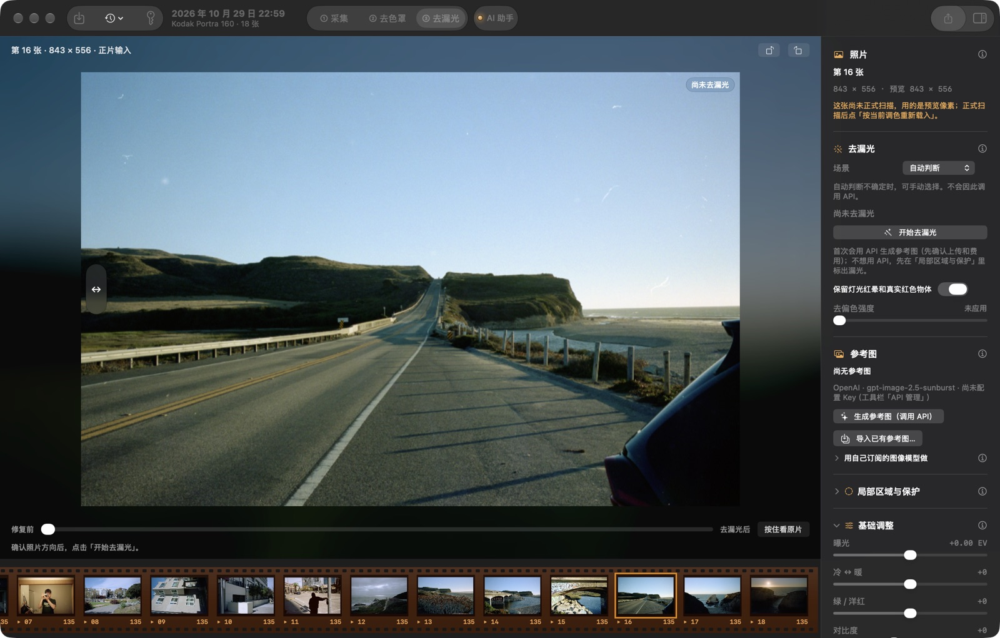

# 去漏光：算法与和 FilmLightLab 的对照

「去漏光」页移植自 FilmLightLab 1.5.0 的匹配算法修订 9。FilmLightLab 是 Node.js 程序（算法为纯 JavaScript，图像读写和缩放用 sharp / libvips），这里把算法逐项改写为 Swift（`Sources/LightLeak.swift`），图像读写、缩放和色彩换算用本程序自己的实现（`Sources/LightLeakIO.swift`），不附带 Node 或任何第三方库。

## 怎么用

去漏光是 ② 去色罩的最后一步，可选：负片变成正片以后，有漏光的照片在这里修干净，再到 ③ 调色。本卷的照片按 ② 去色罩的结果进来（去掉色罩、配好白平衡和黑白场，不带 ③ 的调色），修好以后「用到 ③ 调色」，回到 ③ 在修好的照片上接着调色和导出（见下文「回到 ③ 调色」）。从 ② 画面工具栏的「去漏光」、右栏的「先去漏光（可选）」、胶片条右键或 ⌥⌘L 进来，修的时候顶栏的 ② 写成「② 去色罩 › 去漏光」（App 要先有工程：只修别处已转好的正片时，先在库里点「新建工程」，再从「模块」菜单或 ⌥⌘L 进来，用顶栏的「导入正片」）。这一页移植自 FilmLightLab 1.5.0（修订 9），算法逐项改写为 Swift：同样的输入下，场景判断、自动保护、对齐、拟合出的模型和输出像素与原版一致，

1. **选照片**：在「去色罩」里选中一张，用「画面 > 在去漏光里打开」（⌥⌘L）或胶片条的右键菜单直接进来；在这一页下方胶片条点一张本卷的照片也行，按 ② 去色罩的结果在本机转换为 Adobe RGB 16 位正片处理，不用先导出再导入；也可以「导入正片」其他软件已去色罩、反相的 TIFF / PNG / JPEG（推荐带 ICC 的 16 位 TIFF，原文件不改动）。左右旋转在画面右上角。
2. **开始去漏光**：已有参考图时在本地免费修复；没有参考图、但标了局部区域时，只校正这些区域，也不调用 API；两样都没有时先生成参考图。也可以在「参考图」里导入在别处得到的同一张照片的干净版本，比如用你自己订阅的图像模型做的：展开「用自己订阅的图像模型做」，「导出缩图…」存下和 API 上传的一样的缩图并复制提示词，在 ChatGPT 等能改图的应用里上传、粘贴，下载结果后「导入已有参考图…」，这样不用 API Key。导入正片、API 管理和导出都在顶栏，右栏不再重复。
3. **检查**：拖动画面下方的对比滑杆看修复前后，按住「按住看原片」临时看原片，「结果 / 参考图」切换看参考图。场景（自动 / 白天 / 夜晚）、「保留灯光红晕和真实红色物体」、去偏色强度和基础调整（曝光、冷暖、绿 / 品红、对比度）随时可改，换场景或旋转后用已有参考图在本地重新拟合。所有改动都能 ⌘Z 撤销。
4. **局部处理**（可选）：「局部区域与保护」默认收起，用它的工具时保持展开。里面可以画椭圆框住漏光并点干净参考点（方式有去色偏、减雾，以及「按比例去色偏」：整片按同一个比例去掉色偏，跨过不同物体也不染色，适合翻拍灯往四周加重的颜色暗角）、用画笔保护真实的红色物体和灯光、自动检测候选区域（勾选才生效）、在自动对齐不确定时手动标对应点、裁切，以及保存 / 载入预设（与 FilmLightLab 的预设文件通用）。
5. **导出 16 位 TIFF**：打开照片就能导出；没有去漏光（强度为 0、没有参考图、也没有启用的区域）时，导出的是带基础调整和片边处理的原片，导出提示和参数记录（`leakRepaired: false`）都会写明。原图裁切尺寸的 RGB 16 位 Adobe RGB TIFF，旁边附同一像素的 sRGB JPEG 和参数记录（`.tif.json`）；只写你选的文件，同名的 JPEG 已存在时加编号，不覆盖。本卷照片导出时按 ② 去色罩现在的结果重新转换全分辨率：② 改过（⌘Z、助手调整、换了预设）时页面自己重新载入。本卷照片的颜色和明暗在 ③ 调，这一页没有「基础调整」，也不能转方向或裁切（在 ② 里改）；导入的文件照旧。

6. **用到 ③ 调色**：右栏底部的大键。修复放进这张照片的转换里，回到 ③ 调色：之后的白平衡、影调、色阶、色彩、曲线、锐化，以及导出、接触表和缩略图，都在修好的照片上；去漏光页的「基础调整」不带过去，那些在 ③ 里调。原片不改；③ 的「去漏光」一节里可以「在去漏光里改」或「去掉修复」，⌘Z 也能撤销。也可以「返回 ② 去色罩」，或这张不修「不修，到 ③ 调色」。修过的照片在胶片条左上角有一个琥珀色的魔术棒。修好了还没用到 ③ 的照片，胶片条上是空心的魔术棒，③ 的「去漏光」一节会提醒。以前建立的任务是从调好色的正片开始的，修复用不到 ③：在去漏光页的「照片」一节点「从 ② 的结果重新载入」，区域和参考图都留着，再「用到 ③ 调色」。参考图是在调好色的照片上做的，重新载入时会按那张和 ② 的结果之间的颜色差换到 ② 的颜色（原来的参考图留着），所以修复不会把以前的调色带到 ③。

**参考图与费用**：生成参考图调用 OpenAI 图像接口（`https://api.openai.com/v1/images/edits`，模型 gpt-image-2.5-sunburst / flare 或 gpt-image-2，提示词与 FilmLightLab 相同）。只在你在确认窗口点「生成并去漏光（调用 API）」后，上传最长边 1536 px、无 EXIF 的 JPEG 缩图及附加要求；原尺寸照片留在本机。每次 1 张，不自动重试，失败或超时仍可能已计费。生成的参考图先保存再拟合，拟合失败也不会再次收费。

**API Key**：在「API 管理」里填写，可选存入 macOS 钥匙串（本 App 自己的一项，下次自动读取），否则只在本次内存中；不写入文件、任务、日志，也不会回显。不要把 Key 发到聊天中。首次或 App 更新后 macOS 可能请求钥匙串授权。

**任务**保存在 `~/Library/Application Support/epscan/LightLeak/`（每张一个文件夹：正片预览、参考图、参数），不写入照片库；本卷照片只有在开始去漏光或导入参考图后才保存任务。顶栏「历史任务」列出以前的任务，也可在 Finder 中打开这个文件夹。

## 回到 ③ 调色

修复本身仍是 FilmLightLab 的算法，在 1800 px 宽的基准图上算出修好的样子。「用到 ③ 调色」再把「修了什么」量回转换里：

1. 用建立任务时 ② 的设置把这张重新画一遍（`ImagePipeline.neutral`，内核 `negativeNeutral`：除以片基、按斜率换成对数曝光、白平衡和自动黑白场，不加 ③ 的任何调色），按同样的参数修一遍，不带基础调整。
2. 两张都缩到长边 900 px 以内，按画面的标尺换回胶片自己的读数（负片是除以片基、按斜率换成的对数曝光，反转片是线性光；在分析给的增益和白平衡之前），每个通道分别用导向滤波拟合局部直线：修好的 ≈ a × 原来的 + d，窗口约为画面的 1/80，变化平坦的地方偏向 a = 1（只平移）。剪切到 0 或 1 的像素不参与。
3. a、d 缩成长边 160 格的网格，再按这张的拉直、旋转和镜像换到转换读入的方向，存成卷文件夹 `Repairs/` 里的一个小文件（16 位浮点，几百 KB）。
4. 转换时（内核 `negativeFixed` 等）在胶片的读数上、增益和白平衡之前，按网格平滑插值做 a × 读数 + d；之后的增益、白平衡、曝光、黑白场和 ③ 调色照常。没有修复的照片仍走原来的内核，像素完全一样。

记录里写着这个校正和去漏光页的结果平均差多少（0–255）。校正加在胶片自己的读数上（负片是对数曝光，在全卷斜率估计的增益和白平衡之前），所以 ③ 里改白平衡、曝光、黑白场都不会动它；③ 的自动白平衡、自动色阶和中性灰取样也按修好的读数算。本卷照片的方向和裁切在 ② 里定，去漏光页里不能再转或裁。

## 流程

和 FilmLightLab 的「开始去漏光」一致：

1. **基准图**：原片按方向裁切后缩到 1800 px 宽（Lanczos），Adobe RGB 16 位。
2. **场景与保护**：在 320 px 的缩图上按亮度分布估计白天 / 夜晚 / 混合光（有参考图时 70% 看参考图），检测紧凑的灯光、红晕和小型红色物体；白天只保留有局部红色信号的灯光，浪花、云不当灯光。
3. **拟合**：修正后的原片和参考图各缩到 640 px 并高斯模糊（σ = 3），按绿通道边缘相关自动找参考图的方向（0 / 90 / 180 / 270°）、缩放和平移，再拟合：
   - 21 × 14 左右的局部 RGB 仿射网格（稳健迭代、按场景加正则）；
   - 以原片亮度为第三维的双边残差格（强度在留出样本上选 0 / 0.35 / 0.65 / 1）；
   - 漏光把握场（红色占比下降且红通道下降）和夜景边缘的白色亮雾场（与参考图整体曝光倾向比较，只在夜晚和画面边缘）。
   检测到的灯光在参考图里也必须仍然突出，否则放弃保护；手绘保护不受影响。
4. **应用**：每个像素按网格和残差格的局部校正得到预测值，再按 Adobe RGB 的线性亮度分离：允许变暗的幅度由漏光把握、白雾把握、场景和是否为灯光决定，变亮最多 0.25 EV，越亮越少改动；超出色域时在同一亮度上平滑地向中性收，不逐通道削顶。强度 0 和手绘保护处的像素保持原样。

参考图只提供这些平滑的校正参数，不复制参考图的物体、纹理和结构；颗粒幅度和颜色会改变，不是无损恢复。

## 与原版的对照

用合成的白天和夜景漏光照片（白天有建筑、云和红色标牌；夜景有路灯、红晕、亮窗和底边白雾）及其干净版本做参考图，比较两套引擎：

- **同样的输入**（把本程序缩放后的基准图、缩图、参考图交给 FilmLightLab 的 JavaScript）：场景判断、检测到的灯光（白天 2 个、夜景 28 个）、对齐方向与分数、网格（最大差 1e-12）、残差格（1e-14）、把握场、留出样本误差完全相同，**输出像素最大差 0**；两边把各自拟合的模型交给对方应用，最大差也是 0。
- **各用各的读写和缩放**（FilmLightLab 用 sharp 端到端）：结果平均相差白天 0.08%、夜景 0.14%。差异来自缩放（libvips 先缩放再转换色彩，且大倍率时先做盒式缩小）。高斯模糊与 libvips 逐值相同。
- **到干净画面的平均误差**：白天 0.0348 → 0.0063（FilmLightLab 0.0066），夜景 0.0681 → 0.0182（FilmLightLab 0.0189）。在一张实拍照片上加合成漏光：0.0327 → 0.0186。
- **速度**：1800 px 基准图上拟合约 0.06 秒、应用约 0.07 秒；2400 × 1600 的全分辨率应用约 0.12 秒。

### 色彩换算

FilmLightLab 按它附带的 Adobe RGB (1998) 配置文件解码：纯 563/256 Gamma。macOS 的 ColorSync 转入 Adobe RGB 时在暗部不按纯 Gamma（sRGB 10/255 得到 3072，按定义应为 4695 / 65535），对夜景参考图的影响约 0.7%。因此 sRGB 和线性 sRGB 的图像由本程序按精确的曲线和矩阵换算（sRGB 与 Adobe RGB 同为 D65，红蓝原色相同）；ColorSync 只在同一色彩空间内转换样本格式，这一步是无损的。本卷照片直接取转换管线的浮点输出（扩展 sRGB，不截断色域）再换算。16 位 Adobe RGB 的文件原样读取。

## 数据与隐私

- 任务在 `~/Library/Application Support/epscan/LightLeak/<任务>/`：`job.json`（来源、参考图记录、参数与拟合的模型，键名与 FilmLightLab 相同）、正片预览 `base-*.tif`、参考图、导入时复制的原片。本卷照片不复制原片，导出时按任务里记下的调色重新转换。
- 生成参考图只上传最长边 1536 px 的 JPEG（去掉 APP1 段，不含 EXIF / XMP）和提示词；请求固定发往 `https://api.openai.com/v1/images/edits`，拒绝重定向，不自动重试，错误信息里的 Key 和形似 Key 的字符串会被去掉。
- API Key 存在本 App 自己的钥匙串项（服务名 `local.epscan.mac.openai`），或只在内存中。FilmLightLab 保存的 Key 不会被读取。

## 局部区域、保护、对应点、裁切与预设

右侧「局部区域与保护」一节，按 FilmLightLab 的界面做：

- **画区域**：在照片上拖出椭圆，框住一处漏光；再用**参考点**点同材质、没有漏光的干净位置。区域按它「去色偏」（保留亮度，改色比）、「减雾」（减去漏光的亮雾，恢复暗部），或「按比例去色偏」：在量色偏的位置（默认区域中心，MCP 可另指，要和参考点是同一种东西）量出各通道和参考点的比例，整片在线性光里乘上同一个比例、再还原亮度，所以跨过不同物体也不会被染成参考点的颜色，适合翻拍灯往四周逐渐加重的颜色暗角；这一种不受「保留灯光红晕」的高光门限，手绘保护照样生效。可调强度和羽化；没有参考图时，启用的区域单独就能去漏光，不调用 API；「查看」时按住区域拖动可移动。
- **保护**：用画笔涂出真实的红色物体、灯光等，保护区里参考校正和区域校正都不作用（基础调整照常），手绘保护始终优先。
- **自动检测**：在 320 px 的缩图上按灵敏度找候选漏光区域和灯光保护区。候选区域默认不启用，勾选后才生效（并算作认可，下次拟合保留）；检测到的保护替换之前检测的，手绘的不变。结果只是建议，不是漏光定论。
- **对应点**：自动对齐不确定时，在原片和参考图上依次点同一位置，至少 4 对，拟合按它们求单应映射对齐；清空则按相同构图。换参考图、旋转或裁切后对应点清空。
- **裁切**：按转好方向的原片取 0–1 的范围，重建正片预览，清空区域、保护和对应点；已有参考图在本地重新匹配。
- **预设**：保存参数、区域和对应点为 JSON，格式与 FilmLightLab 的预设文件相同，两边可以互相读。拟合出的模型和场景判断属于某一张照片，不存进预设；区域位置按画幅比例保存，换了照片需检查。

这些操作都能 ⌘Z 撤销（对应点除外）。FilmLightLab 修订 8 及以前的旧模型不读取，点「开始去漏光」免费重新拟合。

## 通过 MCP

FilmLightLab 原来自己有一套本机 HTTP 接口（`server.cjs`），网页界面通过它工作。这里没有单独的接口：这些功能都并进了 App 的 MCP 服务器，和转换工具一起，助手用同一个连接。每一步都调用页面自己的操作，所以和在界面上点一样，可以 ⌘Z 撤销（对应点除外）。

| FilmLightLab 接口 | MCP 工具 |
| --- | --- |
| `GET /api/jobs` | `leak_list_jobs`，`leak_open` 打开任务或本卷某张 |
| `POST /api/upload?role=source` | `leak_import`：给出文件路径，复制进新任务，原文件不改 |
| `POST /api/upload?role=guide` | `leak_import_reference`：别处做好的干净版本，免费 |
| `GET /api/jobs/{id}` | `leak_get_state`，`leak_list_regions`（区域、保护区、对应点） |
| `prepare`（方向、裁切） | `leak_rotate`、`leak_crop`（导入的文件；本卷照片在 ② 改） |
| `preview` 与 `/files/…` | `leak_preview`（结果、原片、参考图），`leak_sample` |
| `detect` | `leak_detect` |
| `fit`（带对应点） | `leak_set_landmarks`，然后 `leak_start`；没有参考图时 `leak_start` 只按启用的局部区域校正 |
| 参数 | `leak_set`、`leak_add_region`、`leak_update_region`、`leak_delete_region`、`leak_add_protection`、`leak_clear_correction` |
| 预设 | `leak_load_preset`；`leak_save_preset` 只打开保存窗口 |
| `generate` | `leak_request_reference`：只打开确认窗口，可预填质量和附加要求；不用 API 时 `leak_reference_prompt` 给出同样的提示词，`leak_export_upload` 打开保存缩图的窗口，用户用自己的图像模型做好后 `leak_import_reference` |
| `export` | `leak_export`：只打开导出窗口 |
| `GET /api/ai/config` | `leak_get_state` 里的 `api_key_configured` |
| `POST /api/ai/config` | 没有：Key 只能由用户在「API 管理」里填 |

有三件事留给用户自己做：

- **生成参考图**：要上传缩图，会产生费用。
- **写文件**：导出结果、保存预设。
- **设置 API Key**。

助手只能读它给出路径的文件，而且是复制进任务读，不改原文件。它不能删除文件，也读不到 Key。

## 自检

`--self-test` 里的去漏光部分：合成漏光的修复效果与漏光定位、强度 0 和手绘保护保持原像素、旋转后找到参考图方向、模型的保存与损坏模型的拒绝、sRGB 暗部的精确换算、16 位 TIFF 读写、上传 JPEG 不含 EXIF；对 OpenAI 的请求在本机替身上检查（地址、Key 只在请求头、尺寸、提示词、请求记录、401 时的说明与去除 Key）；钥匙串在临时钥匙串上检查（记住、不记住、格式错误、移除）；任务从导入、导入参考图、修复、撤销、换场景到导出与重新打开；手画区域与参考点只改区域内、保护画笔下保留原片、自动检测的候选默认不启用、4 对对应点按手动对齐拟合、裁切重建基准图、预设（含 FilmLightLab 的预设文件）往返；生成的参考图先保存再拟合；本卷照片的转换与导出；MCP 工具，包括导入原片和参考图、画区域并改动和删除、保护区、对应点、旋转、裁切、载入预设和预填的生成确认，以及各自的撤销。全程不联网，不碰用户的钥匙串和支持文件夹。
