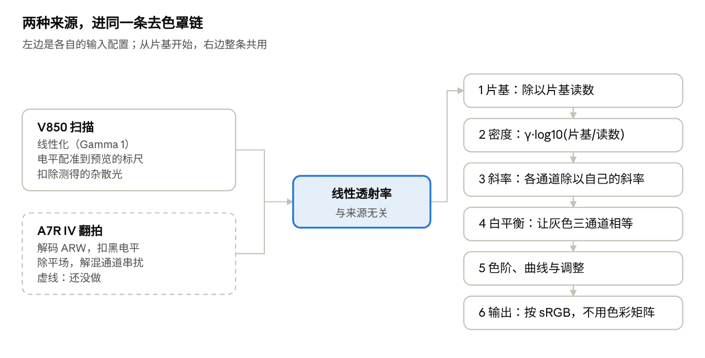

# 去色罩原理：Epson Scan plus 如何把彩色负片转成正片

2026-10-28。在线版本（可评论）：[Claude Docs](https://claude.ai/artifact/TBUhFeVsNFsXem9558cLmu)。

## 概述

去色罩的核心是在「密度」里计算：先除以片基，去掉橙色色罩；再按每个通道各自的反差（斜率）换算回曝光；最后像放大到相纸上一样，定黑白点、调色。全程不用色彩矩阵。

转换按这个顺序进行：

1. **读入与线性化**：扫描值按输入 Gamma 还原成透射率。V850 的 48 位扫描本身是线性的（Gamma 1）；编码未知的导入文件按 2.2。
2. **扫描仪校正**（只对 V850）：正式扫描对预览做电平配准，并扣除测得的杂散光。
3. **片基**：依次取手动取样、整卷共用的取样、整卷片间测量；都没有时，按本张最薄处估计。
4. **密度**：每个通道的密度 = 输入 Gamma × log10（片基读数 ÷ 读数）。
5. **通道斜率**：每个通道的密度除以它自己的斜率，得到这一通道记录下的曝光。斜率依次取本机标定、整卷估计、数据表。
6. **白平衡**：自动对齐各通道，或按中性灰、预设偏移、Dmax 高光点。
7. **色阶与调整**：黑白点、曝光、冷暖、对比、饱和度、曲线。
8. **输出**：结果按 sRGB 解释，转到宽色域时交给 ColorSync。

## 色罩与片基

橙色色罩均匀地铺在整张片基上，所以每个通道除以片基的读数，色罩就没了。剩下的只有拍摄时曝光留下的染料。

色罩是彩色负片里带色的成色剂，用来抵消品红、青染料多余的吸收：品红染料多吸一点蓝光，青染料多吸一点绿和蓝。有了它，放大到相纸上的颜色更干净；代价是整张底片偏橙，蓝通道最暗。

**为什么是除法**：光依次穿过片基和染料，透射率相乘，所以读数 = 光源 × 片基 × 染料。除以片基的读数，光源和片基一起消掉。取对数后乘法变加法，就是「相对片基的光学密度」：

```math
D_c = \gamma \cdot \log_{10}\frac{\mathrm{base}_c}{v_c}
```

其中 c 是红、绿、蓝通道，v 是读数，γ 是输入 Gamma：线性扫描为 1，Gamma 编码的文件乘上它才等于在透射率上取对数。密度 0 就是片基，越密的地方（正片里的亮部）数值越大。

**片基从哪里来**，按优先级：

1. **手动取样**：「取片基」点未曝光的橙色片基，比如片间或片边。
2. **整卷共用的取样**：在片头或片边取一次，点「整卷共用这个片基」。翻拍和一张一个文件的卷没有片间可测，靠这个。
3. **整卷片间测量**：V850 的 48 位整版预览上，取相邻画面之间窄缝的中位数。要求这些缝亮度均匀，而且不比画面里最薄的地方暗；否则说明量到的是片夹，不采用。
4. **本张估计**：取这一张画面内每个通道最亮的 0.5%。这其实是画面里最薄的地方，已经比真正的片基密一点。

**片基为什么要准**：某个通道的片基偏一点，这个通道所有的密度就一起平移，整张偏色，暗部最明显。暗部趾部的修正也只在测得的片基（前三种）上才用，见下一节。「片基微调」按 EV 逐通道移动片基，不会被自动白平衡抵消。

## 密度与通道斜率

三层染料的反差各不相同，所以每个通道的密度要除以它自己的斜率，才能换回同一把曝光标尺。这一步做对了，灰色从暗到亮都保持灰。

**特性曲线**：底片的密度随曝光量的对数上升，中段接近一条直线。直线的斜率就是这一层的反差。负片的斜率远小于 1，而且三层不同。例如参考卷 Portra 160 在 V850 上手调得到的红通道斜率是 0.417，数据表里是 0.52。把密度除以斜率，得到这个通道「记录下的曝光」（以 10 为底的对数，0.30103 为一档）：

```math
e_c = \frac{D_c}{s_c}
```

**为什么不直接拉伸每个通道**：只把每个通道的亮暗范围各自拉满，结果就取决于画面内容。一张蓝天多的照片，蓝通道会被压低。还会出现「色彩交叉」：暗部偏一种色，亮部偏它的补色。按斜率换算后，三个通道在整个影调范围里只差一个常数，白平衡对齐这个常数就够了。

**暗部趾部**：片基附近，特性曲线会弯下来。按直线换算会压暗暗部，还可能让暗部偏色。有趾部宽度 t 时，换算后再把弯曲拉直：

```math
e'_c = e_c + t_c \ln\left(1 - e^{-e_c / t_c}\right)
```

- **什么时候用**：只在片基是测得的时候（手动取样、整卷共用或片间测量）。按本张最薄处估计的片基已经在趾部上了，再从那里弯会让暗部偏色，所以保持直线。
- **趾部宽度从哪里来**：程序记有三种 Kodak 胶片数据表曲线测得的趾部宽度，但 V850 上实测，蓝通道的弯曲和数据表不符，所以默认不用。本机标定时取 4 个以上、包括很暗的中性点（比如灰卡欠曝 2–3 档），程序会同时拟合红、蓝的趾部。

## 斜率从哪里来

斜率按下表从上到下取第一个有的。「胶片」页的「转换依据」会写明这一张用的是哪一种。

| 来源 | 什么时候有 | 给出什么 |
| --- | --- | --- |
| 本机标定预设（名字带「· V850」） | 在这台扫描仪上用中性点标定过这种胶片 | 三个通道的斜率、中性偏移；中性点够暗时还有趾部 |
| 整卷自动估计 | 同一卷里至少 2 张有细节的画面 | 红、蓝的斜率；绿通道沿用预设 |
| Kodak 数据表 | 内置的 Portra 160、Portra 400、Ektar 100 | 三个通道的斜率 |
| 通用 | 以上都没有 | 没有斜率：每张按自己的画面拉伸各通道 |

**整卷自动估计的原理**：取自色彩恒常性里的「灰边缘」思路。

- **明暗变化对三个通道一样**：光在表面上的明暗变化（纹理、褶皱、波浪、阴影过渡）让三个通道的曝光一起变同样多。所以在这些边缘上，红、蓝密度的变化与绿密度的变化之比，就是它们斜率之比。
- **取整卷的中位数**：整卷所有边缘上的这个比值取中位数，带颜色的边缘就拉不动结果。蓝天配暗地面这种「颜色跟着亮度变」的场景也带偏不了它；用全局统计会把天空的蓝当成蓝通道反差。
- **不采用的情况**：只有 1 张画面，边缘少于 500 条，或者比值落在 0.5–2 之外。

**哪些画面算一卷**：

- 扫描的画面一起估计。
- 一个导入文件里有几张画面时（比如一整条胶片），这个文件单独估计。
- 一张一个文件的画面（翻拍，或一张张导入的扫描），默认各自分开。打开「导入的单张一起做整卷估计」后，读法相同（输入 Gamma、位深）的归成一卷。

**为什么本机标定排第一**：斜率其实是「胶片 × 光源 × 传感器通道灵敏度」的组合，不只是胶片的性质。数据表是厂家按自己的测量条件给的，换一台设备就会差很多。上面的 Portra 160，红通道在 V850 上比数据表低约 20%。

## 白平衡、中性灰与 Dmax

换算成曝光后，白平衡给每个通道一个增益 g 和一个偏移 b，让应该是灰的地方三个通道相等：

```math
x_c = g_c \, e_c + b_c
```

斜率已经定下时（本机标定、整卷估计或数据表），增益保持 1，只算偏移。偏移按下面的方式之一来定：

| 方式 | 怎么算 | 适合 |
| --- | --- | --- |
| 自动白平衡 | 每个通道的黑点（画面内最暗的 1%）对齐到 0 | 大多数场景 |
| 取中性灰 | 取样点三个通道的曝光拉到它们的平均值，这一点就是灰的 | 画面里有灰卡、白墙、水泥 |
| 预设偏移 | 本机标定预设记着这卷胶片在这台扫描仪上中性落在哪里 | 关掉自动、用标定结果时 |
| 取高光（Dmax） | 见下 | 画面里有应为纯白的东西 |

通用预设又没有整卷估计时，没有斜率可用，自动白平衡会同时拉伸增益：每个通道最暗 1% 到最亮 1% 的跨度，拉到三个通道跨度的中位数，增益限制在 0.5–2 倍。

**取高光（Dmax）**：点负片上最密、正片里应为纯白的地方。

1. 每个通道先定一个参考点 r：取过中性灰用它；开着自动白平衡时用画面的黑点；否则用片基（0）。
2. 参考点到高光点 h 的距离是这个通道的跨度。每个通道的增益把它的跨度拉到三个通道跨度的平均值，限制在 0.5–2 倍：

```math
g_c = \frac{\overline{h - r}}{h_c - r_c}
```

3. 偏移让三个通道在参考点重合，于是高光点也重合，出来是中性的白。
4. 开着自动色阶时，这一点就是画面的白点，比它更亮的地方剪成白。所以要点应为纯白的地方，比如阳光下的白墙，不要点太阳。

「冷暖」和「绿 / 洋红」不在这里算，而是在色阶之后，对输出值按通道加减。

## 色阶、曲线与输出

正片的亮度和曝光的对数成正比，和放大到相纸上一样：曝光每多一档，输出值就多同样一步。黑白点把这把尺的一段放到 0 到 1：

```math
q_c = \frac{x_c + 0.30103 \cdot \mathrm{EV} - \mathrm{low}}{\mathrm{high} - \mathrm{low}}
```

- **自动色阶**：黑点 low 取三个通道里最暗 0.5% 的最小值，白点 high 取最亮 0.5% 的最大值；取过 Dmax 时白点就是它。关掉自动时，固定用 0 到 3.6，约 12 档。
- **曝光（EV）**：是「放大时的曝光」，在色阶和剪切之前把整把尺平移，每档 0.30103。所以负的 EV 能把高光拉回来。
- **之后依次是**：手动的黑点和白点，冷暖与绿 / 洋红（按通道加减），对比度（绕 0.5 拉伸），剪到 0–1，中间调（幂函数），饱和度（和 Rec. 709 亮度混合）。最后是 RGB 和单通道曲线，用 1024 级查找表。

**不用色彩矩阵**：扫描仪或相机的色彩矩阵，描述的是镜头前景物的颜色。负片上的是三层染料的密度，不是景物颜色，套矩阵没有意义。所以这里三个通道从头到尾各算各的，只在饱和度这一步混合。IT8 色卡测出的矩阵只报告，不应用。

**输出**：算出来的 q 直接当作 sRGB 编码值。导出到 Display P3、Adobe RGB 或 ProPhoto RGB 时不剪到 0–1，饱和度推到 sRGB 以外的颜色会保留，由 ColorSync 转换并嵌入 ICC 配置文件。

## 和扫描仪相关的校正

这些校正都发生在算密度之前，目的是让读数成为干净的线性透射率。之后的去色罩和来源无关。

| 校正 | 做什么 | 只对谁 |
| --- | --- | --- |
| 线性化 | 读数按输入 Gamma 还原成透射率。本程序的 48 位扫描是线性的（Gamma 1）；编码未知的导入文件默认 2.2，可以在「输入设置」里改 | 所有来源 |
| 电平配准 | V850 每次扫描都自己设定读数的高低：2400 dpi 正式扫描的蓝色比 600 dpi 预览高约 11%，而且每个窗口都不同。每张正式扫描到达时，和预览里同一块逐像素对齐，按通道拟合「扫描 = 增益 × 预览 + 偏移」，换算到预览的标尺上。片基和整卷估计都在这把标尺上测，整卷才一致。原始文件不改动 | V850 的 48 位线性扫描 |
| 杂散光 | 扫一张 IT8.7/1 透射色卡，用它的 24 级灰阶拟合每个通道多出来的一层杂散光（透明底片读数的一个比例），转换前扣掉。它在密的地方影响最大 | 标定过的 V850 |
| 锐化 | 扫一张分辨率标靶测出 MTF，按文件的 dpi 生成维纳滤波核，在线性光里反卷积；色调统计仍用未锐化的数据 | 测过 MTF 的扫描仪 |

本机标定预设也是在 V850 上测的，它的斜率、中性偏移和趾部只对这台扫描仪成立。

## 翻拍与扫描用同一套去色罩

翻拍可以和扫描共用同一套去色罩。只要相机的数据先变成线性、扣掉黑电平、除过平场的透射率，从片基开始的整条链就和扫描完全一样。不同的只是进来之前的「输入配置」。



两种来源只在进来之前不同：V850 要做电平配准、扣杂散光，翻拍要扣黑电平、除平场、解混；变成线性透射率之后，六步完全一样。

**每套设备一份输入配置**，包括：

- 线性化方式和黑电平。
- 平场：不放底片、同样曝光拍的一张光源。
- 可选的 3 × 3 解混矩阵，用来分开通道串扰。
- 杂散光。
- MTF 和每毫米像素数。
- 是否需要电平配准。

**相机和 V850 在物理上的不同**：

- **通道串扰**：相机 Bayer 滤色片的三个通道重叠更多。配上白光灯箱，红通道会混进一点品红染料，有效斜率变小，饱和色可能偏。窄带 RGB 光能大幅减轻这一点；R、G、B 灯分别单独点亮各拍一张，就能得到在线性光里准确解混的矩阵。
- **暗角**：镜头暗角和灯箱不均要靠平场逐像素除掉。平场必须和拍片时用同一光圈、对焦、放大率和灯位。扫描仪每次开扫会自己校准，不需要这一步。
- **黑电平**：要逐通道扣准，误差在密的地方会被对数放大。
- **色彩矩阵**：不能用相机自带的，理由见上一节。
- **胶片预设**：V850 上标定的预设不能直接用到相机上。数据表预设可以继续共用，作为后备。

**已经做好的**：

- **按卷估计**：一张一个文件的画面可以归成一卷做整卷估计。在合成的三张单张上，估得 R 0.510 · B 0.650，和真实值一致。
- **片基整卷共用**：在片头或片边取一次，整卷都用，趾部也因此能用上。

**还没做的**：

- **ARW 解码**：解成线性 16 位 TIFF，这一步里依次扣黑电平、除平场、解混、扣杂散光。平场后数值可能超过 1，要留余量。
- **按设备分开存**：本机预设、扫描仪标定和锐化配置。
- **相机预设**：按「A7R IV + 光源」标定一套胶片预设。

## 局限与实用建议

转换最容易出错的是片基和白平衡；两者取对，其余的大多自动就好。

- **能取片基就取**：按本张最薄处估计的片基偏密，暗部趾部也用不上。翻拍时拍一张片头或片边，取片基后整卷共用。
- **单一色调的场景**：如夕阳、整片草地，自动白平衡靠画面统计，可能把场景的颜色当成偏色。这时取中性灰，或关掉自动。
- **整卷估计要线性数据**：8 位 sRGB 预览在密的地方量化粗，斜率会估偏。体检时，三卷 8 位预览的蓝色只有 0.52，16 位线性的卷是 0.61–0.63。
- **本机预设只对标定它的设备成立**：换了扫描仪、相机或光源，要重新标定，或先靠整卷估计。
- **Dmax 点要点对**：它会成为画面的白点。要点应为纯白的景物，不要点光源或太阳。
- **杂散光在密的地方影响最大**：高光发灰、偏色时，先做一次 IT8 标定。翻拍时，用遮光片挡住画面外露出的背光。
