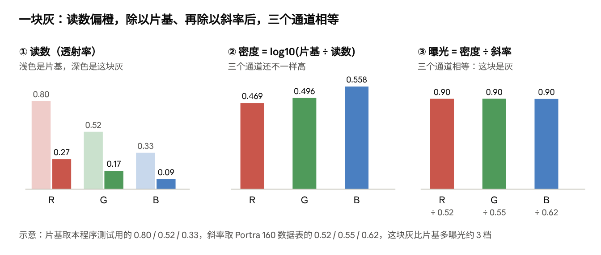
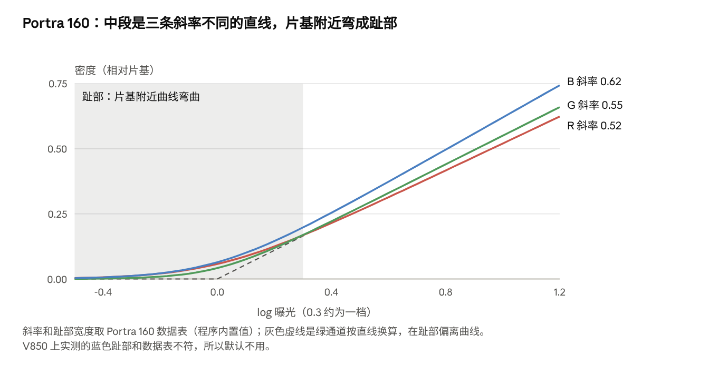
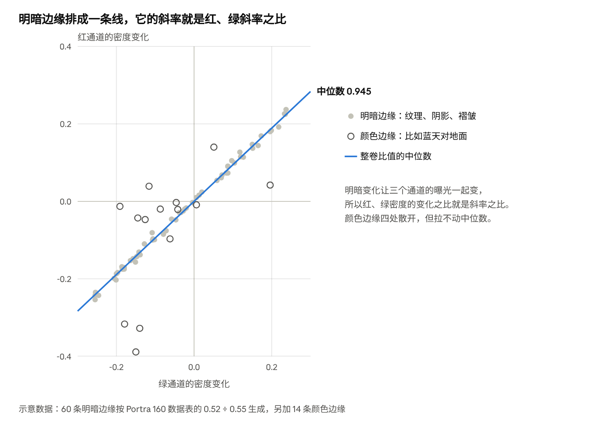
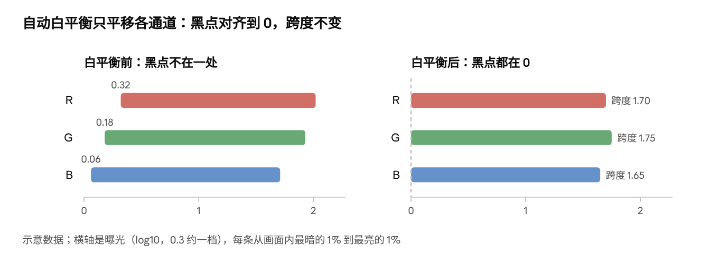
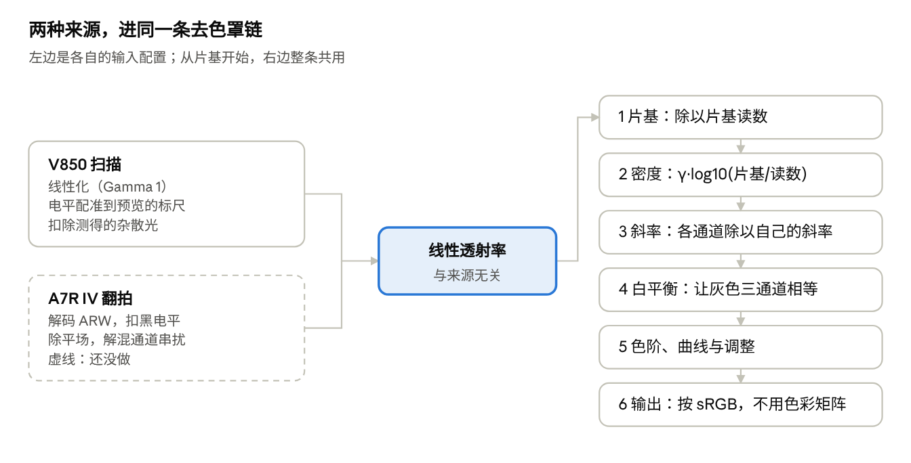

# 去色罩原理：Epson Scan plus 如何把彩色负片转成正片

2026-10-28。在线版本（可评论）：[Claude Docs](https://claude.ai/artifact/TBUhFeVsNFsXem9558cLmu)。

## 概述

去色罩的核心是在「密度」里计算：先除以片基，去掉橙色色罩；再按每个通道各自的反差（斜率）换算回曝光；最后像放大到相纸上一样，定黑白点、调色。全程不用色彩矩阵。

转换按这个顺序进行：

1. **读入与线性化**：扫描值按输入 Gamma 还原成透射率。V850 的 48 位扫描本身是线性的（Gamma 1）；编码未知的导入文件按 2.2。
2. **扫描仪校正**（只对 V850）：正式扫描对预览做电平配准，并扣除测得的杂散光。
3. **片基**：依次取手动取样、整卷共用的取样、整卷片间测量；都没有时，按本张最薄处估计。
4. **密度**：每个通道的密度 = 输入 Gamma × log10（片基读数 ÷ 读数）。
5. **通道斜率**：每个通道的密度除以它自己的斜率，得到这一通道记录下的曝光。斜率依次取本机标定、整卷估计、数据表。
6. **白平衡**：标定预设按它记下的中性；其他预设自动对齐各通道的黑点。也可以按中性灰、Dmax 高光点。
7. **色阶与调整**：黑白点、曝光、冷暖、对比、饱和度、曲线。
8. **输出**：结果按 sRGB 解释，转到宽色域时交给 ColorSync。



读数里蓝色最暗，这就是色罩；除以片基、再按各通道的斜率换算，三个通道就相等了。（示意：片基取本程序测试用的值，斜率取 Portra 160 数据表。）

## 色罩与片基

橙色色罩均匀地铺在整张片基上，所以每个通道除以片基的读数，色罩就没了。剩下的只有拍摄时曝光留下的染料。

色罩是彩色负片里带色的成色剂，用来抵消品红、青染料多余的吸收：品红染料多吸一点蓝光，青染料多吸一点绿和蓝。有了它，放大到相纸上的颜色更干净；代价是整张底片偏橙，蓝通道最暗。

**为什么是除法**：光依次穿过片基和染料，透射率相乘，所以读数 = 光源 × 片基 × 染料。除以片基的读数，光源和片基一起消掉。取对数后乘法变加法，就是「相对片基的光学密度」：

```math
D_c = \gamma \cdot \log_{10}\frac{\mathrm{base}_c}{v_c}
```

其中 c 是红、绿、蓝通道，v 是读数，γ 是输入 Gamma：线性扫描为 1，Gamma 编码的文件乘上它才等于在透射率上取对数。密度 0 就是片基，越密的地方（正片里的亮部）数值越大。

**片基从哪里来**，按优先级：

1. **手动取样**：「取片基」点未曝光的橙色片基，比如片间或片边。
2. **整卷共用的取样**：在片头或片边取一次，点「整卷共用这个片基」。翻拍和一张一个文件的卷没有片间可测，靠这个。
3. **整卷片间测量**：V850 的 48 位整版预览上，取相邻画面之间窄缝的中位数。要求这些缝亮度均匀，而且不比画面里最薄的地方暗；否则说明量到的是片夹，不采用。
4. **片边测量**（翻拍和一张一个文件的照片）：在照片四边找画框外面未曝光的片边和片间。
   - **先找画框的边**：每一边由外往里，找第一条「再往里 4 像素，绿通道就密 0.05 D 以上」的直线，要在这一边中段至少 30% 的地方都成立。线外面是削波的空光时跳过它（那是空光和片边的分界）。只取这条线外面的片子。
   - **为什么要找画框**：画面里很暗的阴影，密度和片基只差 0.03 D 以内，颜色也差不多，只看亮度和颜色分不开；但它在画框里面。阴影一直延伸到画框边上、这一边看不出画框线时，这一边不取。
   - **再挑片基**：线外面的片子里，排除削波的空光（连同它周围 3 像素，缩小、平滑后的空光边缘会像片子），留下沿着这一边均匀的部分，按红/绿、蓝/绿的颜色取最多的那一类，再取其中最亮的 8%（片基是最薄的片子）。还要整行或整列有三成以上是它，并且和照片边缘连着。
   - **每张用自己的**：翻拍时灯的配比可能中途调过，所以每张用自己片边的片基；看不到片边的，用最近一张看得到的。一卷里有三张以上测到片基时，颜色和其它张都不一样的那张不采用（更可能是片夹或画面）。
   - 在单张里打开「标出」，看取的是哪里。
5. **本张估计**：取这一张画面内每个通道最亮的 0.5%。这其实是画面里最薄的地方，已经比真正的片基密一点。

**片基为什么要准**：某个通道的片基偏一点，这个通道所有的密度就一起平移，整张偏色，暗部最明显。暗部趾部的修正也只在测得的片基（前四种）上才用，见下一节。「片基微调」按 EV 逐通道移动片基，不会被自动白平衡抵消。

## 密度与通道斜率

三层染料的反差各不相同，所以每个通道的密度要除以它自己的斜率，才能换回同一把曝光标尺。这一步做对了，灰色从暗到亮都保持灰。

**特性曲线**：底片的密度随曝光量的对数上升，中段接近一条直线。直线的斜率就是这一层的反差。负片的斜率远小于 1，而且三层不同。例如参考卷 Portra 160 在 V850 上手调得到的红通道斜率是 0.417，数据表里是 0.52。把密度除以斜率，得到这个通道「记录下的曝光」（以 10 为底的对数，0.30103 为一档）：

```math
e_c = \frac{D_c}{s_c}
```

**为什么不直接拉伸每个通道**：只把每个通道的亮暗范围各自拉满，结果就取决于画面内容。一张蓝天多的照片，蓝通道会被压低。还会出现「色彩交叉」：暗部偏一种色，亮部偏它的补色。按斜率换算后，三个通道在整个影调范围里只差一个常数，白平衡对齐这个常数就够了。

**暗部趾部**：片基附近，特性曲线会弯下来。按直线换算会压暗暗部，还可能让暗部偏色。有趾部宽度 t 时，换算后再把弯曲拉直：

```math
e'_c = e_c + t_c \ln\left(1 - e^{-e_c / t_c}\right)
```

- **什么时候用**：只在片基是测得的时候（手动取样、整卷共用、片间或片边测量）。按本张最薄处估计的片基已经在趾部上了，再从那里弯会让暗部偏色，所以保持直线。
- **趾部宽度从哪里来**：程序记有三种 Kodak 胶片数据表曲线测得的趾部宽度，但 V850 上实测，蓝通道的弯曲和数据表不符，所以默认不用。本机标定时取 4 个以上、包括很暗的中性点（比如灰卡欠曝 2–3 档），程序会同时拟合红、蓝的趾部。



三条曲线在中段是斜率不同的直线，到片基附近都弯下来。按直线换算（虚线）在那里会偏离，所以要做趾部修正。

## 斜率从哪里来

斜率按下表从上到下取第一个有的。检查器「胶片」一节的转换依据（一行，全文在 ⓘ 里）会写明这一张用的是哪一种。

| 来源 | 什么时候有 | 给出什么 |
| --- | --- | --- |
| 本机标定预设（名字带「· V850」） | 在这台扫描仪上用中性点标定过这种胶片 | 三个通道的斜率、中性偏移；中性点够暗时还有趾部 |
| 整卷自动估计 | 同一卷里至少 2 张有细节的画面 | 红、蓝的斜率；绿通道沿用预设 |
| Kodak 数据表 | 内置的 Portra 160、Portra 400、Ektar 100 | 三个通道的斜率 |
| 通用 | 以上都没有 | 没有斜率：每张按自己的画面拉伸各通道 |

**整卷自动估计的原理**：取自色彩恒常性里的「灰边缘」思路。

- **明暗变化对三个通道一样**：光在表面上的明暗变化（纹理、褶皱、波浪、阴影过渡）让三个通道的曝光一起变同样多。所以在这些边缘上，红、蓝密度的变化与绿密度的变化之比，就是它们斜率之比。
- **取整卷的中位数**：整卷所有边缘上的这个比值取中位数，带颜色的边缘就拉不动结果。蓝天配暗地面这种「颜色跟着亮度变」的场景也带偏不了它；用全局统计会把天空的蓝当成蓝通道反差。
- **不采用的情况**：只有 1 张画面，边缘少于 500 条，或者比值落在 0.5–2 之外。



灰点是明暗边缘，排成一条线；空心点是颜色边缘，四处散开。整卷取中位数，结果就落在那条线上。（示意数据。）

**哪些画面算一卷**：

- 扫描的画面一起估计。
- 一个导入文件里有几张画面时（比如一整条胶片），这个文件单独估计。
- 一张一个文件的画面（翻拍，或一张张导入的扫描），默认各自分开。打开「导入的单张一起做整卷估计」后，读法相同（输入 Gamma、位深）的归成一卷。

**为什么本机标定排第一**：斜率其实是「胶片 × 光源 × 传感器通道灵敏度」的组合，不只是胶片的性质。数据表是厂家按自己的测量条件给的，换一台设备就会差很多。上面的 Portra 160，红通道在 V850 上比数据表低约 20%。

## 白平衡、中性灰与 Dmax

换算成曝光后，白平衡给每个通道一个增益 g 和一个偏移 b，让应该是灰的地方三个通道相等：

```math
x_c = g_c \, e_c + b_c
```

斜率已经定下时（本机标定、整卷估计或数据表），增益保持 1，只算偏移。偏移按下面的方式之一来定：

| 方式 | 怎么算 | 适合 |
| --- | --- | --- |
| 自动白平衡 | 每个通道的黑点（画面内最暗的 1%）对齐到 0 | 没有标定的预设：整卷估计、数据表、通用 |
| 取中性灰 | 取样点三个通道的曝光拉到它们的平均值，这一点就是灰的 | 画面里有灰卡、白墙、水泥 |
| 预设偏移 | 本机或翻拍标定的预设记着这种胶片在这台设备上、取点时的光下中性落在哪里 | 用标定预设时，开不开自动都按它 |
| 取高光（Dmax） | 见下 | 画面里有应为纯白的东西 |



斜率定下后，三个通道只差一个常数；自动白平衡把这个常数减掉，黑点就对齐了，跨度不变。（示意数据。）

通用预设又没有整卷估计时，没有斜率可用，自动白平衡会同时拉伸增益：每个通道最暗 1% 到最亮 1% 的跨度，拉到三个通道跨度的中位数，增益限制在 0.5–2 倍。

**标定预设为什么不对齐黑点**：画面最暗的 1% 常常落在片基上，几乎没曝光，不带光的颜色。对齐它，等于假定三层乳剂从同一个曝光量开始起密度；实际各层起步不同，光的颜色也在里面，于是整张偏色。2026-10-30 一卷阳光下的 Portra 160 翻拍卷，阳光下的灰红层、蓝层分别比绿层多要约 0.6、0.4 档光才起密度，按片基对齐后整张偏绿。标定预设已经知道中性落在哪里，就直接用它。

代价是这个中性属于取点时的光：阴天、树荫、室内拍的照片会带着光的颜色，像日光型胶片按日光印放那样。需要时用取中性灰，或冷暖、绿 / 洋红调；阳光下的灰已经是灰、只有阴影偏蓝时，用「阴影冷暖」。没有标定的预设不知道中性在哪里，照旧对齐黑点；也不改成跳过贴着片基的像素，因为剩下最暗的往往是树荫里的叶子和天光下的阴影，偏色方向各不相同。

**没曝光的地方是中性的黑**：标定的中性偏移、取的中性灰和 Dmax 都是在特性曲线的直线段上算的。贴着片基、没曝光的地方，三个通道的曝光都是 0；照直线段的偏移一配平，红和蓝被抬起来，黑就成了紫黑。可是没光就是黑，黑是中性的。所以在没有拟合趾部的时候，偏移 b 从片基往上逐渐加进来：

```math
x_c = g_c \, e_c + b_c \, \min\left(1, \frac{w(\bar e)}{w(\bar e_\mathrm{grey})}\right), \qquad w(\bar e) = 1 - e^{-\max(0,\,\bar e)/0.12}
```

- $\bar e$ 是三个通道曝光的平均。0.12 约是一个趾部的宽度（Kodak 数据表上是 0.10–0.165）：高出片基 0.36（1.2 档）时，偏移已经加进 95%。
- 取过中性灰时，按这一点归一：它和比它亮的地方用满偏移，所以取样点照样是灰的。
- 自动白平衡对齐画面黑点时不用：那时最暗的地方本来就对齐了。拟合了趾部的预设也不用：趾部已经把三条曲线弯到片基上。
- 自动色阶的黑白点按渐隐后的值统计。

**取高光（Dmax）**：点负片上最密、正片里应为纯白的地方。

1. 每个通道先定一个参考点 r：取过中性灰用它；用标定预设时用它记下的中性；开着自动白平衡时用画面的黑点；否则用片基（0）。
2. 参考点到高光点 h 的距离是这个通道的跨度。每个通道的增益把它的跨度拉到三个通道跨度的平均值，限制在 0.5–2 倍：

```math
g_c = \frac{\overline{h - r}}{h_c - r_c}
```

3. 偏移让三个通道在参考点重合，于是高光点也重合，出来是中性的白。
4. 开着自动色阶时，这一点就是画面的白点，比它更亮的地方剪成白。所以要点应为纯白的地方，比如阳光下的白墙，不要点太阳。

「冷暖」和「绿 / 洋红」不在这里算，而是在色阶之后，对输出值按通道加减。

「阴影冷暖」也在那里，只加在暗部。晴天的阴影由蓝天照亮：一卷翻拍里，树荫下的人行道、水泥和路面在绿色密度 0.28–0.43 D 之间，都比阳光下的中性线红少约 0.18、蓝多约 0.19（log 曝光），不随亮度变。这是光的颜色，不是转换的误差，所以不在白平衡里消掉，而是留给你决定要不要暖回来：

```math
q_r \mathrel{+}= 0.2\,s\,d(l), \qquad q_b \mathrel{-}= 0.2\,s\,d(l), \qquad d(l) = \mathrm{smoothstep}(0.03,\ 0.2,\ l)\,\bigl(1 - \mathrm{smoothstep}(0.2,\ 0.55,\ l)\bigr)
```

- s 是滑杆的值，−1 到 1；l 是这一点在黑白点之后的亮度（Rec. 709）。
- 亮度 0.2 全量，0.55 以上没有，所以阳光下的灰（大多在 0.45 以上）基本不动。
- 往黑也收到 0：没曝光的地方本来是中性的黑（见上一节），像素值又小，加一个固定的红就成了红黑。
- 那卷翻拍的第 01 张，0.5 时树荫下的人行道从 49 / 78 / 103 变成 74 / 77 / 77，阳光下的人行道和天空不变。

## 色阶、曲线与输出

正片的亮度和曝光的对数成正比，和放大到相纸上一样：曝光每多一档，输出值就多同样一步。黑白点把这把尺的一段放到 0 到 1：

```math
q_c = \frac{x_c + 0.30103 \cdot \mathrm{EV} - \mathrm{low}}{\mathrm{high} - \mathrm{low}}
```

- **自动色阶**：黑点 low 取三个通道里最暗 0.5% 的最小值，白点 high 取最亮 0.5% 的最大值；取过 Dmax 时白点就是它。两端相距不到 1.2（4 档，雾、霾、很平的光）时，以两端的中点为准撑开到 1.2：短调的画面印出来还是灰和柔的，中间调不变，不会整张变暗。作者图库 262 张里最短的也有 1.25，中位数 1.6，所以都不受影响。关掉自动时，固定用 0 到 3.6，约 12 档。
- **曝光（EV）**：是「放大时的曝光」，在色阶和剪切之前把整把尺平移，每档 0.30103。所以负的 EV 能把高光拉回来。
- **之后依次是**：手动的黑点和白点，阴影冷暖、冷暖与绿 / 洋红（按通道加减），对比度（绕 0.5 拉伸），饱和度（和 Rec. 709 亮度混合），柔和的两端，剪到 0–1，压高光，阴影和高光，中间调（幂函数）。最后是 RGB 和单通道曲线，用 1024 级查找表。
- **压高光**（0 到 1）：三个通道减同一个量 $0.15\,p\,\mathrm{smoothstep}(0.45,\,1,\,l)$，p 是滑杆，l 是亮度（Rec. 709）。亮度 0.45 以下不动，白在 p = 1 时降到 0.85；减量在最上面变平，所以最亮处的层次不丢。按亮度、不按最亮的通道：蓝天的蓝通道、红漆的红通道很高，人眼看却不算亮，按通道会把它们误压暗。和「高光」不同，它让白也下来，而「高光」两端不动、作用在三分之二。
- **柔和的两端**（默认开，关掉就是直切）：
  - **暗端**：0.05 以下按指数收向黑。
  - **亮端**：从 0.9 起按指数收向白，大约装得下白点以上半档。
  - **高光超出更多时**：这张饱和以后最亮通道的 99.9% 分位数到了 1.1 以上，肩部就从 0.8 起沿一条对数曲线，把它收进 0.98，再往上收向白。离开直线时斜率是 1。1.1 到 1.25 之间逐渐接替，最多收到白点以上两档。
  - **这个 99.9% 在哪里数**：在 GPU 上，画面先缩到 1500 像素宽，经过这张的转换到饱和度为止（不含曝光、对比、冷暖和手动黑白点），取每个像素最亮的通道。白点等其余统计在 300 像素的缩图上就够了，高光不行：路牌、白边在那里只有一两个点宽，和周围平均掉，一张晴天翻拍在缩图上只超出白点 0.4 档，逐像素是 1.4 档，长肩部就没有启动。1500 宽时细的高光还在，颗粒已经平均掉；预览和全尺寸导出都先缩到这个大小，所以测出来一样。两种数法取大的。
  - **「高光」往负调时**：肩部再多伸，−1 时多两档。
  - **颜色跟着收**：肩部不是每个通道各自走。三个通道里最亮的那个走上面的曲线，另外两个保持原来在它下面的距离（同一个减量）。q 和对数曝光成正比，同样的距离就是同样的曝光比，颜色因此不变。每个通道各自走的话，越接近白三个通道挤得越拢：一张晴天翻拍里，朝天空和朝太阳的两块白板，C1 里色差 11.2，各自走时只剩 2.7。
  - **天空的色相也留住**：蓝通道亮过白的晴空，各自走时只压蓝、不压绿，色相从蓝偏向青（258°）；现在三个通道一起下来，保持是蓝的（280°），但三个通道都降了蓝通道那么多，天空会比各自走时暗很多（一张晴空暗 12 个亮度，比 C1 深）。
  - **再把亮度抬回一半**：算出各自走时的亮度 $l_e$ 和一起下来的亮度 $l_k$（Rec. 709），目标是 $l_k + 0.5\,(l_e - l_k)$。最亮的通道不动，另外两个离它的距离按同一个比例缩小，直到亮度到目标。距离之比不变，色相就不变，只是淡一点。三张晴空的天空比只一起下来时亮 3–6，色相 275–279°，仍然是蓝不是青；灰不受影响（`ImagePipeline.highlightLightness`，0 不抬，1 抬回各自走时的亮度）。
  - **太亮的地方照旧褪成白**：这张最亮的 0.1%（没有长肩部时是白点以上 0.1）以外，再往上 0.3 之内逐渐换回各自走，太阳、镜面反光收成白，不会变成彩色。
  - **整卷一起印时**：按整卷最亮的那张。
- **直方图 · SDR 范围**：调整面板里的这个直方图画的是进入两端之前的值，也就是印放的直线上：色阶的黑点是 0，白点是 1，中间按对数曝光，两头不截断。屏幕上有层次的范围，是把一条灰阶从 −1 到 3 送进这张的两端、阴影和高光、中间调和曲线，看它从哪里起离开 0、到哪里到 255。一档是 0.30103 × 对比度 ÷（(high − low) ×（白点 − 黑点））。计数在 GPU 上用整张的每个像素：颗粒和细的亮边才是伸得最远的，缩到 300 像素宽再数，阳光下一张最亮的 0.1% 少算一档。纯白、纯黑的比例按显示出来的这张数，色彩降噪在两端之后，会把亮边的个别通道推到顶。
- **饱和度为什么在两端之前**：像相纸那样，颜色先在染料里，再经过相纸的曲线。加了饱和度的亮颜色（比如蓝天）由肩部收向白，每个通道都留着层次，不会截掉一个通道。两端之间、中间调为 1、阴影和高光为 0 时，放在前后结果一样。

**不用色彩矩阵**：扫描仪或相机的色彩矩阵，描述的是镜头前景物的颜色。负片上的是三层染料的密度，不是景物颜色，套矩阵没有意义。所以这里三个通道从头到尾各算各的，只在饱和度这一步混合。IT8 色卡测出的矩阵只报告，不应用。

**输出**：算出来的 q 直接当作 sRGB 编码值。导出到 Display P3、Adobe RGB 或 ProPhoto RGB 时，饱和度放在两端之后，结果不剪到 0–1，推到 sRGB 以外的颜色会保留，由 ColorSync 转换并嵌入 ICC 配置文件。

## 和扫描仪相关的校正

这些校正都发生在算密度之前，目的是让读数成为干净的线性透射率。之后的去色罩和来源无关。

| 校正 | 做什么 | 只对谁 |
| --- | --- | --- |
| 线性化 | 读数按输入 Gamma 还原成透射率。本程序的 48 位扫描是线性的（Gamma 1）；编码未知的导入文件默认 2.2，可以在「输入设置」里改 | 所有来源 |
| 电平配准 | V850 每次扫描都自己设定读数的高低：2400 dpi 正式扫描的蓝色比 600 dpi 预览高约 11%，而且每个窗口都不同。每张正式扫描到达时，和预览里同一块逐像素对齐，按通道拟合「扫描 = 增益 × 预览 + 偏移」，换算到预览的标尺上。片基和整卷估计都在这把标尺上测，整卷才一致。原始文件不改动 | V850 的 48 位线性扫描 |
| 杂散光 | 扫一张 IT8.7/1 透射色卡，用它的 24 级灰阶拟合每个通道多出来的一层杂散光（透明底片读数的一个比例），转换前扣掉。它在密的地方影响最大 | 标定过的 V850 |
| 锐化 | 扫一张分辨率标靶测出 MTF，按文件的 dpi 生成维纳滤波核，在线性光里反卷积；色调统计仍用未锐化的数据 | 测过 MTF 的扫描仪 |

本机标定预设也是在 V850 上测的，它的斜率、中性偏移和趾部只对这台扫描仪成立。

## 翻拍与扫描用同一套去色罩

翻拍可以和扫描共用同一套去色罩。只要相机的数据先变成线性、扣掉黑电平、除过平场的透射率，从片基开始的整条链就和扫描完全一样。不同的只是进来之前的「输入配置」。



两种来源只在进来之前不同：V850 要做电平配准、扣杂散光，翻拍要扣黑电平、除平场、解混；变成线性透射率之后，六步完全一样。

**每套设备一份输入配置**，包括：

- 线性化方式和黑电平。
- 平场：不放底片、同样曝光拍的一张光源。
- 可选的 3 × 3 解混矩阵，用来分开通道串扰。
- 杂散光。
- MTF 和每毫米像素数。
- 是否需要电平配准。

**相机和 V850 在物理上的不同**：

- **通道串扰**：相机 Bayer 滤色片的三个通道重叠更多。配上白光灯箱，红通道会混进一点品红染料，有效斜率变小，饱和色可能偏。窄带 RGB 光能大幅减轻这一点；R、G、B 灯分别单独点亮各拍一张，就能得到在线性光里准确解混的矩阵。
- **暗角**：镜头暗角和灯箱不均要靠平场逐像素除掉。平场必须和拍片时用同一光圈、对焦、放大率和灯位。扫描仪每次开扫会自己校准，不需要这一步。
- **黑电平**：要逐通道扣准，误差在密的地方会被对数放大。
- **色彩矩阵**：不能用相机自带的，理由见上一节。
- **胶片预设**：V850 上标定的预设不能直接用到相机上。数据表预设可以继续共用，作为后备。

**已经做好的**：

- **按卷估计**：一张一个文件的画面可以归成一卷做整卷估计。在合成的三张单张上，估得 R 0.510 · B 0.650，和真实值一致。
- **片基整卷共用**：在片头或片边取一次，整卷都用，趾部也因此能用上。

**还没做的**：

- **ARW 解码**：解成线性 16 位 TIFF，这一步里依次扣黑电平、除平场、解混、扣杂散光。平场后数值可能超过 1，要留余量。
- **按设备分开存**：本机预设、扫描仪标定和锐化配置。
- **相机预设**：按「A7R IV + 光源」标定一套胶片预设。

## 除尘

灰尘、毛发和纤维挡住光，在负片上比周围的胶片密，转成正片是白点。翻拍没有红外通道（A7R IV 的红外截止滤镜在 850 nm 大约挡掉 15 档），所以只看图像本身来找：`Sources/Dust.swift`。

**怎么找**：

- **比周围密多少**：每个通道的密度减去它的灰度开运算（先取 17 像素内的最小，再取最大；按画面大小缩放），剩下的是比周围都密的小点。
- **和颗粒比**：颗粒本身也有起伏，所以按块量：每 128 像素一块，在这一块和四周两块（共 25 块，全分辨率约 41 万像素）里取每个通道的 99.5% 分位。窗口够大，一处灰尘不会把自己算进颗粒；树叶、草这些地方的起伏大，门槛也跟着高。
- **三个通道都要高**：灰尘挡所有颜色，所以三个通道都要超过颗粒的 2 倍（灵敏度「低 / 高」是 2.6 / 1.6 倍），平均高出 0.2 D 以上才算；一个通道几乎没有光的地方（很饱和的颜色）不会被当成灰尘。
- **长成一处**：从这些点向外长，超过颗粒 0.7 倍的相连像素算同一处，再向外留两三个像素的边。面积按画面大小限在全分辨率的 3 到 2500 像素之间：更大的亮东西是画面。
- **画面里本来的小亮点**：灰尘挡掉每个颜色同样的比例，所以它的绿和红高出得差不多；画面里的东西按胶片三层的反差走，中灰的东西绿比红多（Portra 约 1.28 倍，取这卷的斜率比）。纹理多的地方（那里颗粒的门槛比这张最平处的高 1.5 倍以上），绿 ÷ 红超过 1 和斜率比之间靠近 1 的三成处（Portra 约 1.08）的不算灰尘。平的地方不问这一条：绿通道比红锐，小灰尘的绿在最高处总高一些，天空里的真灰尘会被误放过。
- **不碰的地方**：贴着画面边缘的不算（多半是片框）；四周两种胶片（片边和画面、亮墙和暗柱）之间的也不算：它四周六个像素宽的一圈（全分辨率），某个通道的密度相差超过 0.4 D（灰尘四周一般不到 0.3 D）。
- **翻拍在去串色之前找**：去串色从绿里减掉约三分之一的蓝，而灰尘在蓝里最密，减完以后它在绿里淡了最多一半，落到颗粒以下（三张翻拍去串色以后只找到 6 / 21 / 9 处，之前 17 / 28 / 16 处）。去串色是逐个像素的，所以在去串色之前找到的位置，原样补在去串色以后的负片上。
- **认不出的**：水面、金属的反光和车灯这类很亮的小点落在胶片曲线顶端，三层都压平了，看起来也是中性的，会被当成灰尘。单张上看一下标出的圆圈，点一下就留下。

**怎么补**：

- **平滑的部分**：在对数里按四周的胶片接过去，像一张膜绷在四周（每个点等于上下左右的平均）。
- **颗粒**：在四周 1.3–3.5 倍远、不碰任何一处灰尘的地方，找四周那一圈最像的一块，把它减去它自己的膜，剩下的颗粒加上去。这样四周接得上，里面也不是一块平的。借来的只限颗粒的幅度（它自己起伏的三倍以内），那一块碰到了边或叶子，也不会把它们带进来。
- **只减不增**：补完的像素只会比原来透光，不会更密；也不会比四周最透光的地方更透光，所以补的地方不会出现暗印，也不会把片边的透明片基搬进来。
- **在哪一步补**：在读出来的负片上（翻拍已去串色、除平场），在一切分析和去色罩之前。看到的、导出的和接触表都是补过的，改调色不用重做。每一处存成它在画面坐标里的框和一张小的位图，换分辨率、改裁切都跟着走。
- **速度**：61 MP 的翻拍，找一遍约 0.8 秒，全分辨率补一遍约 0.2 秒，3000 像素的预览补一遍约 0.02 秒。

**还可以更好的**（没做）：

- **暗场照片**：背光关掉，从侧面打光再拍一张：灰尘和划痕散射光，在黑底上发亮，染料不发亮。相机不动，不用对齐。这是不用红外最可靠的办法。
- **红外**：普通 A7R IV 要几分钟的曝光，改全光谱的机身才实用。

## 局限与实用建议

转换最容易出错的是片基和白平衡；两者取对，其余的大多自动就好。

- **能取片基就取**：按本张最薄处估计的片基偏密，暗部趾部也用不上。翻拍时拍一张片头或片边，取片基后整卷共用。
- **单一色调的场景**：如夕阳、整片草地，自动白平衡靠画面统计，可能把场景的颜色当成偏色。这时取中性灰，或关掉自动。
- **整卷估计要线性数据**：8 位 sRGB 预览在密的地方量化粗，斜率会估偏。体检时，三卷 8 位预览的蓝色只有 0.52，16 位线性的卷是 0.61–0.63。
- **本机预设只对标定它的设备成立**：换了扫描仪、相机或光源，要重新标定，或先靠整卷估计。
- **Dmax 点要点对**：它会成为画面的白点。要点应为纯白的景物，不要点光源或太阳。
- **杂散光在密的地方影响最大**：高光发灰、偏色时，先做一次 IT8 标定。翻拍时，用遮光片挡住画面外露出的背光。
