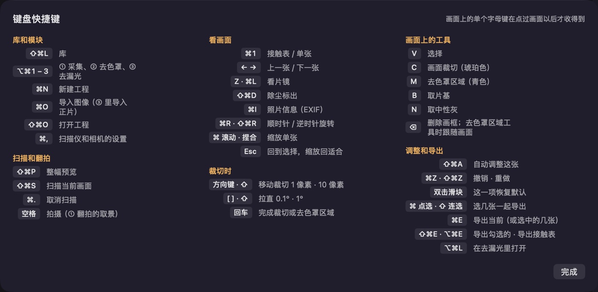

# 键盘快捷键

App 里「帮助」菜单的「键盘快捷键」（⌘/）也列着这些。

| 按键 | 作用 |
|---|---|
| ⇧⌘P | 预览 |
| ⇧⌘S | 扫描当前画面 |
| ⌘. | 取消扫描 |
| ⇧⌘L | 库 |
| ⌥⌘1 / ⌥⌘2 / ⌥⌘3 | ① 采集 / ② 去色罩 / ③ 去漏光（有工程以后） |
| ⌘N | 新建工程 |
| ⌘O / ⇧⌘O | 导入 / 打开工程 |
| ⌘1 | 接触表 / 单张 |
| ← / → | 上一张 / 下一张（单张视图和接触表上都可以，接触表跟着翻页） |
| V / C / M / B / N | 选择、画面裁切、去色罩区域、片基、中性灰（画面有焦点时；去色罩区域、片基、中性灰只在 ② 去色罩） |
| Z | 放上 / 收起看片镜（画面有焦点时） |
| ⌫ | 删除所选画面；取 IT8 或中性点时撤回上一个点 |
| ⌘L | 看片镜 |
| ⇧⌘D | 除尘标出 |
| ⌘I | 照片信息（EXIF） |
| ⇧⌘A | 自动调整这张 |
| ⌘R / ⇧⌘R | 顺时针 / 逆时针旋转（接触表上整卷一起转） |
| ⌘E / ⇧⌘E | 导出当前 / 导出勾选 |
| ⌥⌘E | 导出接触表 |
| ⌘Z / ⇧⌘Z | 撤销 / 重做 |
| ⌘, | 回到 ① 采集，打开左栏：当前来源（扫描仪或相机）的设置（有工程以后） |
| ⌘ + 滚动，或捏合 | 缩放（单张视图） |
| Esc | 退出当前工具并复位缩放 |
| 空格 | 拍摄（① 翻拍的取景） |
| ⌘/ | 键盘快捷键一览 |
